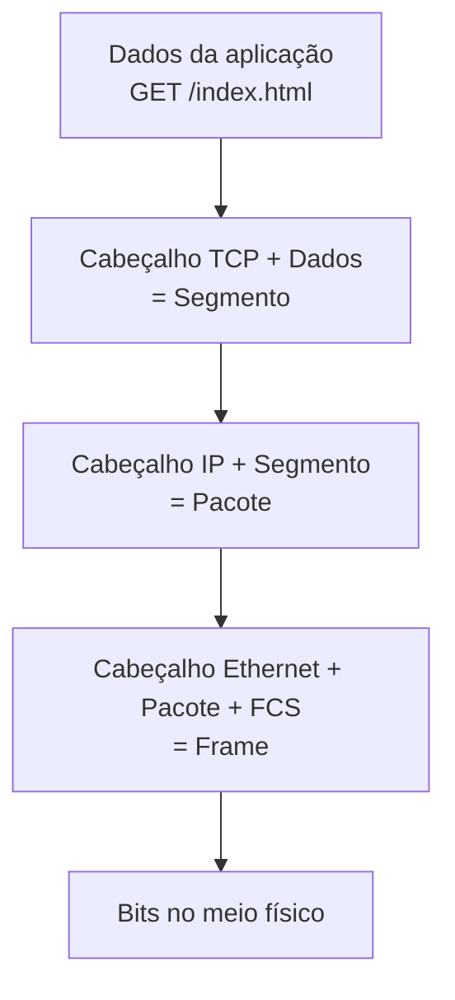
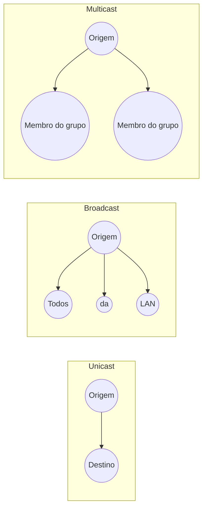

# Fundamentos de Redes

> [!info] Posição na trilha
> **Etapa 1 — Fundamentos.** Esta é a primeira nota da trilha. Não há pré-requisitos além de noções básicas de programação. Veja o [[Mapa de Estudos de Redes]].

## 1. Definição

Uma **rede de computadores** é um conjunto de dispositivos (computadores, servidores, roteadores, switches, celulares, containers, máquinas virtuais) interligados por um meio de comunicação (cabo, fibra óptica, rádio) e que seguem **regras comuns — os protocolos** — para trocar dados.

Três elementos são sempre necessários:

| Elemento | O que é | Exemplos |
|---|---|---|
| **Nós (nodes)** | Dispositivos que enviam, recebem ou encaminham dados | Notebook, servidor, roteador, Pod do Kubernetes |
| **Meio (link)** | Caminho físico ou lógico por onde os dados trafegam | Cabo de par trançado, fibra, Wi‑Fi, interface virtual `veth` |
| **Protocolos** | Regras de formato, ordem e significado das mensagens | Ethernet, IP, TCP, HTTP, DNS |

## 2. Por que isso importa

Praticamente todo sistema moderno é distribuído: um navegador fala com um load balancer, que fala com uma API, que fala com um banco de dados e uma fila de mensagens, frequentemente em máquinas, zonas ou até provedores diferentes. Para um engenheiro DevOps:

- **Deploy** significa colocar processos em hosts que precisam se encontrar pela rede.
- **Incidentes** frequentemente são de rede: DNS errado, porta bloqueada, certificado expirado, rota ausente.
- **Segurança** depende de controlar *quem fala com quem*.
- **Desempenho** depende de latência, largura de banda e perda de pacotes.

Sem fundamentos, o troubleshooting vira tentativa e erro. Com eles, você consegue formular hipóteses e testá-las camada por camada.

## 3. Como funciona (visão intuitiva)

Pense em enviar uma encomenda pelos Correios:

1. Você escreve uma carta (os **dados da aplicação**).
2. Coloca num envelope com o nome do destinatário e o departamento (**porta / transporte**).
3. Coloca o envelope numa caixa com o endereço completo (**endereço IP / rede**).
4. O caminhão da transportadora leva a caixa até o próximo centro de distribuição (**enlace / frame**).
5. Em cada centro de distribuição a caixa é reetiquetada para o próximo trecho, mas o endereço final não muda (**roteamento**).
6. No destino, o processo inverso acontece: abre-se a caixa, depois o envelope, e a carta chega à pessoa certa.

Esse "embrulhar em camadas" é a **encapsulação**, e "desembrulhar" é a **desencapsulação**. Elas são detalhadas em [[01 - Modelo OSI]] e [[02 - Modelo TCP-IP]].

## 4. Conceitos centrais

### 4.1 Tipos de rede por abrangência

| Sigla | Nome | Abrangência típica | Exemplo |
|---|---|---|---|
| **PAN** | Personal Area Network | Poucos metros | Fone Bluetooth com celular |
| **LAN** | Local Area Network | Uma casa, escritório, andar ou data center | Switch do escritório, rede de um rack |
| **WLAN** | Wireless LAN | Igual à LAN, mas sem fio (IEEE 802.11 / Wi‑Fi) | Wi‑Fi doméstico |
| **CAN** | Campus Area Network | Vários prédios próximos | Universidade |
| **MAN** | Metropolitan Area Network | Uma cidade | Rede de fibra metropolitana de um provedor |
| **WAN** | Wide Area Network | Países e continentes | Internet; links MPLS entre filiais |
| **SAN** | Storage Area Network | Data center | Rede dedicada a armazenamento (Fibre Channel, iSCSI) |
| **VPN** | Virtual Private Network | Lógica, sobre outra rede | Túnel cifrado do notebook até a empresa — ver [[23 - Segurança de Redes]] |

Em cloud aparece também a **VPC/VNet** (Virtual Private Cloud / Virtual Network): uma rede privada lógica dentro do provedor. Ver [[22 - Redes em Cloud e DevOps]].

> [!note] Classificação não é rígida
> As fronteiras entre LAN, MAN e WAN são convenções. O que importa na prática é: **a comunicação acontece no mesmo domínio de camada 2 (mesma LAN) ou precisa passar por um roteador?** Essa distinção determina se você precisa de [[08 - DHCP e ARP|ARP]] ou de [[09 - Roteamento e Gateway|roteamento]].

### 4.2 Topologias

- **Estrela:** todos os nós ligados a um equipamento central (switch). É a topologia física dominante em LANs Ethernet.
- **Malha (mesh):** vários caminhos entre nós; dá redundância. Backbones e redes de data center (leaf‑spine) se aproximam disso.
- **Barramento e anel:** históricas; aparecem em livros mas são raras hoje.

Distinga **topologia física** (como os cabos estão ligados) de **topologia lógica** (como os dados fluem). Uma VPC na cloud, por exemplo, não tem cabos visíveis para você, mas tem topologia lógica (subnets, rotas).

### 4.3 Arquiteturas de comunicação

| Arquitetura | Como funciona | Vantagens | Desvantagens | Exemplos |
|---|---|---|---|---|
| **Cliente‑servidor** | Clientes iniciam pedidos; servidores escutam e respondem | Controle centralizado, fácil de proteger e escalar horizontalmente | Servidor é ponto central de falha/carga | HTTP, bancos de dados, SSH |
| **Peer‑to‑peer (P2P)** | Cada nó é cliente e servidor ao mesmo tempo | Sem ponto central, distribui carga | Difícil de controlar, NAT dificulta conexões | BitTorrent, alguns protocolos de blockchain, WebRTC |

Em DevOps quase tudo é cliente‑servidor, mas note que **um mesmo processo pode ser servidor e cliente**: uma API é servidor para o navegador e cliente do banco de dados.

### 4.4 Unidades de dados (PDU)

Cada camada chama seu "pacote" por um nome diferente. Esse vocabulário é usado o tempo todo em documentação e logs:

| Camada (TCP/IP) | Nome da PDU | Endereço usado |
|---|---|---|
| Aplicação | Dados / mensagem | Nome (URL, hostname) |
| Transporte | **Segmento** (TCP) / **Datagrama** (UDP) | Porta |
| Internet / Rede | **Pacote** (ou datagrama IP) | Endereço IP |
| Enlace | **Frame** (quadro) | Endereço MAC |
| Física | **Bits** | — |

No dia a dia, "pacote" é usado de forma genérica para qualquer PDU. Quando a precisão importar, use o termo correto.

### 4.5 Encapsulação e desencapsulação



- **Encapsulação (envio):** cada camada adiciona seu cabeçalho (e às vezes um trailer, como o FCS do Ethernet, usado para detectar erros) ao que recebeu da camada de cima.
- **Desencapsulação (recepção):** cada camada lê e remove seu cabeçalho, entregando o conteúdo à camada de cima.
- **Roteadores** desencapsulam até a camada 3 (para ler o IP de destino) e reencapsulam num **novo frame** para o próximo salto. O IP de destino permanece; o MAC muda a cada salto.

### 4.6 Métricas de desempenho

| Métrica | Definição | Unidade | Analogia | O que causa problemas |
|---|---|---|---|---|
| **Largura de banda (bandwidth)** | Capacidade máxima teórica do link | bit/s (Mbps, Gbps) | Número de faixas da estrada | Link saturado, plano contratado baixo |
| **Throughput** | Taxa real de dados transferidos com sucesso | bit/s | Carros que realmente passam por hora | Congestionamento, perda, latência alta com janela TCP pequena |
| **Goodput** | Throughput útil para a aplicação (sem cabeçalhos e retransmissões) | bit/s | Passageiros transportados, não carros | Overhead de protocolo |
| **Latência** | Tempo para um dado ir de A até B (one‑way) ou ir e voltar (**RTT**, Round‑Trip Time) | ms | Tempo de viagem | Distância física, filas em roteadores, processamento |
| **Jitter** | Variação da latência entre pacotes | ms | Viagens às vezes 10 min, às vezes 40 | Filas variáveis, Wi‑Fi congestionado |
| **Perda de pacotes (packet loss)** | Percentual de pacotes que não chegam | % | Carros que somem no caminho | Buffers cheios, interferência, enlaces ruins, filtros |

> [!warning] Equívoco comum: "bits" vs "bytes"
> Velocidade de rede é medida em **bits** por segundo (b minúsculo: Mbps). Tamanho de arquivo costuma ser em **bytes** (B maiúsculo: MB). 100 Mbps ≈ 12,5 MB/s no máximo teórico, antes de overhead.

> [!tip] Latência e banda são independentes
> Um link de 10 Gbps entre São Paulo e Tóquio continua tendo ~250 ms ou mais de RTT, por limite físico (velocidade da luz na fibra ≈ 2/3 de *c*). Aumentar banda não reduz latência. Para aplicações "tagarelas" (muitas requisições pequenas e sequenciais), a latência domina o tempo total.

**Produto banda × atraso (BDP — Bandwidth‑Delay Product):** quantidade de dados "em trânsito" no link. Ex.: 100 Mbps × 0,1 s = 10 Mbit ≈ 1,25 MB. Se a janela TCP for menor que o BDP, o throughput nunca atinge a banda disponível. Ver [[05 - TCP e UDP]].

### 4.7 Formas de entrega: unicast, broadcast, multicast, anycast



| Tipo | Destino | Exemplo de uso | Observação |
|---|---|---|---|
| **Unicast** | Um único host | HTTP, SSH, quase todo o tráfego | Padrão |
| **Broadcast** | Todos os hosts do segmento L2 | ARP request, DHCP Discover | Existe só em IPv4; não atravessa roteadores |
| **Multicast** | Hosts inscritos num grupo | Streaming em redes corporativas, descoberta de serviços (mDNS), IPv6 Neighbor Discovery | IPv4 `224.0.0.0/4`, IPv6 `ff00::/8` |
| **Anycast** | O nó "mais próximo" de vários que anunciam o mesmo IP | Servidores DNS raiz, CDNs, resolvers públicos | Implementado por roteamento (BGP), não por um tipo especial de endereço em IPv4 |

IPv6 **não tem broadcast**; usa multicast no lugar. Ver [[03 - Endereçamento IP e Sub-redes]].

### 4.8 Equipamentos básicos

| Equipamento | Camada principal | Função |
|---|---|---|
| **Hub** (obsoleto) | 1 | Repete bits para todas as portas |
| **Switch** | 2 | Encaminha frames pela tabela de MACs (CAM table) |
| **Roteador** | 3 | Encaminha pacotes entre redes diferentes usando tabela de rotas |
| **Switch L3** | 2 e 3 | Switch com capacidade de roteamento entre VLANs |
| **Firewall** | 3–7 | Filtra tráfego segundo regras — ver [[14 - Firewall e Filtragem de Pacotes]] |
| **Load balancer** | 4 ou 7 | Distribui conexões/requisições entre servidores — ver [[16 - Balanceamento de Carga]] |
| **Access Point** | 1–2 | Liga clientes Wi‑Fi à LAN cabeada |

Em ambientes virtualizados, esses papéis são feitos por software: `bridge` do Linux (switch), `iptables`/`nftables` (firewall e NAT), `kube-proxy`, Envoy, etc.

## 5. Exemplos práticos

### Exemplo 1 — O que acontece quando você acessa `https://exemplo.com`

1. O navegador precisa do IP → consulta **DNS** ([[07 - DNS]]).
2. O sistema verifica se o IP está na mesma rede local; se não, envia ao **gateway padrão** ([[09 - Roteamento e Gateway]]).
3. Para enviar o frame ao gateway, descobre o MAC dele via **ARP** ([[08 - DHCP e ARP]]).
4. Abre uma conexão **TCP** na porta 443 (three‑way handshake) ([[05 - TCP e UDP]]).
5. Negocia **TLS** e valida o certificado ([[12 - TLS e Certificados]]).
6. Envia a requisição **HTTP** ([[11 - HTTP e HTTPS]]).
7. No caminho, o roteador doméstico aplica **NAT** ([[10 - NAT e PAT]]).
8. Do lado do servidor, provavelmente há um **load balancer / reverse proxy** ([[15 - Proxy e Reverse Proxy]], [[16 - Balanceamento de Carga]]).

Cada passo é um ponto de falha possível — e um tema desta base de conhecimento.

### Exemplo 2 — Banda vs latência numa API

Uma página faz 50 chamadas sequenciais a uma API em outro continente com RTT de 200 ms. Mesmo com banda infinita, só a latência soma ~10 s (50 × 200 ms), sem contar handshakes. Soluções: paralelizar, agrupar chamadas, reutilizar conexões (keep‑alive, HTTP/2), aproximar o servidor do cliente (CDN, região mais próxima).

## 6. Comandos e demonstrações

Estes comandos são para Linux (a maior parte dos servidores e containers). Em Windows, existem equivalentes indicados quando relevantes.

```bash
# Interfaces e endereços IP da máquina
ip addr show            # forma curta: ip a

# Testar alcance e medir RTT/perda (4 pacotes)
ping -c 4 1.1.1.1

# Ver a tabela de rotas (inclui o gateway padrão)
ip route show

# Medir latência por salto
tracepath 1.1.1.1       # ou: traceroute 1.1.1.1
```

No Windows (PowerShell/cmd): `ipconfig /all`, `ping -n 4 1.1.1.1`, `route print`, `tracert 1.1.1.1`.

## 7. Interpretação da saída

Exemplo de saída típica de `ping` em Linux (iputils):

```text
PING 1.1.1.1 (1.1.1.1) 56(84) bytes of data.
64 bytes from 1.1.1.1: icmp_seq=1 ttl=57 time=12.4 ms
64 bytes from 1.1.1.1: icmp_seq=2 ttl=57 time=11.9 ms
...
--- 1.1.1.1 ping statistics ---
4 packets transmitted, 4 received, 0% packet loss, time 3004ms
rtt min/avg/max/mdev = 11.873/12.150/12.431/0.210 ms
```

- `time=` → RTT de cada pacote (latência ida e volta).
- `0% packet loss` → perda de pacotes.
- `mdev` → desvio médio do RTT, uma boa aproximação do **jitter**.
- `56(84) bytes` → 56 bytes de dados ICMP; 84 incluindo cabeçalhos ICMP (8) e IP (20).

Detalhes completos em [[19 - Ferramentas de Diagnóstico]].

## 8. Problemas comuns

| Sintoma | Causa provável | Onde estudar |
|---|---|---|
| "Internet lenta" mas `ping` baixo | Banda saturada ou perda intermitente | [[18 - Diagnóstico e Troubleshooting]] |
| Chamadas de API lentas para outra região | Latência física + chamadas sequenciais | Esta nota, seção 5 |
| Vídeo/voz picotando | Jitter e perda | [[05 - TCP e UDP]] |
| Funciona por IP, não por nome | DNS | [[07 - DNS]] |
| Alcança hosts locais, mas não a Internet | Gateway/rota/NAT | [[09 - Roteamento e Gateway]] |

## 9. Troubleshooting (método geral)

Um procedimento que funciona para quase tudo:

1. **Defina o problema com precisão**: quem (origem) não consegue falar com quem (destino), por qual protocolo/porta, desde quando.
2. **Reproduza** com uma ferramenta simples (`curl`, `nc`, `ping`).
3. **Suba as camadas**: link/interface → IP/rota → DNS → porta TCP/UDP → TLS → aplicação.
4. **Divida o caminho** (testar a partir de pontos intermediários) até isolar o trecho com falha.
5. **Mude uma coisa por vez** e documente.

O processo completo está em [[18 - Diagnóstico e Troubleshooting]].

## 10. Aplicações em DevOps

- **Containers** criam redes virtuais inteiras dentro de um host (bridges, interfaces `veth`, NAT). Ver [[20 - Redes em Docker]].
- **Kubernetes** exige que todo Pod tenha IP próprio e alcance outros Pods. Ver [[21 - Redes em Kubernetes]].
- **Cloud** expõe os mesmos conceitos (subnets, rotas, NAT, firewall) como APIs e Infraestrutura como Código. Ver [[22 - Redes em Cloud e DevOps]].
- **Observabilidade**: latência, taxa de erro e throughput (os "golden signals" incluem latência, tráfego, erros e saturação) são, em boa parte, métricas de rede.

## 11. Considerações de segurança

- Toda conexão de rede é uma **superfície de ataque**. O princípio do **menor privilégio** vale para rede: libere apenas o tráfego necessário.
- Broadcast e redes planas (sem segmentação) facilitam movimentação lateral de um invasor. Ver [[17 - VLAN e Segmentação de Redes]].
- Tráfego não cifrado pode ser lido por quem estiver no caminho. Prefira protocolos com TLS/SSH.

## 12. Resumo

- Rede = nós + meio + protocolos.
- LAN/WAN definem abrangência; o que importa tecnicamente é se o destino está **no mesmo segmento** ou **atrás de um roteador**.
- Dados são **encapsulados** em camadas: dados → segmento → pacote → frame → bits.
- Banda ≠ throughput ≠ latência. Latência é limitada pela física.
- Unicast é o padrão; broadcast fica restrito à LAN IPv4; multicast entrega para grupos.

## 13. Verificação de conhecimento

1. Qual a diferença entre largura de banda e throughput? Dê um exemplo em que a banda é alta mas o throughput é baixo.
2. Por que aumentar a banda não resolve uma aplicação com 100 chamadas sequenciais a um servidor distante?
3. Em qual camada um roteador precisa desencapsular um frame para decidir para onde enviá-lo? O que muda e o que se mantém no reenvio?
4. Converta 1 Gbps para MB/s (teórico).
5. Cite um protocolo que usa broadcast e explique por que ele não funciona entre redes diferentes.

> [!success]- Respostas
> 1. Banda é a capacidade teórica; throughput é o que efetivamente passa. Ex.: link de 1 Gbps com 5% de perda e RTT alto — o TCP reduz a taxa de envio e o throughput fica muito abaixo de 1 Gbps.
> 2. Porque cada chamada espera pelo menos um RTT; o tempo total é dominado pela soma das latências, não pela capacidade do link.
> 3. Até a camada 3 (IP). O endereço IP de destino se mantém; o cabeçalho Ethernet (MACs de origem/destino) é reescrito para o próximo salto, e o TTL do IP é decrementado.
> 4. 1 Gbps = 1000 Mbit/s ÷ 8 = 125 MB/s.
> 5. ARP (ou DHCP Discover). Broadcasts são limitados ao domínio de camada 2; roteadores não os encaminham.

## 14. Tópicos relacionados

- Próxima nota: [[01 - Modelo OSI]]
- [[02 - Modelo TCP-IP]]
- [[03 - Endereçamento IP e Sub-redes]]
- [[18 - Diagnóstico e Troubleshooting]]
- [[Mapa de Estudos de Redes]]
