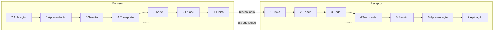
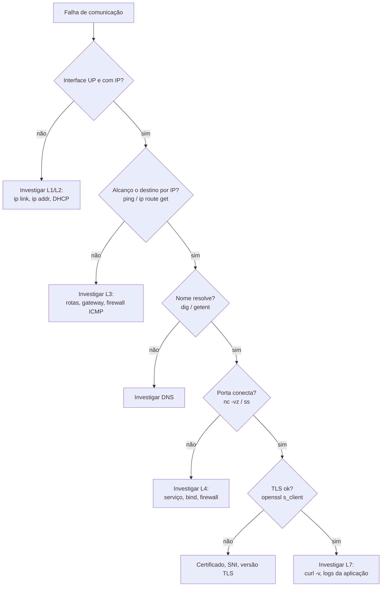

# Modelo OSI

> [!info] Posição na trilha
> **Etapa 1 — Fundamentos.** Pré-requisito: [[00 - Fundamentos de Redes]]. Próxima: [[02 - Modelo TCP-IP]].

## 1. Definição

O **modelo OSI** (Open Systems Interconnection), publicado pela ISO como norma ISO/IEC 7498‑1, é um **modelo de referência conceitual** que divide a comunicação em rede em **sete camadas**, cada uma com uma responsabilidade bem definida e que oferece serviços à camada imediatamente acima.

> [!important] OSI é um modelo, não uma implementação
> A pilha de protocolos que roda na Internet é a **TCP/IP** ([[02 - Modelo TCP-IP]]). A pilha de protocolos OSI propriamente dita praticamente não é usada. Mesmo assim, o **vocabulário** OSI ("problema de camada 2", "load balancer L7") é universal na indústria.

## 2. Por que isso importa

- **Linguagem comum:** "o firewall é L4", "o Ingress é L7", "é um problema de L2" — todos esses termos vêm do OSI.
- **Isolamento de responsabilidades:** cada camada pode mudar sem afetar as outras (trocar Wi‑Fi por cabo não muda o HTTP).
- **Troubleshooting estruturado:** testar de baixo para cima (ou de cima para baixo) evita "chutes".

## 3. Como funciona

Cada camada:

1. Recebe dados da camada de cima (no envio).
2. Adiciona suas informações de controle (cabeçalho).
3. Passa para a camada de baixo.

No receptor, o processo é invertido. Logicamente, **cada camada conversa com a mesma camada do outro lado** (comunicação *peer‑to‑peer* entre camadas): o TCP do cliente "fala" com o TCP do servidor, mesmo que fisicamente os dados desçam e subam a pilha.



Mnemônico em inglês (de baixo para cima): **P**lease **D**o **N**ot **T**hrow **S**ausage **P**izza **A**way (Physical, Data Link, Network, Transport, Session, Presentation, Application).

## 4. Conceitos centrais — as sete camadas

| # | Camada | Responsabilidade | PDU | Endereço / identificador | Protocolos e tecnologias | Equipamentos/componentes |
|---|---|---|---|---|---|---|
| 7 | **Aplicação** | Serviços de rede usados pelas aplicações | Dados | URL, hostname | HTTP, DNS, SSH, SMTP, FTP, gRPC | Reverse proxy, WAF, API gateway |
| 6 | **Apresentação** | Formato, codificação, compressão, cifragem dos dados | Dados | — | Codificação de caracteres (UTF‑8), formatos (JSON, Protobuf), TLS (frequentemente associado aqui) | — |
| 5 | **Sessão** | Abrir, manter e encerrar diálogos | Dados | — | RPC, NetBIOS; conceitos como retomada de sessão | — |
| 4 | **Transporte** | Comunicação processo‑a‑processo, confiabilidade, controle de fluxo | Segmento / datagrama | **Porta** | TCP, UDP, QUIC (sobre UDP) | Load balancer L4, firewall stateful |
| 3 | **Rede** | Endereçamento lógico e roteamento entre redes | Pacote | **Endereço IP** | IPv4, IPv6, ICMP, protocolos de roteamento (OSPF, BGP) | Roteador, switch L3 |
| 2 | **Enlace** | Entrega entre nós no mesmo meio/segmento; detecção de erros | Frame | **Endereço MAC** | Ethernet (IEEE 802.3), Wi‑Fi (802.11), ARP*, VLAN (802.1Q) | Switch, bridge, access point |
| 1 | **Física** | Transmissão de bits como sinais elétricos, ópticos ou de rádio | Bits | — | Padrões de cabos, conectores, codificação de sinal | Cabos, transceivers, hubs, repetidores |

\* O **ARP** fica entre as camadas 2 e 3 (às vezes chamado de "camada 2,5"): resolve endereços de camada 3 (IP) para camada 2 (MAC). Ver [[08 - DHCP e ARP]].

### Onde fica o TLS?

O TLS não se encaixa perfeitamente: roda **sobre** o TCP e **abaixo** do HTTP. Muitos materiais o colocam na camada 6 (cifragem) ou 5 (sessão); na prática ele é tratado como parte da camada de aplicação no modelo TCP/IP. O importante é a ordem real: `HTTP → TLS → TCP → IP`. Ver [[12 - TLS e Certificados]].

### Camadas 5 e 6 na prática

No mundo TCP/IP, as funções das camadas 5 e 6 são normalmente implementadas **dentro da própria aplicação ou de bibliotecas** (serialização JSON, compressão gzip, TLS). Por isso, quando alguém diz "L7", geralmente está englobando 5, 6 e 7.

## 5. Exemplos práticos

### 5.1 Uma requisição HTTP atravessando as camadas

Um navegador em `192.168.1.10` faz `GET /` para `93.184.215.14:80` (HTTP sem TLS, para simplificar):

| Camada | O que é adicionado/decidido |
|---|---|
| 7 | Texto `GET / HTTP/1.1\r\nHost: exemplo.com\r\n...` |
| 4 | Cabeçalho TCP: porta de origem efêmera (ex.: 51544), porta destino 80, número de sequência, flags |
| 3 | Cabeçalho IP: origem 192.168.1.10, destino 93.184.215.14, TTL 64, protocolo 6 (TCP) |
| 2 | Cabeçalho Ethernet: MAC origem = placa do notebook; **MAC destino = gateway** (o servidor está em outra rede) |
| 1 | Sinais no cabo ou ondas de rádio |

### 5.2 Classificando equipamentos e serviços DevOps

| Componente | Camada predominante | Por quê |
|---|---|---|
| Docker bridge `docker0` | 2 | Funciona como um switch virtual |
| Regras `iptables` de DNAT do Docker | 3/4 | Reescreve IP e porta |
| Kubernetes Service (via kube-proxy) | 4 | Balanceia por IP:porta |
| Kubernetes Ingress / Gateway API HTTPRoute | 7 | Roteia por host e caminho HTTP |
| Security Group (cloud) | 3/4 | Filtra por IP, protocolo e porta |
| WAF | 7 | Inspeciona conteúdo HTTP |

## 6. Comandos e demonstrações — ferramentas por camada

| Camada | Pergunta | Comando Linux |
|---|---|---|
| 1 | A interface tem link? | `ip link show eth0` (procure `state UP` e `LOWER_UP`); `ethtool eth0` (procure `Link detected: yes`) |
| 2 | Conheço o MAC do vizinho/gateway? | `ip neigh show` |
| 3 | Tenho IP e rota? Alcanço o destino? | `ip addr`, `ip route get 8.8.8.8`, `ping`, `tracepath` |
| 4 | A porta está aberta e aceitando conexões? | `ss -tlnp`, `nc -vz host 443` |
| 6 | O TLS negocia? Certificado válido? | `openssl s_client -connect host:443 -servername host` |
| 7 | A aplicação responde corretamente? | `curl -v https://host/health` |

```bash
# Exemplo de verificação de L1/L2: estado da interface
ip link show eth0
# 2: eth0: <BROADCAST,MULTICAST,UP,LOWER_UP> mtu 1500 qdisc ... state UP ...
#    link/ether 52:54:00:12:34:56 brd ff:ff:ff:ff:ff:ff
```

## 7. Interpretação

- `UP` indica que a interface foi habilitada administrativamente; `LOWER_UP` indica que há **sinal físico (carrier)**. `UP` sem `LOWER_UP` → cabo desconectado ou problema de L1.
- `link/ether` é o endereço MAC (L2); `brd ff:ff:ff:ff:ff:ff` é o MAC de broadcast.
- Se `ping` por IP funciona, as camadas 1–3 estão funcionando no caminho até aquele destino (salvo filtros específicos de ICMP).
- Se `nc -vz` conecta mas `curl` falha, o problema está em L5–L7 (TLS, HTTP, aplicação).

## 8. Problemas comuns por camada

| Camada | Sintomas | Causas típicas |
|---|---|---|
| 1 | Interface sem `LOWER_UP`, erros CRC | Cabo, porta, transceiver, driver |
| 2 | Sem resposta ARP, `FAILED` em `ip neigh`, MAC duplicado | VLAN errada, switch, conflito de IP |
| 3 | `Network is unreachable`, `Destination Host Unreachable`, TTL exceeded | Falta de rota, máscara errada, gateway errado |
| 4 | `Connection refused`, `Connection timed out` | Serviço parado, escutando em outra interface, firewall |
| 5/6 | Erro de handshake TLS, certificado inválido | Certificado expirado, SNI ausente, versões de TLS incompatíveis |
| 7 | HTTP 4xx/5xx, respostas incorretas | Bug, configuração, autenticação, upstream fora |

## 9. Troubleshooting



> [!tip] Ping bloqueado não significa host fora
> Muitos ambientes cloud e firewalls bloqueiam ICMP. Se o `ping` falhar, teste a porta TCP diretamente (`nc -vz host 443`) antes de concluir que há problema de L3.

## 10. Aplicações em DevOps

- **Load balancers L4 vs L7:** um L4 vê apenas IPs e portas (rápido, agnóstico de protocolo); um L7 entende HTTP (pode rotear por caminho, reescrever cabeçalhos, terminar TLS). Ver [[16 - Balanceamento de Carga]].
- **Service mesh** (ex.: Istio, Linkerd) atua em L4/L7 entre serviços.
- **NetworkPolicy** padrão do Kubernetes atua em L3/L4 (IP, porta, protocolo). Ver [[21 - Redes em Kubernetes]].
- **Postmortems** ficam mais claros quando a causa é situada em uma camada.

## 11. Considerações de segurança

Ataques e defesas também se distribuem pelas camadas:

| Camada | Ataque exemplo | Defesa |
|---|---|---|
| 2 | ARP spoofing, MAC flooding | Port security, Dynamic ARP Inspection, segmentação |
| 3 | IP spoofing, varredura | Filtros anti‑spoofing, firewalls |
| 4 | SYN flood, varredura de portas | SYN cookies, rate limiting, menor exposição de portas |
| 6 | Downgrade de TLS, certificado falso | TLS 1.2+, validação de certificado, HSTS |
| 7 | SQL injection, XSS, abuso de API | WAF, validação de entrada, autenticação |

Defesa em profundidade = controles em várias camadas. Ver [[23 - Segurança de Redes]].

## 12. Resumo

- OSI tem 7 camadas: Física, Enlace, Rede, Transporte, Sessão, Apresentação, Aplicação.
- É modelo de referência; a Internet roda TCP/IP, mas o vocabulário OSI é universal.
- PDUs: bits → frames → pacotes → segmentos → dados.
- Endereços: MAC (L2), IP (L3), porta (L4), nome/URL (L7).
- Use as camadas como roteiro de diagnóstico.

## 13. Verificação de conhecimento

1. Em que camada atua um switch comum? E um roteador?
2. Um Security Group que libera "TCP 443 de 0.0.0.0/0" atua em quais camadas?
3. `ping` funciona, mas `curl https://site` retorna erro de certificado. Em que camada está o problema?
4. Por que um load balancer L4 não consegue rotear `/api` e `/static` para backends diferentes?
5. Classifique: ARP, ICMP, UDP, DNS, Ethernet, TLS.

> [!success]- Respostas
> 1. Switch: camada 2. Roteador: camada 3.
> 2. Camadas 3 (IP de origem) e 4 (protocolo TCP e porta 443).
> 3. Camada de sessão/apresentação (TLS); L1–L4 estão funcionando.
> 4. Porque o caminho da URL é informação da camada 7, que um balanceador L4 não inspeciona.
> 5. ARP: entre L2 e L3; ICMP: L3 (auxiliar do IP); UDP: L4; DNS: L7; Ethernet: L2 (e L1 na parte física); TLS: entre L4 e L7 (associado a L5/L6).

## 14. Tópicos relacionados

- Anterior: [[00 - Fundamentos de Redes]]
- Próxima: [[02 - Modelo TCP-IP]]
- [[18 - Diagnóstico e Troubleshooting]]
- [[16 - Balanceamento de Carga]]
- [[Mapa de Estudos de Redes]]
