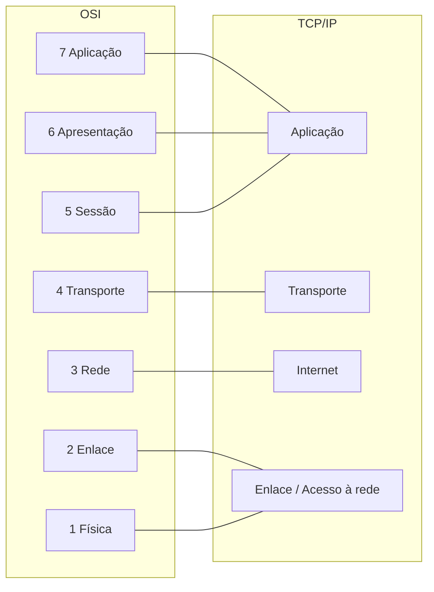
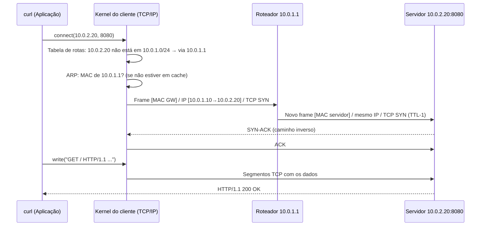

# Modelo TCP/IP

> [!info] Posição na trilha
> **Etapa 1 — Fundamentos.** Pré-requisitos: [[00 - Fundamentos de Redes]], [[01 - Modelo OSI]]. Próxima: [[03 - Endereçamento IP e Sub-redes]].

## 1. Definição

O **modelo TCP/IP** (também chamado *Internet Protocol Suite*) é o conjunto de protocolos e a arquitetura em camadas **que efetivamente rodam na Internet** e em praticamente todas as redes modernas. Ele foi descrito formalmente nas RFC 1122 e RFC 1123 (requisitos para hosts da Internet), que definem quatro camadas.

Diferente do OSI, o TCP/IP nasceu **da implementação**: os protocolos vieram primeiro, o modelo depois.

## 2. Por que isso importa

- É o que o kernel Linux, o Windows, os containers e as clouds implementam.
- Comandos como `ip`, `ss`, `tcpdump` e `curl` operam diretamente sobre esta pilha.
- Saber em que camada um dado é tratado explica, por exemplo, por que o Docker usa `iptables` (camada Internet/Transporte) para publicar portas e por que um Ingress precisa entender HTTP.

## 3. Como funciona

### 3.1 As camadas e a correspondência com o OSI

| TCP/IP (RFC 1122) | Equivalente OSI | Função | Protocolos |
|---|---|---|---|
| **Aplicação** | 5, 6, 7 | Protocolos usados pelos programas | HTTP, DNS, SSH, TLS*, SMTP, DHCP |
| **Transporte** | 4 | Comunicação fim a fim entre processos (portas) | TCP, UDP (QUIC roda sobre UDP) |
| **Internet** | 3 | Endereçamento e roteamento entre redes | IPv4, IPv6, ICMP, ICMPv6 |
| **Enlace (Link)** | 1, 2 | Transmissão no meio local | Ethernet, Wi‑Fi, ARP, PPP |

\* TLS opera entre o transporte e a aplicação; na classificação TCP/IP é usualmente tratado como parte da aplicação.

> [!note] Modelo de 4 ou 5 camadas?
> Muitos livros didáticos (ex.: Kurose & Ross, Tanenbaum) usam um modelo "híbrido" de **5 camadas**, separando a camada de Enlace em **Enlace** e **Física**. Não há contradição: é só uma questão de granularidade. As RFCs usam 4.



### 3.2 Princípio fim a fim e "ampulheta"

A arquitetura TCP/IP é frequentemente descrita como uma **ampulheta**: muitas aplicações em cima, muitas tecnologias de enlace embaixo, e **um único protocolo no gargalo: o IP**. Qualquer coisa que fale IP consegue se comunicar com qualquer outra, independente do meio físico.

O **princípio fim a fim** (end‑to‑end) diz que funções como confiabilidade devem ficar nas pontas (hosts), não nos roteadores. Por isso o IP é "best effort" (sem garantia de entrega) e o TCP, nos hosts, implementa retransmissão. Middleboxes como NAT e firewalls quebram parcialmente esse princípio — fonte de muitos problemas práticos ([[10 - NAT e PAT]]).

## 4. Conceitos centrais

### 4.1 Cabeçalhos essenciais

**IPv4 (20 bytes sem opções)** — campos mais relevantes no dia a dia:

| Campo | Para que serve |
|---|---|
| Version | 4 |
| TTL (Time To Live) | Decrementado a cada roteador; ao chegar a 0, o pacote é descartado e um ICMP "Time Exceeded" é enviado. Evita loops e é a base do `traceroute` |
| Protocol | Protocolo da camada de cima: 1 = ICMP, 6 = TCP, 17 = UDP |
| Source / Destination Address | IPs de origem e destino |
| Flags / Fragment Offset | Controle de fragmentação (bit DF = Don't Fragment) |
| Total Length | Tamanho do pacote |

**IPv6 (40 bytes fixos)**: simplificado — `Hop Limit` (equivalente ao TTL), `Next Header` (equivalente ao Protocol), endereços de 128 bits, sem checksum de cabeçalho e **sem fragmentação por roteadores** (só a origem fragmenta).

**TCP (20 bytes sem opções)**: portas, número de sequência, número de ACK, flags (`SYN`, `ACK`, `FIN`, `RST`, `PSH`, `URG`), janela. Detalhes em [[05 - TCP e UDP]].

**UDP (8 bytes)**: portas, tamanho e checksum. Só isso.

**Ethernet II (14 bytes + 4 de FCS)**: MAC destino, MAC origem, EtherType (`0x0800` = IPv4, `0x86DD` = IPv6, `0x0806` = ARP).

### 4.2 MTU e overhead

- **MTU (Maximum Transmission Unit):** maior pacote IP que um enlace transporta sem fragmentar. Ethernet padrão: **1500 bytes**.
- **MSS (Maximum Segment Size):** maior quantidade de dados TCP por segmento. Em IPv4/Ethernet sem opções: 1500 − 20 (IP) − 20 (TCP) = **1460 bytes**.
- Túneis (VPN, VXLAN, GRE, overlays de Kubernetes) adicionam cabeçalhos e **reduzem a MTU efetiva**. Ex.: VXLAN adiciona 50 bytes → MTU interna de 1450.

> [!warning] Problemas de MTU são traiçoeiros
> Sintoma clássico: `ping` e conexões pequenas funcionam, mas transferências grandes, TLS handshakes ou `git clone` travam. Causa comum: um enlace com MTU menor no caminho + ICMP "Fragmentation Needed" bloqueado por firewall (quebra do **Path MTU Discovery**). Ver [[18 - Diagnóstico e Troubleshooting]].

## 5. Exemplo prático — fluxo completo de um pacote

Cenário: `curl http://10.0.2.20:8080/` executado em `10.0.1.10/24`, com gateway `10.0.1.1`. O servidor está em outra subnet.



Passo a passo:

1. **Aplicação:** o `curl` monta a requisição HTTP e pede ao sistema operacional, via **socket**, uma conexão TCP com `10.0.2.20:8080`.
2. **Transporte:** o kernel escolhe uma porta efêmera de origem e inicia o three‑way handshake.
3. **Internet:** o kernel consulta a tabela de rotas. O destino não está na rede local, então o próximo salto é o gateway.
4. **Enlace:** o kernel precisa do MAC do **gateway** (não do servidor!) e o obtém via ARP.
5. **Roteador:** recebe o frame, desencapsula até o IP, decrementa o TTL, consulta sua tabela e reencapsula num novo frame para a rede `10.0.2.0/24`.
6. **Servidor:** desencapsula camada a camada; o kernel entrega os dados ao processo que tem um socket escutando em `:8080`.

## 6. Comandos e demonstrações

```bash
# Ver qual rota e interface o kernel usaria para um destino
ip route get 10.0.2.20

# Observar o encapsulamento real com tcpdump (requer root)
# -i any: todas as interfaces | -n: não resolver nomes | -e: mostrar cabeçalho Ethernet (MACs)
sudo tcpdump -i any -n -e port 8080

# Ver MTU das interfaces
ip link show | grep mtu

# Testar a MTU do caminho sem fragmentar (Linux iputils)
# -M do: proibir fragmentação | -s 1472: 1472 + 8 (ICMP) + 20 (IP) = 1500
ping -M do -s 1472 -c 3 10.0.2.20
```

## 7. Interpretação

`ip route get` (exemplo):

```text
10.0.2.20 via 10.0.1.1 dev eth0 src 10.0.1.10 uid 1000
    cache
```

- `via 10.0.1.1` → o pacote vai ao gateway (destino em outra rede).
- `dev eth0` → interface de saída.
- `src 10.0.1.10` → IP de origem que será usado.
- Se o destino estiver na mesma rede, não aparece `via`.

`ping -M do -s 1472` falhando com mensagem como `message too long` ou `Frag needed and DF set (mtu = 1450)` indica que a MTU do caminho é menor que 1500.

## 8. Problemas comuns

| Problema | Camada TCP/IP | Sinal |
|---|---|---|
| Sem IP na interface | Enlace/Internet | `ip addr` sem `inet` (DHCP falhou) |
| Rota ausente | Internet | `Network is unreachable` |
| MTU incompatível em túnel | Internet/Enlace | Transferências grandes travam; pequenas funcionam |
| Porta fechada | Transporte | `Connection refused` (recebeu RST) |
| Filtro silencioso | Internet/Transporte | `Connection timed out` |
| Protocolo errado (HTTP numa porta HTTPS) | Aplicação | Respostas estranhas, `400 Bad Request`, erro TLS |

## 9. Troubleshooting

Pense **de baixo para cima** quando nada funciona, e **de cima para baixo** quando o sintoma é específico de uma aplicação. Em ambos os casos, use a correspondência:

- Enlace → `ip link`, `ip neigh`
- Internet → `ip addr`, `ip route`, `ping`, `tracepath`
- Transporte → `ss`, `nc`
- Aplicação → `dig`, `curl`, `openssl s_client`

## 10. Aplicações em DevOps

- **Containers** recebem uma pilha TCP/IP própria graças ao *network namespace* do Linux: interfaces, rotas, regras de firewall e sockets isolados. Ver [[20 - Redes em Docker]].
- **Overlays** (VXLAN, Geneve, WireGuard) encapsulam pacotes IP dentro de UDP/IP para conectar containers em hosts diferentes — e reduzem a MTU. Ver [[21 - Redes em Kubernetes]].
- **QUIC/HTTP/3** reimplementam confiabilidade sobre UDP, ilustrando que as camadas não são rígidas.

## 11. Considerações de segurança

- O IP não autentica a origem: endereços podem ser forjados (**IP spoofing**). Autenticação deve ocorrer em camadas superiores (TLS, SSH, tokens).
- Nada na pilha TCP/IP básica cifra dados; a confidencialidade vem de TLS, SSH, IPsec ou WireGuard.
- Bloquear todo ICMP "por segurança" quebra Path MTU Discovery e diagnósticos; filtre seletivamente. Ver [[14 - Firewall e Filtragem de Pacotes]].

## 12. Resumo

- TCP/IP é a pilha real da Internet: Enlace, Internet, Transporte, Aplicação.
- O IP é o ponto comum ("cintura da ampulheta"); é best‑effort.
- No mesmo pacote, o MAC muda a cada salto; IP e portas permanecem (exceto quando há NAT).
- MTU padrão Ethernet é 1500; túneis reduzem a MTU efetiva.

## 13. Verificação de conhecimento

1. Quais camadas OSI são agrupadas na camada de Aplicação do TCP/IP?
2. Um host `192.168.0.5/24` quer falar com `192.168.0.99`. Ele precisa do MAC de quem? E para falar com `8.8.8.8`?
3. Qual o tamanho máximo de payload de um `ping` sem fragmentação em um enlace com MTU 1500 (IPv4)?
4. Por que túneis VXLAN podem causar travamentos apenas em transferências grandes?

> [!success]- Respostas
> 1. Sessão, Apresentação e Aplicação (5, 6 e 7).
> 2. Do próprio `192.168.0.99` (mesma rede). Para `8.8.8.8`, do gateway padrão.
> 3. 1472 bytes (1500 − 20 IP − 8 ICMP).
> 4. O encapsulamento reduz a MTU efetiva; pacotes grandes excedem o limite e, se o PMTUD falhar (ICMP bloqueado), são descartados silenciosamente.

## 14. Tópicos relacionados

- Anterior: [[01 - Modelo OSI]]
- Próxima: [[03 - Endereçamento IP e Sub-redes]]
- [[05 - TCP e UDP]]
- [[19 - Ferramentas de Diagnóstico]]
- [[Mapa de Estudos de Redes]]
