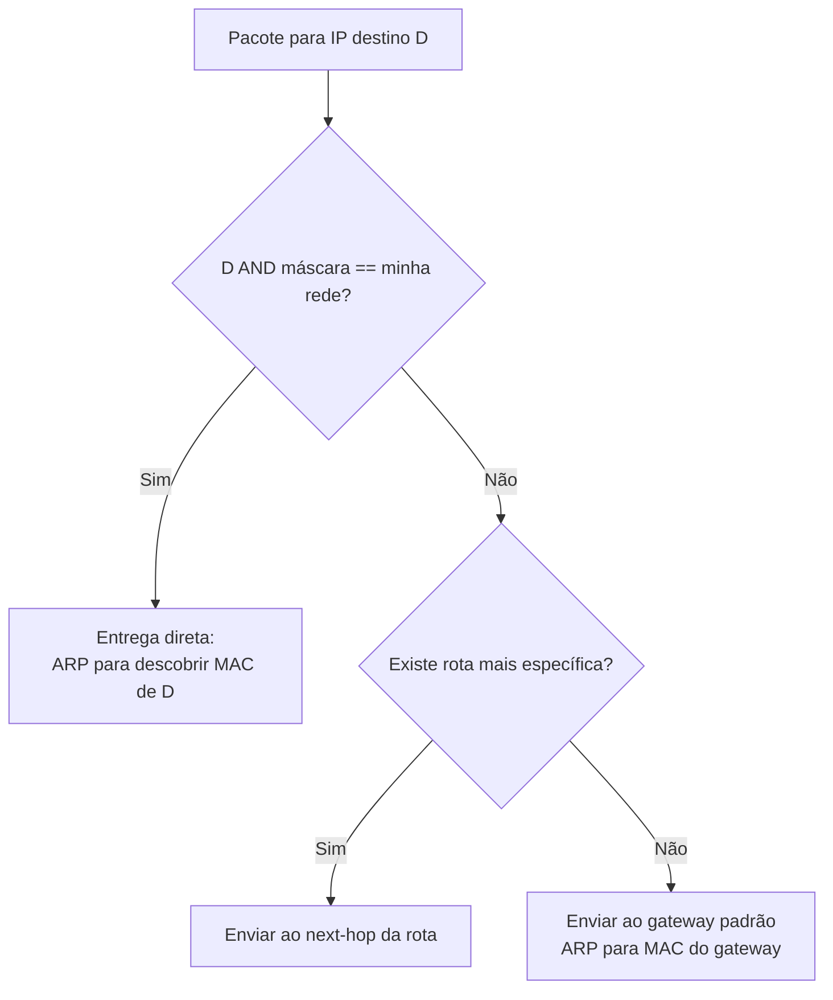

# Endereçamento IP e Sub-redes

> [!info] Posição na trilha
> **Etapa 1 — Fundamentos.** Pré-requisitos: [[02 - Modelo TCP-IP]]. Próxima: [[04 - CIDR e Subnetting]] (cálculos detalhados).

## 1. Definição

Um **endereço IP** é um identificador lógico atribuído a uma **interface de rede** (não a um computador inteiro), usado pela camada Internet para entregar pacotes entre redes.

- **IPv4:** 32 bits, escrito em notação decimal com pontos: `192.168.10.25`. Cerca de 4,3 bilhões de endereços (2³²).
- **IPv6:** 128 bits, escrito em hexadecimal com dois‑pontos: `2001:db8:85a3::8a2e:370:7334`. 2¹²⁸ endereços.

Todo endereço tem duas partes:

- **Prefixo de rede**: identifica a rede (todos os hosts da mesma sub-rede compartilham).
- **Parte de host**: identifica a interface dentro daquela rede.

A **máscara de sub-rede** (ou o tamanho do prefixo, `/24`) diz onde termina uma parte e começa a outra.

> [!important] Interface, não máquina
> Um servidor com duas placas de rede tem pelo menos dois IPs. Um roteador tem um IP em cada rede a que se conecta. Um único host Linux com Docker tem dezenas de interfaces virtuais.

## 2. Por que isso importa

- Decidir se um destino é **local** (entrega direta via ARP) ou **remoto** (enviar ao gateway) depende de comparar prefixos.
- Planejar VPCs, subnets de Kubernetes e redes Docker sem **sobreposição** de faixas é tarefa recorrente de DevOps.
- Erros de máscara ou de faixa causam problemas difíceis: "funciona para algumas máquinas, não para outras".

## 3. Como funciona

### 3.1 IPv4 em binário

Cada um dos 4 octetos vai de 0 a 255 (8 bits):

```text
192      .168      .10       .25
11000000  10101000  00001010  00011001
```

Com máscara `255.255.255.0` (`/24`):

```text
Endereço : 11000000.10101000.00001010.00011001  (192.168.10.25)
Máscara  : 11111111.11111111.11111111.00000000  (255.255.255.0)
AND      : 11000000.10101000.00001010.00000000  (192.168.10.0) ← endereço de rede
```

O **AND bit a bit** entre IP e máscara produz o **endereço de rede**. Dois hosts estão na mesma sub-rede se o resultado for igual para ambos (usando a mesma máscara).

### 3.2 Decisão local vs remoto



Na prática, o kernel faz uma única consulta à tabela de rotas, onde a rede local aparece como rota "diretamente conectada". Ver [[09 - Roteamento e Gateway]].

## 4. Conceitos centrais

### 4.1 Endereços especiais de uma sub-rede IPv4

Para `192.168.10.0/24`:

| Tipo | Valor | Regra |
|---|---|---|
| **Endereço de rede** | `192.168.10.0` | Todos os bits de host = 0. Identifica a rede; não é atribuído a host |
| **Broadcast** | `192.168.10.255` | Todos os bits de host = 1. Envio para todos da sub-rede |
| **Hosts utilizáveis** | `192.168.10.1` – `192.168.10.254` | 2⁸ − 2 = 254 |
| **Gateway (convenção)** | Geralmente `.1` ou `.254` | É só convenção, não regra |

Exceções: `/31` (RFC 3021) permite 2 hosts em enlaces ponto a ponto sem rede/broadcast; `/32` representa um único host (usado em rotas e regras de firewall).

> [!note] Em cloud, perde-se mais que 2 endereços
> Provedores reservam endereços extras em cada subnet. Na AWS, por exemplo, são reservados **5** endereços de cada subnet — os 4 primeiros e o último (rede, roteador da VPC, DNS, reservado para uso futuro, broadcast). Em uma `/24` restam 251. Outros provedores têm regras próprias — consulte a documentação.

### 4.2 Classes (histórico) vs CIDR

Até 1993 os endereços eram divididos em **classes** (A: /8, B: /16, C: /24). Isso desperdiçava muito espaço e foi substituído pelo **CIDR** (Classless Inter‑Domain Routing, RFC 4632), em que o prefixo pode ter qualquer tamanho. O termo "classe C" ainda é usado informalmente para dizer "/24", mas **não reflete como o roteamento funciona hoje**. Ver [[04 - CIDR e Subnetting]].

### 4.3 Endereços IPv4 privados e especiais

| Faixa | Uso | Referência |
|---|---|---|
| `10.0.0.0/8` | Privado | RFC 1918 |
| `172.16.0.0/12` (172.16.0.0 – 172.31.255.255) | Privado | RFC 1918 |
| `192.168.0.0/16` | Privado | RFC 1918 |
| `100.64.0.0/10` | **CGNAT** (Shared Address Space, usado por provedores com NAT de operadora) | RFC 6598 |
| `127.0.0.0/8` | **Loopback** (o próprio host; `127.0.0.1` é o mais usado) | RFC 1122 |
| `169.254.0.0/16` | **Link‑local** (autoconfiguração quando não há DHCP — APIPA no Windows); também usado por serviços de metadata de cloud (`169.254.169.254`) | RFC 3927 |
| `0.0.0.0/8` | "Este host/esta rede"; `0.0.0.0` como endereço de *bind* significa "todas as interfaces"; como rota, `0.0.0.0/0` é a rota padrão | RFC 1122 |
| `224.0.0.0/4` | Multicast | RFC 5771 |
| `255.255.255.255` | Broadcast limitado (rede local) | RFC 919 |
| `192.0.2.0/24`, `198.51.100.0/24`, `203.0.113.0/24` | **Documentação** (TEST‑NET; use em exemplos) | RFC 5737 |
| `240.0.0.0/4` | Reservado | RFC 1112 |

O registro oficial é o **IANA IPv4 Special-Purpose Address Registry** (RFC 6890).

**IPs privados** não são roteados na Internet pública. Para sair para a Internet, precisam de **NAT** ([[10 - NAT e PAT]]). IPs **públicos** são globalmente únicos e atribuídos por RIRs (no Brasil, via LACNIC/NIC.br) a provedores e organizações.

### 4.4 IPv6 — fundamentos

**Notação e abreviação** (RFC 5952):

- 8 grupos de 16 bits em hexadecimal: `2001:0db8:0000:0000:0000:ff00:0042:8329`
- Zeros à esquerda de cada grupo podem ser omitidos: `2001:db8:0:0:0:ff00:42:8329`
- **Uma** sequência de grupos zerados pode virar `::` → `2001:db8::ff00:42:8329`
- Em URLs, use colchetes: `http://[2001:db8::1]:8080/`

**Tipos e faixas importantes:**

| Faixa | Tipo | Equivalente aproximado em IPv4 |
|---|---|---|
| `::1/128` | Loopback | `127.0.0.1` |
| `::/128` | Não especificado | `0.0.0.0` |
| `fe80::/10` | Link‑local (obrigatório em toda interface IPv6) | `169.254.0.0/16` |
| `fc00::/7` (na prática `fd00::/8`) | **ULA** — Unique Local Address (uso privado) | RFC 1918 |
| `2000::/3` | Global Unicast (endereços públicos) | IPs públicos |
| `ff00::/8` | Multicast | `224.0.0.0/4` |
| `2001:db8::/32` | Documentação | TEST‑NET |
| `::ffff:0:0/96` | IPv4‑mapped (ex.: `::ffff:192.0.2.1`) | — |

**Diferenças conceituais importantes:**

- **Sem broadcast**: usa multicast (ex.: `ff02::1` = todos os nós do enlace).
- **Sem ARP**: usa **NDP** (Neighbor Discovery Protocol, sobre ICMPv6) para descobrir vizinhos e roteadores.
- **SLAAC** (Stateless Address Autoconfiguration): hosts podem gerar o próprio endereço a partir do prefixo anunciado pelo roteador; DHCPv6 é opcional.
- **Sub-rede padrão de LAN é /64**. Não se faz "economia" de endereços como em IPv4.
- **Vários endereços por interface** é normal (link‑local + global + temporários de privacidade).
- Com abundância de endereços, **NAT não é necessário** para escassez — mas firewall continua indispensável.

### 4.5 Gateway padrão e tabela de rotas (prévia)

O **gateway padrão** (default gateway) é o roteador para onde vai todo tráfego cujo destino não corresponde a nenhuma rota mais específica. Ele **deve estar na mesma sub-rede** do host. Aprofundado em [[09 - Roteamento e Gateway]].

### 4.6 Atribuição de endereços

| Método | Como | Uso típico |
|---|---|---|
| Estático | Configurado manualmente (netplan, NetworkManager, `/etc/network/interfaces`) | Servidores, roteadores |
| DHCP | Servidor entrega IP, máscara, gateway, DNS | Desktops, VMs em cloud (o provedor usa DHCP internamente) — ver [[08 - DHCP e ARP]] |
| SLAAC | IPv6 autoconfigurado | Redes IPv6 |
| IPAM / CNI | Software de orquestração aloca IPs | Docker, Kubernetes |

## 5. Exemplos práticos

### Exemplo 1 — Estão na mesma rede?

`10.0.1.50/24` e `10.0.2.50/24`:

- Rede do primeiro: `10.0.1.0`; do segundo: `10.0.2.0` → **redes diferentes**, precisa de roteador.

Agora com `/16`: ambos estão em `10.0.0.0/16` → **mesma rede**.

> [!warning] Máscaras inconsistentes
> Se o host A acha que está em `/16` e o host B em `/24`, A tentará ARP direto para B, mas B mandará as respostas ao gateway. O resultado é comunicação assimétrica e intermitente. Todos os hosts de uma sub-rede devem usar a **mesma máscara**.

### Exemplo 2 — Cenário típico de servidor cloud

```text
VPC:          10.20.0.0/16
Subnet app:   10.20.1.0/24   (privada)
Servidor:     10.20.1.15
Gateway:      10.20.1.1      (roteador virtual da VPC)
Saída Internet: NAT Gateway
IP público do serviço: atribuído ao load balancer, não ao servidor
```

Ver [[22 - Redes em Cloud e DevOps]].

### Exemplo 3 — Por que `localhost` em container "não funciona"

Dentro de um container, `127.0.0.1` é o **loopback do próprio container** (outro network namespace), não do host. Uma aplicação no container que tenta acessar um banco em `localhost:5432` do host vai falhar. Ver [[20 - Redes em Docker]].

## 6. Comandos e demonstrações

```bash
# Endereços de todas as interfaces (IPv4 e IPv6)
ip addr show
ip -4 addr show       # somente IPv4
ip -6 addr show       # somente IPv6
ip -br addr           # resumo, uma linha por interface

# Rota padrão e gateway
ip route show default

# Calculadora de sub-rede (pacote ipcalc; a sintaxe e o formato da saída variam entre distribuições)
ipcalc 192.168.10.25/24

# Descobrir seu IP público (serviço externo; envia uma requisição para terceiros)
curl -s https://ifconfig.me ; echo
```

## 7. Interpretação

Exemplo de `ip addr show eth0`:

```text
2: eth0: <BROADCAST,MULTICAST,UP,LOWER_UP> mtu 1500 qdisc fq_codel state UP group default qlen 1000
    link/ether 08:00:27:aa:bb:cc brd ff:ff:ff:ff:ff:ff
    inet 192.168.10.25/24 brd 192.168.10.255 scope global dynamic eth0
       valid_lft 86051sec preferred_lft 86051sec
    inet6 fe80::a00:27ff:feaa:bbcc/64 scope link
       valid_lft forever preferred_lft forever
```

| Trecho | Significado |
|---|---|
| `inet 192.168.10.25/24` | IPv4 e prefixo |
| `brd 192.168.10.255` | Broadcast da sub-rede |
| `scope global` | Endereço utilizável para comunicação fora do host |
| `dynamic` | Obtido via DHCP (ou SLAAC, em IPv6) |
| `valid_lft 86051sec` | Tempo restante da concessão (lease) |
| `inet6 fe80::.../64 scope link` | Endereço IPv6 link‑local, válido apenas no enlace |

`ip -br addr` fornece uma visão resumida:

```text
lo        UNKNOWN  127.0.0.1/8 ::1/128
eth0      UP       192.168.10.25/24 fe80::a00:27ff:feaa:bbcc/64
docker0   DOWN     172.17.0.1/16
```

`docker0` com estado `DOWN` é normal quando nenhum container está conectado.

## 8. Problemas comuns

| Sintoma | Causa provável |
|---|---|
| IP `169.254.x.x` na interface | DHCP falhou; o sistema autoconfigurou link‑local |
| Sem acesso à Internet, mas rede local ok | Gateway ausente/errado, NAT, DNS |
| Conflito de IP (avisos, conexões instáveis) | Dois hosts com o mesmo IP |
| VPN conecta mas não alcança nada da empresa | Sobreposição de faixas (ex.: casa e empresa em `192.168.1.0/24`) |
| Containers não alcançam uma rede corporativa `172.17.x.x` | Sobreposição com a rede padrão do Docker (`172.17.0.0/16`) |
| Serviço escuta só em `127.0.0.1` | Bind em loopback; inacessível de fora |

## 9. Troubleshooting

1. `ip -br addr` — a interface tem IP? É o esperado? Qual o prefixo?
2. `ip route` — existe rota padrão? O gateway está dentro da sub-rede?
3. `ping <gateway>` — alcança o gateway?
4. `ip neigh` — o MAC do gateway foi resolvido?
5. Compare faixas de todas as redes envolvidas (casa, VPN, VPC, Docker, Kubernetes) em busca de **sobreposição**.

## 10. Aplicações em DevOps

- **Planejamento de endereçamento (IPAM)**: reserve faixas distintas para VPCs, redes on‑premises, VPN, Pods e Services do Kubernetes. Sobreposição impede peering e VPN no futuro.
- **Docker** usa `172.17.0.0/16` por padrão em `docker0` e aloca outras faixas privadas para redes customizadas; é configurável em `/etc/docker/daemon.json` (`bip`, `default-address-pools`).
- **Kubernetes** usa uma faixa para Pods (Pod CIDR) e outra para Services (Service CIDR), definidas na criação do cluster.
- **Dual stack** (IPv4 + IPv6) é suportado por Kubernetes e pelos principais provedores de cloud.

## 11. Considerações de segurança

- **IP privado não é controle de segurança**: protege do roteamento público, mas não de quem já está dentro da rede.
- Serviço escutando em `0.0.0.0` aceita conexões de **todas** as interfaces — inclusive a pública. Prefira bind explícito quando possível.
- O endereço de metadata `169.254.169.254` em clouds pode expor credenciais; ataques **SSRF** o exploram. Use proteções como IMDSv2 (AWS) e bloqueios de egress em containers.
- Hosts com IPv6 habilitado e sem firewall IPv6 podem ficar expostos mesmo que o firewall IPv4 esteja correto.

## 12. Resumo

- IP identifica interfaces; prefixo/máscara separam rede e host.
- Rede = bits de host em 0; broadcast = bits de host em 1.
- Faixas privadas RFC 1918: `10/8`, `172.16/12`, `192.168/16`. Loopback `127/8`. Link‑local `169.254/16`.
- IPv6: 128 bits, `/64` por LAN, sem broadcast, NDP no lugar do ARP, link‑local `fe80::/10`.
- Evitar sobreposição de faixas é essencial em cloud, VPN e containers.

## 13. Verificação de conhecimento

1. Qual o endereço de rede e de broadcast de `172.16.5.130/24`?
2. `172.32.0.1` é um endereço privado?
3. Abrevie: `2001:0db8:0000:0000:0001:0000:0000:0001`.
4. Seu notebook recebeu `169.254.33.7`. O que isso indica?
5. Por que dois hosts com máscaras diferentes na mesma LAN podem ter comunicação intermitente?

> [!success]- Respostas
> 1. Rede `172.16.5.0`, broadcast `172.16.5.255`.
> 2. Não. A faixa privada `172.16.0.0/12` vai até `172.31.255.255`.
> 3. `2001:db8::1:0:0:1` (o `::` substitui a **maior** sequência de zeros; em empate, a primeira — RFC 5952).
> 4. Que o DHCP não respondeu e o sistema atribuiu um endereço link‑local automático.
> 5. Porque cada host decide de forma diferente se o outro é "local", gerando caminhos assimétricos (um usa ARP direto, outro envia ao gateway).

## 14. Tópicos relacionados

- Anterior: [[02 - Modelo TCP-IP]]
- Próxima: [[04 - CIDR e Subnetting]]
- [[08 - DHCP e ARP]]
- [[09 - Roteamento e Gateway]]
- [[10 - NAT e PAT]]
- [[Mapa de Estudos de Redes]]
