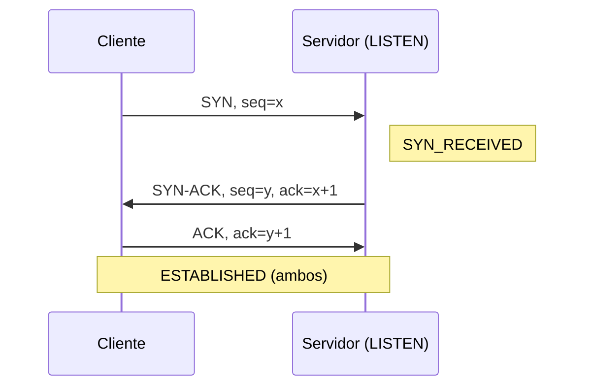
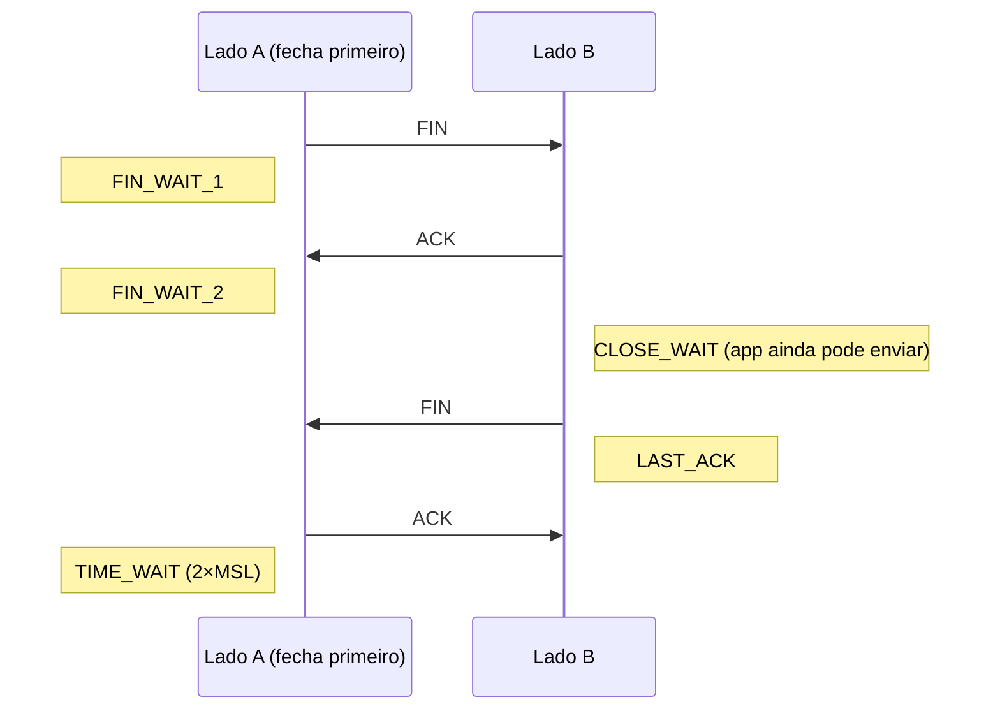

# TCP e UDP

> [!info] Posição na trilha
> **Etapa 2 — Protocolos de Comunicação.** Pré-requisitos: [[02 - Modelo TCP-IP]], [[03 - Endereçamento IP e Sub-redes]]. Próxima: [[06 - Portas e Sockets]].

## 1. Definição

A camada de transporte entrega dados **entre processos** (não apenas entre hosts). Os dois protocolos principais são:

- **TCP (Transmission Control Protocol)** — especificação atual na **RFC 9293**. Orientado a conexão, confiável, entrega um **fluxo ordenado de bytes** (byte stream).
- **UDP (User Datagram Protocol)** — **RFC 768**. Sem conexão, sem garantia de entrega ou ordem; entrega **datagramas** independentes.

Ambos usam **portas** para identificar processos. Ver [[06 - Portas e Sockets]].

## 2. Por que isso importa

- Mensagens como `Connection refused`, `Connection reset by peer` e `Connection timed out` são do TCP — saber o que cada uma significa acelera muito o diagnóstico.
- Timeouts, keep‑alive, pools de conexão, `TIME_WAIT` e retransmissões impactam desempenho de APIs e bancos de dados.
- DNS, NTP, VoIP, VXLAN, WireGuard e QUIC usam UDP; regras de firewall precisam distinguir os dois protocolos.

## 3. Como funciona — TCP

### 3.1 Estabelecimento de conexão: three‑way handshake



1. **SYN:** o cliente propõe a conexão e informa seu número de sequência inicial (ISN, aleatório por segurança), além de opções (MSS, window scaling, SACK, timestamps).
2. **SYN‑ACK:** o servidor aceita, informa seu próprio ISN e confirma o do cliente.
3. **ACK:** o cliente confirma. A conexão está estabelecida e os dados podem fluir.

Custo: **1 RTT** antes de enviar dados (TLS adiciona mais; ver [[12 - TLS e Certificados]]).

### 3.2 Encerramento



- Cada direção é fechada independentemente (por isso são quatro mensagens; às vezes o ACK e o FIN de B vão juntos).
- Quem fecha primeiro passa por **TIME_WAIT** (2 × MSL; no Linux, fixo em 60 s) para absorver segmentos atrasados e garantir que o último ACK chegou.
- **RST (reset)** encerra abruptamente: usado quando chega um segmento para uma porta sem ninguém escutando, ou quando uma aplicação aborta a conexão.

### 3.3 Estados TCP mais vistos no `ss`

| Estado | Significado | Quando preocupa |
|---|---|---|
| `LISTEN` | Socket aguardando conexões | — |
| `SYN-SENT` | Cliente enviou SYN, aguarda resposta | Muitos → destino não responde (firewall descartando) |
| `SYN-RECV` | Servidor recebeu SYN, enviou SYN‑ACK | Muitos → possível SYN flood ou cliente sem retorno |
| `ESTAB` | Conexão estabelecida | — |
| `FIN-WAIT-1/2` | Fechamento iniciado localmente | — |
| `CLOSE-WAIT` | O outro lado fechou; **a aplicação local ainda não chamou close()** | Acúmulo indica **bug na aplicação** (vazamento de conexões) |
| `TIME-WAIT` | Aguardando após fechar | Muitos milhares → muitas conexões curtas; considere keep‑alive/pool |
| `LAST-ACK` | Aguardando ACK final | — |

### 3.4 Confiabilidade

- **Números de sequência** numeram cada **byte** enviado.
- **ACKs cumulativos** confirmam "recebi tudo até o byte N‑1; espero o N".
- **Retransmissão por timeout (RTO):** se o ACK não chega a tempo, o segmento é reenviado. O RTO é calculado a partir do RTT medido (RFC 6298) e cresce exponencialmente a cada nova falha (backoff).
- **Fast retransmit:** três ACKs duplicados indicam perda, e o segmento é reenviado sem esperar o timeout.
- **SACK (Selective ACK):** o receptor informa blocos recebidos fora de ordem, evitando retransmitir o que já chegou.
- **Ordenação:** o receptor reordena os segmentos pelos números de sequência antes de entregá-los à aplicação.
- **Checksum:** detecta corrupção (fraco; integridade forte vem de TLS).

### 3.5 Controle de fluxo (proteger o **receptor**)

O receptor anuncia uma **janela de recepção (rwnd)**: quantos bytes ainda cabem no seu buffer. O emissor não pode ter mais bytes não confirmados do que a janela. Com **window scaling** (RFC 7323), a janela pode passar de 64 KB e chegar a cerca de 1 GB, essencial em links de alto BDP ([[00 - Fundamentos de Redes]]).

Janela zero (`win 0` no tcpdump) = receptor sobrecarregado; a aplicação não está lendo os dados rápido o bastante.

### 3.6 Controle de congestionamento (proteger a **rede**)

O emissor mantém uma **janela de congestionamento (cwnd)**. Ele envia no máximo `min(cwnd, rwnd)` bytes não confirmados.

- **Slow start:** começa com cwnd pequena (janela inicial de 10 segmentos no Linux, RFC 6928) e a dobra a cada RTT.
- **Congestion avoidance:** após um limiar, cresce de forma linear.
- **Perda detectada → reduz a cwnd.** Por isso perda de pacotes derruba o throughput do TCP.
- Algoritmos: **CUBIC** (padrão no Linux e em outros sistemas), **BBR** (modela banda e RTT em vez de reagir só a perdas; disponível no Linux), Reno (clássico).

```bash
# Ver algoritmo de congestionamento em uso no Linux
sysctl net.ipv4.tcp_congestion_control
```

### 3.7 Outras características

- **Nagle's algorithm:** agrupa pequenas escritas para reduzir pacotes pequenos; pode adicionar latência em protocolos interativos (desligado com a opção de socket `TCP_NODELAY`).
- **Keepalive TCP:** sondas em conexões ociosas; no Linux, o padrão é começar após 7200 s (`net.ipv4.tcp_keepalive_time`). NATs e load balancers costumam derrubar conexões ociosas **bem antes disso**, por isso aplicações configuram keep‑alives próprios.
- **Byte stream:** o TCP não preserva limites de mensagem. Duas chamadas `send()` podem chegar em um único `recv()`, ou uma em várias. Protocolos de aplicação definem o próprio enquadramento (ex.: `Content-Length` no HTTP).

## 4. Como funciona — UDP

- Sem handshake: a aplicação simplesmente envia datagramas.
- Cabeçalho de 8 bytes: porta de origem, porta de destino, tamanho, checksum.
- **Preserva limites de mensagem**: cada `sendto()` gera um datagrama.
- Sem retransmissão, ordenação ou controle de congestionamento. Se a aplicação precisar disso, implementa por conta própria (como o QUIC faz).
- Datagramas grandes (> MTU) são fragmentados pelo IP; a perda de um fragmento invalida todo o datagrama. Por isso protocolos UDP costumam manter mensagens pequenas.

### Quando usar UDP

| Uso | Motivo |
|---|---|
| **DNS** | Consulta e resposta em um datagrama cada; handshake seria desperdício (usa TCP para respostas grandes e transferências de zona) |
| **VoIP, vídeo em tempo real, jogos** | Dado atrasado é inútil; melhor perder do que esperar retransmissão |
| **DHCP** | O cliente ainda nem tem IP; usa broadcast |
| **NTP, Syslog (tradicional), SNMP** | Mensagens pequenas e simples |
| **QUIC / HTTP/3** | Implementa confiabilidade e criptografia no espaço do usuário, evitando limitações do TCP |
| **Túneis (WireGuard, VXLAN, OpenVPN em modo UDP)** | Evita "TCP sobre TCP", que degrada muito sob perda |

## 5. Conceitos centrais — comparação

| Característica | TCP | UDP |
|---|---|---|
| Conexão | Sim (handshake) | Não |
| Confiabilidade | Retransmissão, ACKs | Nenhuma |
| Ordem | Garantida | Não garantida |
| Unidade | Fluxo de bytes | Datagramas (limites preservados) |
| Controle de fluxo/congestionamento | Sim | Não (a aplicação deve cuidar) |
| Cabeçalho | 20–60 bytes | 8 bytes |
| Latência inicial | ≥ 1 RTT | 0 |
| Broadcast/multicast | Não | Sim |
| Exemplo de erro ao conectar porta fechada | RST → `Connection refused` | ICMP Port Unreachable (se não filtrado), ou silêncio |
| Exemplos | HTTP/1.1, HTTP/2, SSH, TLS, PostgreSQL, MySQL | DNS, DHCP, NTP, QUIC, VXLAN |

> [!warning] Equívoco comum: "UDP é mais rápido"
> UDP não tem handshake nem retransmissão, então tem **menos latência inicial e overhead**, mas não "transfere mais rápido" por natureza. Sem controle de congestionamento, um envio UDP agressivo pode saturar a rede e **perder mais**. A escolha deve ser por requisitos (tolerância a perda, tempo real), não por "velocidade".

## 6. Exemplos práticos

### 6.1 As três mensagens de erro TCP mais importantes

| Mensagem | O que aconteceu na rede | Causas típicas |
|---|---|---|
| `Connection refused` | Chegou um **RST** em resposta ao SYN | Nada escutando na porta; serviço escutando só em `127.0.0.1`; firewall configurado com `REJECT --reject-with tcp-reset` |
| `Connection timed out` | **Nenhuma resposta** ao SYN após as retransmissões | Firewall com DROP, Security Group, host desligado, rota de retorno ausente |
| `Connection reset by peer` | RST recebido **com a conexão já estabelecida** | Aplicação caiu ou abortou, load balancer/proxy encerrou conexão ociosa, middlebox |
| `No route to host` | ICMP Host Unreachable (ou ARP sem resposta na rede local) | Host fora do ar na mesma LAN, rota inexistente, rejeição por firewall com esse código |

### 6.2 Por que um pool de conexões importa

Cada nova conexão TCP + TLS custa ~2–3 RTTs antes do primeiro byte útil. Um serviço que abre uma conexão nova ao banco a cada requisição paga esse custo sempre, além de acumular `TIME_WAIT`. Pools e HTTP keep‑alive reutilizam conexões.

## 7. Comandos e demonstrações

```bash
# Conexões TCP estabelecidas, sem resolver nomes
ss -tn

# Contagem de conexões por estado
ss -tan | awk 'NR>1 {print $1}' | sort | uniq -c | sort -rn

# Detalhes internos (RTT, cwnd, retransmissões) de conexões para a porta 443
ss -ti '( dport = :443 )'

# Observar um three-way handshake (terminal 1)
sudo tcpdump -i any -n 'tcp port 8080 and (tcp[tcpflags] & (tcp-syn|tcp-fin|tcp-rst) != 0)'

# Servidor de teste TCP e cliente (terminais 2 e 3). Sintaxe do OpenBSD netcat;
# o netcat "tradicional" exige: nc -l -p 8080
nc -l 8080
nc 127.0.0.1 8080

# Teste UDP
nc -u -l 9000           # servidor
echo "oi" | nc -u -w1 127.0.0.1 9000   # cliente

# Estatísticas de retransmissão do kernel
nstat -az | grep -i retrans
```

## 8. Interpretação da saída

### `tcpdump` de um handshake

```text
IP 127.0.0.1.51544 > 127.0.0.1.8080: Flags [S], seq 1234567, win 65495, options [mss 65495,sackOK,TS ...,nop,wscale 7], length 0
IP 127.0.0.1.8080 > 127.0.0.1.51544: Flags [S.], seq 7654321, ack 1234568, win 65483, options [...], length 0
IP 127.0.0.1.51544 > 127.0.0.1.8080: Flags [.], ack 1, win 512, length 0
```

| Flag no tcpdump | Significado |
|---|---|
| `[S]` | SYN |
| `[S.]` | SYN + ACK (o `.` representa ACK) |
| `[.]` | Apenas ACK |
| `[P.]` | PSH + ACK (dados) |
| `[F.]` | FIN + ACK |
| `[R]` ou `[R.]` | RST |

Por padrão, após o handshake o tcpdump mostra números de sequência **relativos** (`ack 1`); use `-S` para ver os absolutos. A MSS de 65495 aparece porque é loopback (MTU 65536); em Ethernet seria ~1460.

### `ss -ti`

```text
ESTAB 0 0 10.0.0.5:48222 93.184.215.14:443
     cubic wscale:7,7 rto:216 rtt:15.2/3.1 mss:1448 cwnd:10 bytes_acked:5120 retrans:0/2 ...
```

- `cubic` → algoritmo de congestionamento.
- `rtt:15.2/3.1` → RTT suavizado / variação (ms).
- `cwnd:10` → janela de congestionamento em segmentos.
- `retrans:0/2` → retransmissões pendentes / total na conexão. Valores altos indicam perda no caminho.
- As duas primeiras colunas numéricas (`Recv-Q` e `Send-Q`) mostram bytes nas filas. Para sockets estabelecidos: `Recv-Q` alto → aplicação local não está lendo; `Send-Q` alto → o outro lado ou a rede não está dando conta.

## 9. Problemas comuns

| Problema | Diagnóstico | Ação |
|---|---|---|
| Milhares de `CLOSE-WAIT` | `ss -tan state close-wait` | Bug: a aplicação não fecha sockets |
| Milhares de `TIME-WAIT` no cliente | `ss -s` | Reutilizar conexões (keep‑alive, pool) |
| Esgotamento de portas efêmeras | Erros `Cannot assign requested address` | Pool de conexões; ampliar `ip_local_port_range`; mais IPs de origem (comum em NAT gateways) |
| Muitos `SYN-SENT` | Destino não responde | Firewall/SG/rota |
| Conexões ociosas caem após alguns minutos | Timeout de NAT/LB | Keep‑alive na aplicação abaixo do timeout do intermediário |
| Throughput baixo em link longo | `ss -ti` mostra retransmissões ou cwnd pequena | Investigar perda; ajustar buffers; considerar BBR |

## 10. Troubleshooting

1. **Conecta?** `nc -vz host porta` → `succeeded/open` vs `refused` vs timeout.
2. **Refused** → vá ao servidor: `ss -tlnp | grep :porta`. Está escutando? Em qual endereço?
3. **Timeout** → firewall ou rota. Capture no servidor: `tcpdump -n port <porta>`. O SYN chega? O SYN‑ACK sai?
   - SYN não chega → bloqueio no caminho.
   - SYN chega e SYN‑ACK sai, mas o cliente não recebe → caminho de retorno (rota assimétrica, NAT, firewall de saída).
4. **Reset no meio** → logs da aplicação, timeouts de proxy/LB.
5. **Lento** → `ss -ti` (rtt, retrans), `mtr` para perda no caminho.

## 11. Aplicações em DevOps

- **Health checks TCP** (só verificam handshake) vs **HTTP** (verificam a aplicação). Ver [[16 - Balanceamento de Carga]].
- **Timeouts encadeados:** cliente → LB → proxy → app → banco. Os timeouts devem ser coerentes (os de dentro menores que os de fora) para evitar requisições "fantasmas".
- **Kubernetes** usa probes TCP/HTTP/gRPC; Services suportam TCP, UDP e SCTP.
- **Graceful shutdown:** ao remover um Pod/instância, drene conexões em vez de enviar RST abrupto.
- **Docker/K8s com UDP:** cuidado com o rastreamento de conexões (conntrack) para UDP, que pode manter mapeamentos antigos após trocas de backend (problema clássico de DNS em clusters).

## 12. Considerações de segurança

- **SYN flood:** muitos SYNs sem completar o handshake esgotam a fila. O Linux mitiga com **SYN cookies** (`net.ipv4.tcp_syncookies=1`, ativado por padrão na maioria das distribuições).
- **Varredura de portas:** um SYN scan revela portas abertas (SYN‑ACK), fechadas (RST) e filtradas (silêncio). Reduza a superfície expondo apenas o necessário.
- **Amplificação UDP:** como UDP não tem handshake, o IP de origem pode ser forjado; serviços que respondem com muito mais dados que o pedido (DNS aberto, NTP monlist, memcached) são usados em ataques DDoS. Nunca exponha resolvers DNS recursivos ou memcached à Internet.
- O TCP **não cifra** nada: use TLS.

## 13. Resumo

- TCP: conexão (SYN, SYN‑ACK, ACK), confiável, ordenado, fluxo de bytes, controle de fluxo (rwnd) e de congestionamento (cwnd).
- UDP: sem conexão, datagramas, mínimo overhead; confiabilidade fica com a aplicação.
- `refused` = RST (ninguém escutando); `timed out` = silêncio (filtro/rota); `reset by peer` = conexão abortada.
- `CLOSE-WAIT` acumulado = bug de aplicação; `TIME-WAIT` acumulado = muitas conexões curtas.

## 14. Verificação de conhecimento

1. Desenhe o three‑way handshake com números de sequência para ISN cliente = 100 e servidor = 500.
2. Uma conexão retorna `Connection refused` imediatamente. O firewall está descartando pacotes? Justifique.
3. Você vê 3.000 sockets em `CLOSE-WAIT` em um servidor de API. Onde está o problema?
4. Por que túneis VPN preferem UDP?
5. O que limita o throughput de uma conexão: rwnd, cwnd, ou ambos?

> [!success]- Respostas
> 1. `SYN seq=100` → `SYN-ACK seq=500 ack=101` → `ACK seq=101 ack=501`.
> 2. Não: houve uma resposta (RST). Um DROP causaria timeout. Um firewall com REJECT, porém, também pode gerar RST.
> 3. Na aplicação do servidor, que não está fechando conexões depois que o cliente fechou.
> 4. Para evitar TCP sobre TCP (retransmissões e controle de congestionamento em duas camadas se amplificam), além de ter menor overhead.
> 5. Ambos: o emissor usa `min(cwnd, rwnd)`.

## 15. Tópicos relacionados

- Anterior: [[04 - CIDR e Subnetting]]
- Próxima: [[06 - Portas e Sockets]]
- [[11 - HTTP e HTTPS]]
- [[14 - Firewall e Filtragem de Pacotes]]
- [[19 - Ferramentas de Diagnóstico]]
- [[Mapa de Estudos de Redes]]
