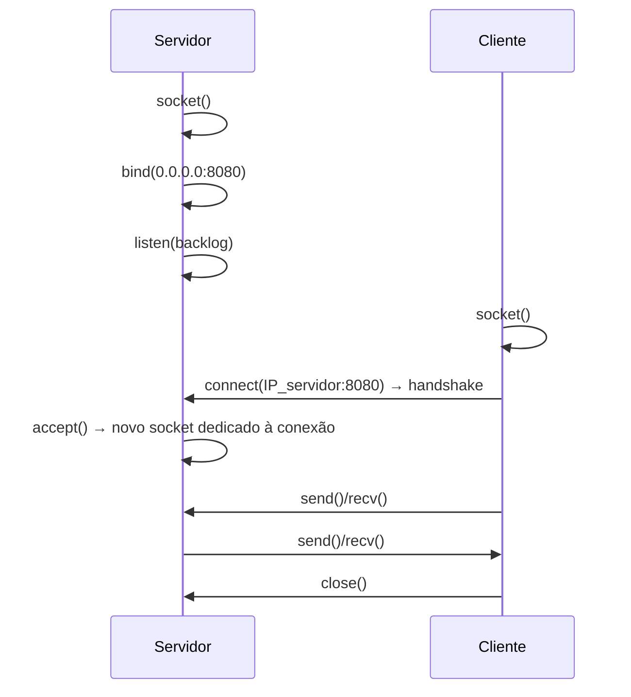
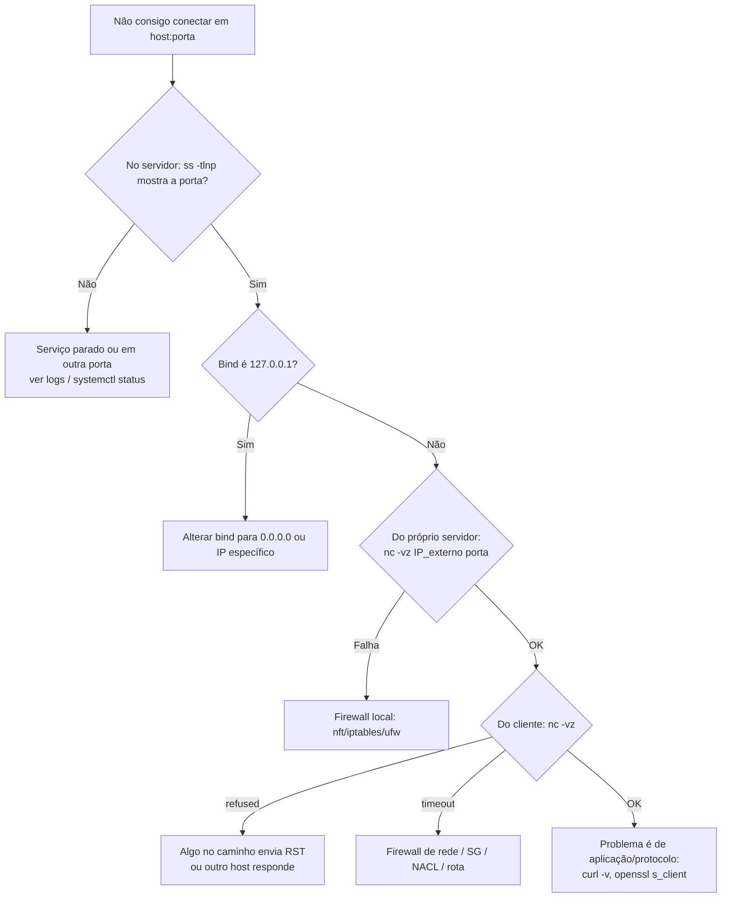

# Portas e Sockets

> [!info] Posição na trilha
> **Etapa 2 — Protocolos de Comunicação.** Pré-requisito: [[05 - TCP e UDP]]. Próxima: [[07 - DNS]].

## 1. Definição

- **Porta:** número de 16 bits (0–65535) no cabeçalho TCP/UDP que identifica **qual processo** num host deve receber os dados. O IP leva o pacote até o host; a porta leva até a aplicação.
- **Socket:** a abstração do sistema operacional (um descritor de arquivo no Linux) que uma aplicação usa para enviar e receber dados pela rede. Um socket é associado a um endereço IP, uma porta e um protocolo.
- **Conexão TCP** é identificada pela **5‑tupla**: `(protocolo, IP origem, porta origem, IP destino, porta destino)`.

Analogia: o IP é o endereço do prédio; a porta é o número do apartamento.

## 2. Por que isso importa

- "A aplicação subiu mas não responde" muitas vezes é: escutando na porta errada, na interface errada, ou porta bloqueada.
- Publicar portas no Docker, `containerPort`/`targetPort` no Kubernetes, listeners de load balancer e regras de Security Group — tudo gira em torno de portas.
- Esgotamento de portas efêmeras é uma causa real de falhas em serviços com alto volume de conexões de saída.

## 3. Como funciona

### 3.1 Faixas de portas (IANA, RFC 6335)

| Faixa | Nome | Uso |
|---|---|---|
| 0 – 1023 | **Well‑known / system ports** | Serviços padrão. No Linux, abrir *listen* nelas exige privilégio (root ou capability `CAP_NET_BIND_SERVICE`) — o limite é configurável via `net.ipv4.ip_unprivileged_port_start` |
| 1024 – 49151 | **Registered / user ports** | Serviços registrados (ex.: 3306 MySQL, 5432 PostgreSQL) |
| 49152 – 65535 | **Dynamic / private (efêmeras)** | Sugestão da IANA para portas de origem temporárias |

> [!note] Portas efêmeras variam por sistema
> O Linux usa por padrão **32768–60999** (`/proc/sys/net/ipv4/ip_local_port_range`). O Windows moderno segue a faixa IANA 49152–65535. Isso importa ao escrever regras de firewall stateless (ex.: Network ACLs em cloud), que precisam liberar o tráfego de retorno nas portas efêmeras.

### 3.2 Ciclo de vida de um socket TCP (API de sockets BSD/POSIX)



- `bind()` associa o socket a um IP e porta locais.
- `listen()` marca o socket como passivo e define a fila de conexões pendentes (**backlog**).
- `accept()` retorna um **novo socket** para cada cliente; o socket original continua escutando. Por isso um servidor na porta 443 pode ter milhares de conexões simultâneas: todas compartilham a porta local 443, mas cada uma tem uma 5‑tupla diferente.
- O cliente geralmente não chama `bind()`; o kernel escolhe uma **porta efêmera** automaticamente.

### 3.3 O endereço de bind importa

| Bind | Quem consegue conectar |
|---|---|
| `127.0.0.1:8080` | Apenas processos no mesmo host (mesmo network namespace) |
| `0.0.0.0:8080` | Qualquer interface IPv4 do host |
| `[::]:8080` | Qualquer interface IPv6 — e, no Linux, também IPv4 se `net.ipv6.bindv6only=0` (padrão), via endereços IPv4‑mapped |
| `10.0.1.15:8080` | Apenas por aquele IP específico |

> [!warning] O erro clássico em containers
> Uma aplicação dentro de um container que escuta em `127.0.0.1` **não é acessível** via porta publicada (`-p 8080:8080`), porque o tráfego chega pela interface `eth0` do container, não pelo loopback. Configure a aplicação para escutar em `0.0.0.0`. Ver [[20 - Redes em Docker]].

## 4. Conceitos centrais

### 4.1 Portas conhecidas que todo DevOps deve reconhecer

| Porta | Protocolo | Serviço |
|---|---|---|
| 20/21 | TCP | FTP (dados/controle) — legado, não cifrado |
| 22 | TCP | SSH, SFTP, SCP |
| 23 | TCP | Telnet — legado, não cifrado; não use |
| 25 | TCP | SMTP (entre servidores de e‑mail) |
| 53 | UDP/TCP | DNS |
| 67/68 | UDP | DHCP (servidor/cliente) |
| 80 | TCP | HTTP |
| 110 / 143 | TCP | POP3 / IMAP |
| 123 | UDP | NTP |
| 161/162 | UDP | SNMP / traps |
| 443 | TCP (e UDP para HTTP/3) | HTTPS |
| 465 / 587 | TCP | SMTP com TLS implícito / submissão com STARTTLS |
| 514 | UDP | Syslog |
| 636 | TCP | LDAPS |
| 993 / 995 | TCP | IMAPS / POP3S |
| 1433 | TCP | Microsoft SQL Server |
| 2049 | TCP/UDP | NFS |
| 2375 / 2376 | TCP | Docker daemon API (sem TLS / com TLS) — **nunca exponha a 2375** |
| 2379/2380 | TCP | etcd (cliente/peer) |
| 3000 | TCP | Convenção comum: Grafana, apps Node.js em desenvolvimento |
| 3306 | TCP | MySQL / MariaDB |
| 3389 | TCP | RDP (Windows) |
| 4789 | UDP | VXLAN |
| 5432 | TCP | PostgreSQL |
| 5672 | TCP | AMQP (RabbitMQ) |
| 6379 | TCP | Redis |
| 6443 | TCP | Kubernetes API server |
| 8080 / 8443 | TCP | HTTP/HTTPS alternativos (convenção) |
| 9090 | TCP | Prometheus |
| 9092 | TCP | Kafka |
| 9100 | TCP | Prometheus node_exporter |
| 10250 | TCP | Kubelet API |
| 27017 | TCP | MongoDB |
| 30000–32767 | TCP/UDP | Faixa padrão de NodePort no Kubernetes |
| 51820 | UDP | WireGuard (padrão comum) |

O arquivo `/etc/services` mapeia nomes a portas no Linux; a lista oficial é o **IANA Service Name and Transport Protocol Port Number Registry**.

> [!important] Porta é convenção, não garantia
> Nada impede um serviço SSH na porta 443 ou HTTP na 5432. Firewalls que filtram "por porta" não sabem qual protocolo realmente passa. Identifique o serviço pelo processo (`ss -p`) ou pelo protocolo em si (`curl`, `openssl s_client`).

### 4.2 Porta de origem vs destino

```text
Cliente 192.168.1.10:51544  ──►  Servidor 203.0.113.5:443
Resposta 203.0.113.5:443    ──►  192.168.1.10:51544
```

Regras de firewall **stateful** liberam a resposta automaticamente; regras **stateless** precisam permitir explicitamente o retorno para portas efêmeras. Ver [[14 - Firewall e Filtragem de Pacotes]].

### 4.3 Limite de conexões

Para um mesmo par `(IP origem, IP destino, porta destino)`, o número de conexões simultâneas de saída é limitado pela quantidade de portas efêmeras disponíveis (~28 mil no padrão Linux). Isso afeta proxies, NAT gateways e clientes de alto volume. Soluções: reuso de conexões, mais IPs de origem, mais IPs de destino, ampliar a faixa.

## 5. Exemplos práticos

### Exemplo 1 — "Porta já em uso"

```text
Error: listen EADDRINUSE: address already in use :::3000
```

Outro processo já fez `bind` na porta. Encontre-o:

```bash
sudo ss -tlnp 'sport = :3000'
```

### Exemplo 2 — Serviço acessível só localmente

`curl localhost:8080` funciona no servidor, mas não de fora. `ss -tlnp` mostra `127.0.0.1:8080` → altere o bind da aplicação, ou coloque um reverse proxy na frente ([[15 - Proxy e Reverse Proxy]]).

## 6. Comandos e demonstrações

```bash
# Sockets TCP em escuta, numéricos, com processo (sudo para ver processos de outros usuários)
sudo ss -tlnp
#   -t TCP | -u UDP | -l listening | -n numérico | -p processo | -a todos os estados

# UDP em escuta
sudo ss -ulnp

# Conexões estabelecidas para a porta 5432
ss -tn state established '( dport = :5432 or sport = :5432 )'

# Resumo geral
ss -s

# Faixa de portas efêmeras
cat /proc/sys/net/ipv4/ip_local_port_range

# Testar se uma porta remota aceita conexões (OpenBSD netcat)
nc -vz 10.0.1.15 5432
#   -v verbose | -z apenas varrer, sem enviar dados | -w 3 timeout de 3 s

# Alternativa sem netcat, usando o bash (recurso do bash, não um arquivo real)
timeout 3 bash -c '</dev/tcp/10.0.1.15/5432' && echo aberta || echo "fechada/filtrada"

# Ferramenta legada (pacote net-tools), ainda comum em documentação antiga
sudo netstat -tulpn

# Qual processo usa a porta (alternativa)
sudo lsof -i :8080
```

No Windows: `netstat -ano` e `Get-NetTCPConnection -State Listen` (PowerShell); `Test-NetConnection host -Port 443`.

## 7. Interpretação

```text
State   Recv-Q  Send-Q  Local Address:Port   Peer Address:Port  Process
LISTEN  0       511     0.0.0.0:80           0.0.0.0:*          users:(("nginx",pid=812,fd=6))
LISTEN  0       4096    127.0.0.53%lo:53     0.0.0.0:*          users:(("systemd-resolve",pid=501,fd=14))
LISTEN  0       128     [::]:22              [::]:*             users:(("sshd",pid=700,fd=4))
LISTEN  0       244     127.0.0.1:5432       0.0.0.0:*          users:(("postgres",pid=950,fd=7))
```

| Coluna | Em LISTEN significa |
|---|---|
| `Recv-Q` | Conexões completas aguardando `accept()` |
| `Send-Q` | Tamanho máximo da fila (backlog) |
| `Local Address:Port` | Endereço e porta do bind |
| `Process` | Processo, PID e descritor |

Leitura: nginx aceita de qualquer IPv4 na porta 80; o resolver local do systemd escuta só em `127.0.0.53`; SSH escuta em todas as interfaces (IPv6 e, provavelmente, IPv4 também); PostgreSQL **só local**.

Se `Recv-Q` em LISTEN se aproxima de `Send-Q`, a fila de aceitação está enchendo: a aplicação não está aceitando conexões rápido o bastante.

Saídas do `nc -vz` (OpenBSD netcat; o texto exato varia entre implementações):

| Saída | Significado |
|---|---|
| `Connection to 10.0.1.15 5432 port [tcp/postgresql] succeeded!` | Porta aberta |
| `nc: connect to 10.0.1.15 port 5432 (tcp) failed: Connection refused` | Host alcançável, nada escutando (ou REJECT) |
| `... failed: Connection timed out` / sem retorno até `-w` | Filtrado (DROP) ou host inalcançável |

## 8. Problemas comuns

| Sintoma | Causa | Verificação |
|---|---|---|
| `EADDRINUSE` | Porta ocupada (ou socket em TIME_WAIT sem `SO_REUSEADDR`) | `ss -tlnp` |
| `EACCES` / `Permission denied` ao escutar na porta 80 | Porta privilegiada sem root/capability | Use porta > 1023 + proxy, ou `setcap 'cap_net_bind_service=+ep'` |
| Acessível localmente, não remotamente | Bind em 127.0.0.1 ou firewall | `ss -tlnp`, regras de firewall |
| `Cannot assign requested address` em conexões de saída | Portas efêmeras esgotadas | `ss -s`, contar conexões por destino |
| Container não responde na porta publicada | App escuta em 127.0.0.1 dentro do container, ou porta interna errada | `docker exec ... ss -tlnp` |

## 9. Troubleshooting



## 10. Aplicações em DevOps

- **Docker:** `-p 8080:80` mapeia porta do host → porta do container. `-p 127.0.0.1:8080:80` publica somente no loopback do host.
- **Kubernetes:** `containerPort` (documentação/descoberta), `targetPort` (porta no Pod), `port` (porta do Service), `nodePort` (porta em cada nó). Ver [[21 - Redes em Kubernetes]].
- **Load balancers:** *listener* (porta exposta) → *target group/backend* (porta da aplicação).
- **Health endpoints** em porta separada (ex.: 8081) permitem expor métricas e health checks sem expô-los publicamente.

## 11. Considerações de segurança

- Faça **inventário de portas** abertas regularmente (`ss -tlnp` em hosts; varreduras autorizadas na borda).
- **Nunca** exponha à Internet: API do Docker (2375/2376), kubelet (10250), etcd (2379), Redis, MongoDB, Elasticsearch e bancos sem autenticação forte e filtragem por origem.
- Mudar a porta do SSH reduz ruído de bots, mas **não** é um controle de segurança real; use chaves e filtragem de origem. Ver [[13 - SSH]].
- Varrer redes de terceiros sem autorização pode ser ilegal e violar termos de uso; faça varreduras (`nmap`) apenas em ambientes próprios ou autorizados.

## 12. Resumo

- Porta identifica o processo; IP identifica a interface; a 5‑tupla identifica a conexão.
- Servidores fazem `bind` + `listen` em porta fixa; clientes usam portas efêmeras.
- O endereço de bind (127.0.0.1 vs 0.0.0.0) decide quem pode conectar.
- `ss -tlnp` é o comando essencial para ver quem escuta onde.

## 13. Verificação de conhecimento

1. Quantas conexões simultâneas um servidor pode ter na porta 443? Por que não há conflito?
2. Uma Network ACL stateless libera entrada na porta 443. O que mais precisa ser liberado para a resposta sair?
3. Um container escuta em `127.0.0.1:3000` e foi iniciado com `-p 3000:3000`. Por que `curl localhost:3000` no host falha?
4. Qual comando mostra qual processo está escutando na porta 9090?
5. O que significa `Recv-Q` alto em um socket LISTEN?

> [!success]- Respostas
> 1. Muitas (limitadas por memória, descritores de arquivo e configuração), porque cada conexão é uma 5‑tupla diferente (IP/porta do cliente variam).
> 2. Tráfego de saída para as portas efêmeras do cliente (ex.: 1024–65535, dependendo do sistema operacional dos clientes).
> 3. O tráfego encaminhado chega pela `eth0` do container, mas a aplicação aceita só pelo loopback do container.
> 4. `sudo ss -tlnp 'sport = :9090'` (ou `sudo lsof -i :9090`).
> 5. Conexões completas estão acumulando sem a aplicação chamar `accept()` — aplicação sobrecarregada ou travada.

## 14. Tópicos relacionados

- Anterior: [[05 - TCP e UDP]]
- Próxima: [[07 - DNS]]
- [[14 - Firewall e Filtragem de Pacotes]]
- [[20 - Redes em Docker]]
- [[19 - Ferramentas de Diagnóstico]]
- [[Mapa de Estudos de Redes]]
