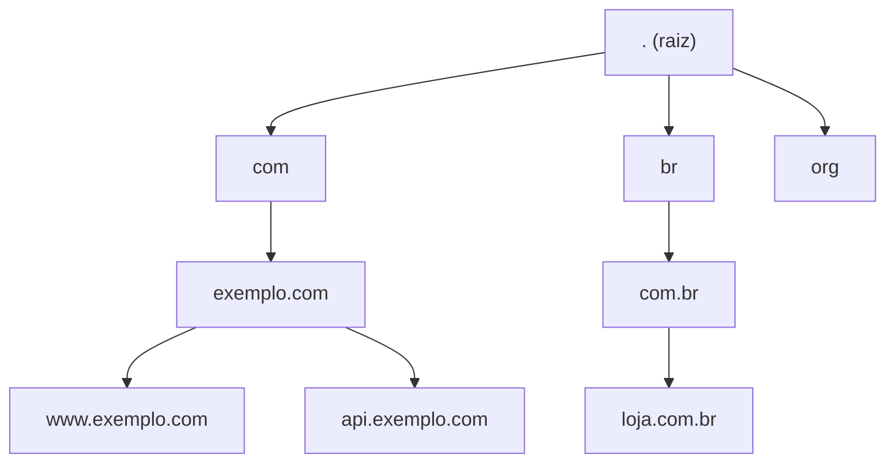
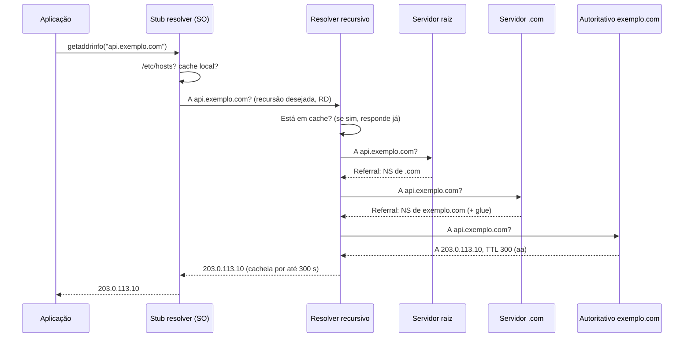
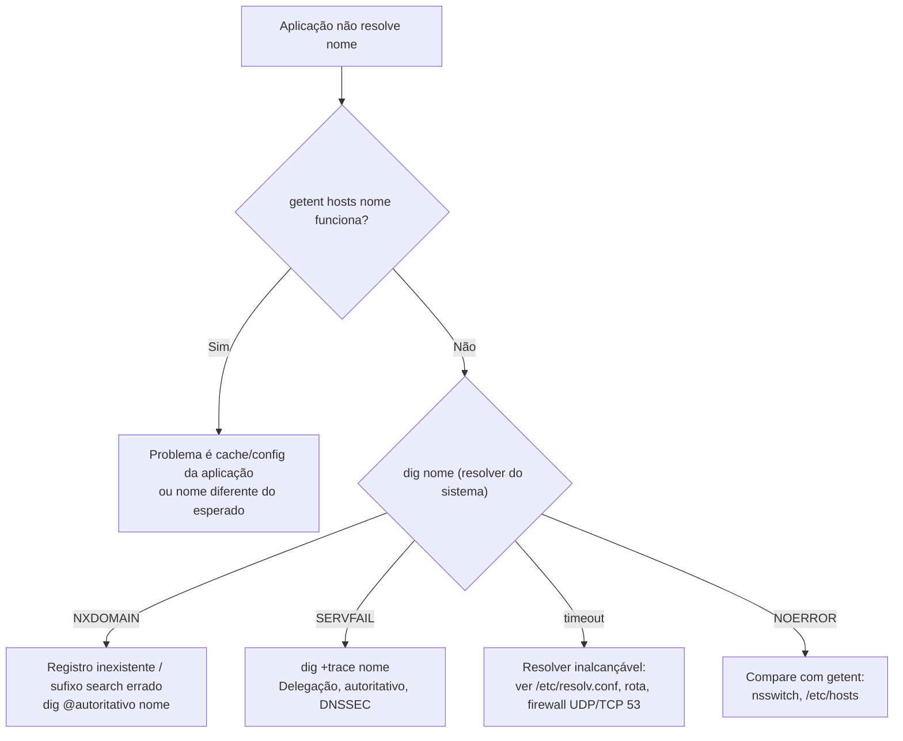

# DNS — Domain Name System

> [!info] Posição na trilha
> **Etapa 2 — Protocolos de Comunicação.** Pré-requisitos: [[05 - TCP e UDP]], [[06 - Portas e Sockets]]. Próxima: [[08 - DHCP e ARP]].

## 1. Definição

O **DNS** é um banco de dados **distribuído e hierárquico** que traduz nomes legíveis (`api.exemplo.com`) em dados técnicos, principalmente endereços IP, mas também servidores de e‑mail, aliases, chaves e textos de verificação. Especificado originalmente nas RFC 1034 e 1035, com muitas extensões posteriores.

Usa a **porta 53**, por padrão em **UDP**, recorrendo a **TCP** quando a resposta é grande demais ou em transferências de zona. Variantes cifradas: **DoT** (DNS over TLS, porta 853) e **DoH** (DNS over HTTPS, porta 443).

## 2. Por que isso importa

> "It's always DNS." — piada recorrente entre engenheiros, porque é verdade com frequência.

- Toda chamada a uma URL começa com DNS. Se o DNS falha ou está lento, tudo falha ou fica lento.
- Migrações, deploys blue/green e failover de regiões frequentemente são feitos **trocando registros DNS** — e o **TTL** decide quanto tempo os clientes demoram a perceber.
- Service discovery em Docker e Kubernetes é DNS.
- Certificados TLS (validação ACME), e‑mail (SPF, DKIM, DMARC) e verificação de domínio dependem de registros DNS.

## 3. Como funciona

### 3.1 Hierarquia de nomes



- **Raiz (`.`):** atendida por 13 identidades de servidores raiz (`a.root-servers.net` a `m.root-servers.net`), cada uma replicada mundialmente via **anycast**.
- **TLD (Top‑Level Domain):** `.com`, `.br`, `.org`, `.io`...
- **Domínio de segundo nível e subdomínios:** `exemplo.com`, `api.exemplo.com`.
- **FQDN (Fully Qualified Domain Name):** nome completo terminado em ponto: `api.exemplo.com.` (o ponto final representa a raiz; geralmente é omitido).
- **Zona:** parte da árvore administrada por um conjunto de servidores autoritativos. A **delegação** é feita com registros NS.

### 3.2 Papéis dos servidores

| Papel | O que faz | Exemplos |
|---|---|---|
| **Stub resolver** | Biblioteca no cliente (glibc, musl, systemd‑resolved) que envia a pergunta a um resolver recursivo | Seu sistema operacional |
| **Resolver recursivo** | Faz todo o trabalho de percorrer a hierarquia e **cacheia** respostas | Resolver do provedor de Internet, `1.1.1.1`, `8.8.8.8`, resolver da VPC, CoreDNS (para nomes externos, encaminha) |
| **Servidor autoritativo** | Tem a "fonte da verdade" de uma zona; responde com o flag `aa` (Authoritative Answer) | Route 53, Cloud DNS, Azure DNS, Cloudflare DNS, BIND, PowerDNS |
| **Forwarder** | Repassa consultas para outro resolver | dnsmasq em roteadores domésticos, Docker embedded DNS |

### 3.3 Fluxo de resolução



- **Consulta recursiva:** o cliente pede ao resolver "me dê a resposta final".
- **Consulta iterativa:** o resolver pergunta a cada nível e recebe **referências** (*referrals*) para o próximo.
- **Glue records:** IPs dos servidores NS incluídos na resposta quando os próprios NS estão dentro da zona delegada (ex.: `ns1.exemplo.com`), evitando um ciclo.

### 3.4 Ordem de resolução no Linux

O stub resolver da glibc consulta fontes na ordem definida em `/etc/nsswitch.conf`:

```text
hosts: files dns
```

1. `files` → `/etc/hosts`
2. `dns` → servidores listados em `/etc/resolv.conf`

Variações importantes:

- Em sistemas com **systemd‑resolved**, `/etc/resolv.conf` costuma apontar para `127.0.0.53` (um stub local), e a linha `hosts:` pode incluir `resolve` e `myhostname`. Use `resolvectl status` para ver os servidores reais.
- Imagens Alpine usam **musl**, cujo resolver tem comportamento diferente da glibc (por exemplo, historicamente sem suporte a DNS via TCP, adicionado na musl 1.2.4, e tratamento diferente de `search`/`ndots`). Isso explica problemas de DNS "só em containers Alpine".
- `dig` e `nslookup` **ignoram** `/etc/hosts` e `nsswitch.conf`: consultam o DNS diretamente. Para ver o que a aplicação realmente obtém, use `getent hosts nome`.

### 3.5 `/etc/resolv.conf`

```text
nameserver 10.0.0.2
search exemplo.internal svc.cluster.local
options ndots:5 timeout:2 attempts:2
```

| Diretiva | Efeito |
|---|---|
| `nameserver` | Resolver(s) a consultar (glibc usa até 3) |
| `search` | Sufixos tentados para nomes "curtos" |
| `ndots:n` | Se o nome tem **menos de n pontos**, os sufixos de `search` são tentados **antes** do nome literal |
| `timeout`, `attempts` | Tempo e tentativas por servidor |

## 4. Conceitos centrais

### 4.1 Tipos de registro

| Tipo | Função | Exemplo |
|---|---|---|
| **A** | Nome → IPv4 | `api.exemplo.com. 300 IN A 203.0.113.10` |
| **AAAA** | Nome → IPv6 | `api.exemplo.com. 300 IN AAAA 2001:db8::10` |
| **CNAME** | Alias para outro nome (canônico) | `www.exemplo.com. CNAME exemplo.com.` |
| **MX** | Servidor de e‑mail do domínio, com prioridade | `exemplo.com. MX 10 mail.exemplo.com.` |
| **TXT** | Texto livre: SPF, DKIM, DMARC, verificações | `exemplo.com. TXT "v=spf1 include:_spf.google.com ~all"` |
| **NS** | Servidores autoritativos da zona (delegação) | `exemplo.com. NS ns1.provedor.net.` |
| **SOA** | Metadados da zona: servidor primário, e‑mail do responsável, serial, timers, TTL negativo | Um por zona |
| **PTR** | IP → nome (DNS reverso), na zona `in-addr.arpa` / `ip6.arpa` | `10.113.0.203.in-addr.arpa. PTR api.exemplo.com.` |
| **SRV** | Localiza serviços: prioridade, peso, porta, alvo | `_sip._tcp.exemplo.com. SRV 10 60 5060 sip.exemplo.com.` |
| **CAA** | Quais autoridades certificadoras podem emitir certificados para o domínio | `exemplo.com. CAA 0 issue "letsencrypt.org"` |
| **HTTPS / SVCB** | Parâmetros de conexão (ALPN, HTTP/3, ECH) — RFC 9460 | Usado por navegadores modernos |

> [!warning] Regras do CNAME
> - Um nome com CNAME **não pode ter outros registros** (exceto os de DNSSEC).
> - Por isso, o **apex/raiz da zona** (`exemplo.com`) não pode ser CNAME, já que precisa de SOA e NS. Provedores oferecem soluções proprietárias como **ALIAS/ANAME** ou "CNAME flattening" (ex.: registros *alias* do Route 53).
> - Cadeias longas de CNAME aumentam a latência de resolução.

### 4.2 TTL e cache

- **TTL (Time To Live)**, em segundos, diz por quanto tempo um resolver pode **cachear** a resposta.
- O cache existe em vários níveis: navegador, SO (systemd‑resolved, nscd), runtime da linguagem (a JVM, por exemplo, tem cache próprio configurável via `networkaddress.cache.ttl`), resolver recursivo.
- **Cache negativo:** respostas `NXDOMAIN` também são cacheadas, pelo tempo derivado do SOA (RFC 2308). Criar um registro logo após consultá-lo (e receber NXDOMAIN) pode exigir espera.
- **"Propagação DNS"** é, na verdade, **expiração de caches**. Não há "empurrão" de mudanças.

> [!tip] Estratégia de TTL para migrações
> Dias antes de uma troca de IP, **reduza o TTL** (ex.: de 3600 para 60). Espere o TTL **antigo** expirar. Faça a troca. Depois de estabilizar, aumente o TTL novamente.

### 4.3 Códigos de resposta (RCODE)

| RCODE | Significado | Causa típica |
|---|---|---|
| `NOERROR` | Sucesso (pode vir **sem resposta** se o nome existe mas não tem aquele tipo — "NODATA") | — |
| `NXDOMAIN` | O nome **não existe** | Erro de digitação, registro não criado, sufixo de `search` errado |
| `SERVFAIL` | O resolver não conseguiu obter resposta | Autoritativo fora do ar, falha de validação DNSSEC, delegação quebrada |
| `REFUSED` | O servidor recusou responder | Resolver não aceita consultas recursivas daquela origem |

## 5. Exemplos práticos

### Exemplo 1 — `ndots:5` no Kubernetes

Em Pods, o `resolv.conf` típico é:

```text
search default.svc.cluster.local svc.cluster.local cluster.local
nameserver 10.96.0.10
options ndots:5
```

Uma consulta a `api.github.com` (2 pontos, menos que 5) é tentada primeiro como `api.github.com.default.svc.cluster.local`, depois `...svc.cluster.local`, depois `...cluster.local` — todas resultam em NXDOMAIN — e só então `api.github.com.`. Isso multiplica consultas (e cada tentativa pode ser feita para A e AAAA). Mitigações: usar FQDN com ponto final (`api.github.com.`), ajustar `dnsConfig.options` do Pod para `ndots` menor, usar NodeLocal DNSCache. Ver [[21 - Redes em Kubernetes]].

### Exemplo 2 — Split‑horizon DNS

O mesmo nome resolve para IPs diferentes dependendo de onde vem a consulta: `db.exemplo.com` → IP privado dentro da VPC, IP público (ou nada) fora. Implementado com zonas privadas em cloud ou *views* no BIND. Comum e útil, mas confunde no troubleshooting: sempre pergunte **"de onde estou consultando?"**.

### Exemplo 3 — Verificação de domínio para certificado (ACME DNS‑01)

A autoridade certificadora pede um TXT em `_acme-challenge.exemplo.com` com um token. Se o TXT existe, a posse do domínio está provada. Permite emitir certificados **wildcard**. Ver [[12 - TLS e Certificados]].

## 6. Comandos e demonstrações

```bash
# Consulta básica (registro A)
dig api.exemplo.com

# Só a resposta
dig +short api.exemplo.com

# Tipos específicos
dig exemplo.com MX
dig exemplo.com TXT
dig exemplo.com NS
dig api.exemplo.com AAAA

# Usar um resolver específico
dig @1.1.1.1 api.exemplo.com

# Perguntar diretamente ao autoritativo (ignora caches)
dig @ns1.provedor.net api.exemplo.com

# Seguir toda a cadeia de delegação, da raiz ao autoritativo
dig +trace api.exemplo.com

# DNS reverso
dig -x 8.8.8.8

# Forçar TCP
dig +tcp exemplo.com

# O que a APLICAÇÃO resolve (respeita /etc/hosts e nsswitch)
getent hosts api.exemplo.com
getent ahosts api.exemplo.com      # todos os endereços, IPv4 e IPv6

# nslookup (disponível também no Windows)
nslookup api.exemplo.com
nslookup -type=MX exemplo.com 8.8.8.8

# systemd-resolved
resolvectl status
resolvectl query api.exemplo.com
sudo resolvectl flush-caches
```

No Windows (PowerShell): `Resolve-DnsName api.exemplo.com`, `ipconfig /displaydns`, `ipconfig /flushdns`.

## 7. Interpretação da saída do `dig`

```text
; <<>> DiG 9.18.x <<>> api.exemplo.com
;; global options: +cmd
;; Got answer:
;; ->>HEADER<<- opcode: QUERY, status: NOERROR, id: 41235
;; flags: qr rd ra; QUERY: 1, ANSWER: 1, AUTHORITY: 0, ADDITIONAL: 1

;; QUESTION SECTION:
;api.exemplo.com.               IN      A

;; ANSWER SECTION:
api.exemplo.com.        287     IN      A       203.0.113.10

;; Query time: 3 msec
;; SERVER: 127.0.0.53#53(127.0.0.53) (UDP)
;; WHEN: ...
;; MSG SIZE  rcvd: 60
```

| Elemento | Significado |
|---|---|
| `status: NOERROR` | RCODE (ver tabela 4.3) |
| `flags: qr` | É uma resposta |
| `rd` | *Recursion Desired* — o cliente pediu recursão |
| `ra` | *Recursion Available* — o servidor oferece recursão |
| `aa` (ausente aqui) | *Authoritative Answer* — aparece quando quem responde é o autoritativo |
| `287` | TTL **restante** no cache (o original pode ter sido 300). Rodar de novo mostra o número diminuindo |
| `Query time: 3 msec` | Muito baixo → provavelmente veio de cache |
| `SERVER` | Quem respondeu. `127.0.0.53` = stub do systemd‑resolved |
| `ANSWER: 0` com `NOERROR` | NODATA: o nome existe, mas não há registro daquele tipo |
| `AUTHORITY SECTION` com SOA | Comum em NXDOMAIN/NODATA; o TTL do SOA define o cache negativo |

## 8. Problemas comuns

| Sintoma | Causa provável | Como confirmar |
|---|---|---|
| `curl: (6) Could not resolve host` | DNS falhou para aquele nome | `getent hosts nome`, `dig nome` |
| Funciona por IP, não por nome | Resolver inacessível ou registro ausente | `dig @<resolver> nome`; `nc -vzu <resolver> 53` |
| Alguns clientes veem IP antigo | Cache com TTL longo | `dig` em resolvers diferentes; ver TTL |
| `dig` resolve, aplicação não | `/etc/hosts`, nsswitch, cache da aplicação/JVM, musl | `getent hosts nome` |
| Lentidão intermitente de ~5 s | Timeout de um resolver listado (o próximo só é tentado após o timeout); ou problemas com consultas A/AAAA paralelas em conntrack | `dig` com cada `nameserver`; `options single-request-reopen` (glibc) |
| `SERVFAIL` | Autoritativo indisponível, DNSSEC quebrado | `dig +trace`; `dig +cd` (desativa checagem DNSSEC) para comparar |
| Nome interno resolve fora da VPN mas não dentro (ou vice‑versa) | Split DNS / resolvers diferentes | `resolvectl status` para ver qual servidor serve cada domínio |

## 9. Troubleshooting



Perguntas-chave:

1. **Qual nome exato** está sendo consultado (com ou sem sufixo de `search`)?
2. **Qual resolver** está respondendo?
3. **O autoritativo** tem o registro correto? (`dig @ns nome`)
4. **Qual o TTL** e quando foi a mudança?
5. **De onde** a consulta é feita (split‑horizon, VPN, container)?

## 10. Aplicações em DevOps

- **Docker:** redes customizadas (user‑defined bridge) oferecem DNS interno (`127.0.0.11` dentro do container) que resolve nomes de containers e serviços. A bridge padrão **não** oferece isso. Ver [[20 - Redes em Docker]].
- **Kubernetes:** o CoreDNS resolve `servico.namespace.svc.cluster.local` para o ClusterIP do Service. Ver [[21 - Redes em Kubernetes]].
- **Cloud:** zonas públicas e privadas, resolvers da VPC (na AWS, no endereço base da VPC +2, e também em `169.254.169.253`), registros com health checks e roteamento por latência/geolocalização/peso.
- **Infraestrutura como Código:** gerencie registros DNS com Terraform; ferramentas como **external-dns** criam registros automaticamente a partir de Services/Ingresses do Kubernetes.
- **Deploys:** blue/green por DNS depende do TTL; para trocas rápidas, prefira trocar o alvo de um load balancer.

## 11. Considerações de segurança

| Risco | Descrição | Mitigação |
|---|---|---|
| **Cache poisoning / spoofing** | Injeção de respostas falsas em resolvers | Portas de origem aleatórias, **DNSSEC** |
| **Sequestro de domínio** | Conta no registrador comprometida | MFA, registry lock |
| **Subdomain takeover** | CNAME aponta para recurso cloud que foi apagado e pode ser reivindicado por terceiros | Remova registros órfãos; audite CNAMEs |
| **Resolver aberto** | Usado em ataques de amplificação | Restrinja recursão a clientes internos |
| **Exfiltração/tunelamento via DNS** | Dados codificados em consultas | Monitorar volume e entropia de consultas; forçar o uso de resolvers controlados |
| **Privacidade** | Consultas em texto claro revelam o que você acessa | DoT/DoH |

- **DNSSEC** assina registros criptograficamente (autenticidade e integridade), mas **não cifra** consultas.
- Use registros **CAA** para restringir quem pode emitir certificados para seu domínio.

## 12. Resumo

- DNS é hierárquico (raiz → TLD → domínio) e distribuído; resolvers recursivos fazem o trabalho e cacheiam.
- Registros principais: A, AAAA, CNAME, MX, TXT, NS, SOA, PTR, SRV, CAA.
- TTL controla o cache; "propagação" é expiração de cache.
- `dig` consulta o DNS; `getent` mostra o que a aplicação vê.
- `NXDOMAIN` = não existe; `SERVFAIL` = falha ao resolver; timeout = resolver inalcançável.

## 13. Verificação de conhecimento

1. Qual a diferença entre um resolver recursivo e um servidor autoritativo?
2. Você alterou um registro A com TTL 86400 há 1 hora e alguns usuários ainda veem o IP antigo. Por quê? O que deveria ter sido feito?
3. Por que `dig` pode mostrar um IP enquanto `curl` usa outro?
4. Em um Pod com `ndots:5`, quantas consultas (no pior caso, contando só registros A) são feitas para `google.com`?
5. Por que não é possível criar um CNAME em `exemplo.com` (apex)?
6. Qual comando mostra a cadeia completa de delegação de um nome?

> [!success]- Respostas
> 1. O recursivo busca a resposta em nome do cliente e cacheia; o autoritativo detém os registros da zona e responde com autoridade.
> 2. Resolvers cachearam a resposta antiga por até 24 h. Deveria ter reduzido o TTL com antecedência (pelo menos 24 h antes da troca).
> 3. `dig` ignora `/etc/hosts` e caches da aplicação; `curl` usa o resolver do sistema (nsswitch). Podem também consultar servidores diferentes.
> 4. Até 4: três sufixos de `search` + o nome absoluto (e o dobro se também consultar AAAA).
> 5. O apex precisa de registros SOA e NS, e um nome com CNAME não pode ter outros registros.
> 6. `dig +trace nome`.

## 14. Tópicos relacionados

- Anterior: [[06 - Portas e Sockets]]
- Próxima: [[08 - DHCP e ARP]]
- [[12 - TLS e Certificados]]
- [[20 - Redes em Docker]]
- [[21 - Redes em Kubernetes]]
- [[19 - Ferramentas de Diagnóstico]]
- [[Mapa de Estudos de Redes]]
