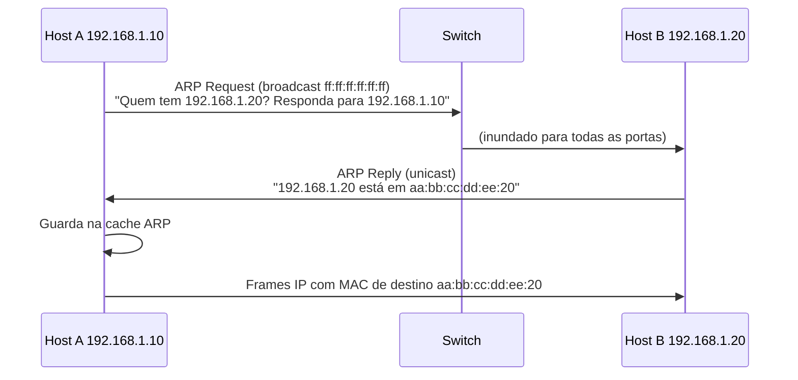

# DHCP e ARP

> [!info] Posição na trilha
> **Etapa 2 — Protocolos de Comunicação.** Pré-requisitos: [[03 - Endereçamento IP e Sub-redes]], [[05 - TCP e UDP]]. Próxima: [[09 - Roteamento e Gateway]].

Esta nota cobre dois protocolos que operam "nos bastidores" da rede local:

- **DHCP** — *como um host recebe sua configuração IP*.
- **ARP** — *como um host descobre o endereço MAC correspondente a um IP na mesma rede*.

---

## Parte 1 — DHCP

### 1. Definição

O **DHCP (Dynamic Host Configuration Protocol)**, RFC 2131 para IPv4, permite que um servidor atribua automaticamente a um cliente:

- Endereço IP e máscara
- Gateway padrão (option 3, *router*)
- Servidores DNS (option 6) e domínio de busca
- Tempo de concessão (**lease**)
- Outras opções: NTP, MTU, servidor de boot (PXE), rotas estáticas (option 121)

Usa **UDP**: servidor na porta **67**, cliente na **68**. Para IPv6 existe o **DHCPv6** (RFC 8415), que coexiste com o SLAAC.

### 2. Por que isso importa

- Sem DHCP, cada host precisaria de configuração manual, propensa a conflitos.
- VMs em cloud recebem IP via DHCP do provedor; containers recebem IP por mecanismos análogos (IPAM do Docker ou do CNI).
- Falhas de DHCP resultam em hosts sem rede, ou com IP `169.254.x.x`.

### 3. Como funciona — o processo DORA

```mermaid
sequenceDiagram
    participant C as Cliente (sem IP)
    participant S as Servidor DHCP
    C->>S: DISCOVER (broadcast, origem 0.0.0.0 → 255.255.255.255)
    S->>C: OFFER (IP proposto, máscara, gateway, DNS, lease)
    C->>S: REQUEST (broadcast: "aceito a oferta do servidor X")
    S->>C: ACK (confirma; cliente configura a interface)
```

1. **Discover:** o cliente, ainda sem IP, envia um broadcast procurando servidores.
2. **Offer:** um ou mais servidores oferecem um endereço.
3. **Request:** o cliente escolhe uma oferta e a solicita formalmente. É broadcast para que os outros servidores saibam que suas ofertas foram recusadas.
4. **Acknowledge:** o servidor confirma. Se o endereço não estiver mais disponível, responde **NAK** e o cliente recomeça.

Antes de usar o endereço, muitos clientes checam por conflito (ex.: ARP probe; RFC 5227) e podem enviar **DECLINE** se o IP já estiver em uso.

**Renovação:** em **T1** (por padrão, 50% do lease) o cliente tenta renovar diretamente com o servidor (unicast). Em **T2** (87,5%), tenta com qualquer servidor (broadcast). Se o lease expirar, o cliente perde o endereço.

**RELEASE:** o cliente pode devolver o endereço ao desligar (opcional).

### 4. Conceitos centrais

| Conceito | Descrição |
|---|---|
| **Escopo / pool** | Faixa de IPs que o servidor pode distribuir |
| **Reserva** | IP fixo associado a um MAC (ou client‑id) específico |
| **Lease** | Tempo de validade da concessão |
| **DHCP Relay (ip helper)** | Como DISCOVER é broadcast e não atravessa roteadores, um *relay agent* no roteador encaminha a mensagem em unicast para um servidor DHCP em outra rede, incluindo o campo `giaddr` para identificar a sub-rede de origem |
| **Exclusões** | IPs do escopo que não devem ser distribuídos (gateway, servidores estáticos) |

### 5. Comandos

```bash
# Ver se o endereço é dinâmico e o lease restante
ip addr show eth0      # procure "dynamic" e "valid_lft"

# NetworkManager: detalhes do DHCP da conexão ativa
nmcli device show eth0

# systemd-networkd
networkctl status eth0

# Renovar com dhclient (ISC; em desuso em várias distribuições, mas ainda comum)
sudo dhclient -r eth0 && sudo dhclient -v eth0
#   -r libera o lease atual | -v mostra o diálogo DORA
# ATENÇÃO: em uma sessão SSH por essa interface, liberar o IP derruba sua conexão.

# Observar mensagens DHCP
sudo tcpdump -i eth0 -n -v 'udp port 67 or udp port 68'
```

Windows: `ipconfig /release`, `ipconfig /renew`, `ipconfig /all` (mostra servidor DHCP e lease).

### 6. Problemas comuns

| Sintoma | Causa |
|---|---|
| IP `169.254.x.x` (APIPA/link‑local) | Nenhum servidor DHCP respondeu |
| Hosts recebem gateway/DNS errados | **Servidor DHCP indevido (rogue)** na rede, ex.: um roteador doméstico ligado na rede corporativa |
| Novos hosts não obtêm IP | Pool esgotado (leases longos com muitos dispositivos temporários) |
| Cliente em outra VLAN sem IP | Falta de DHCP relay |

### 7. Segurança

- **Rogue DHCP** permite ataques man‑in‑the‑middle (entregando um gateway/DNS controlado pelo atacante). Mitigação em switches gerenciáveis: **DHCP snooping** (portas confiáveis para servidores; as demais não podem enviar OFFER/ACK).
- **DHCP starvation:** esgotar o pool com MACs falsos. Mitigação: port security, limites por porta.

---

## Parte 2 — ARP

### 1. Definição

O **ARP (Address Resolution Protocol)**, RFC 826, descobre o **endereço MAC** associado a um **IPv4** **dentro do mesmo segmento de camada 2**. Ele é encapsulado diretamente em Ethernet (EtherType `0x0806`), não em IP.

Em IPv6, a mesma função é feita pelo **NDP (Neighbor Discovery Protocol)**, RFC 4861, usando mensagens ICMPv6 *Neighbor Solicitation* e *Neighbor Advertisement* enviadas a endereços multicast.

### 2. Por que isso importa

Um frame Ethernet precisa de um MAC de destino. O IP diz **para quem** é o pacote; o ARP diz **para qual placa enviar o frame no próximo salto**. Se o ARP falha, nada passa — nem `ping`.

> [!important] ARP é usado para o próximo salto, não para o destino final
> Para falar com um IP de **outra rede**, o host faz ARP do **gateway**, nunca do destino remoto.

### 3. Como funciona



- A **cache ARP** (tabela de vizinhos) guarda os mapeamentos por um tempo limitado; o Linux revalida entradas periodicamente (estados `REACHABLE` → `STALE` → `DELAY` → `PROBE`).
- **Gratuitous ARP:** um host anuncia seu próprio mapeamento IP→MAC sem ser perguntado. Usado para detectar conflitos e, muito importante, para **failover de IP virtual** (Keepalived/VRRP, clusters): quando o IP flutuante muda de máquina, um gratuitous ARP atualiza as caches dos vizinhos.
- **Proxy ARP:** um roteador responde ARP em nome de hosts em outra rede. Algumas implementações de rede de containers e nuvem usam variações disso.

### 4. Switch e tabela MAC (contexto)

O switch aprende em qual porta cada MAC está observando o **MAC de origem** dos frames (tabela CAM). Frames para MAC desconhecido ou broadcast são **inundados** (flooding) para todas as portas da VLAN. Ver [[17 - VLAN e Segmentação de Redes]].

### 5. Comandos

```bash
# Tabela de vizinhos (ARP para IPv4, NDP para IPv6)
ip neigh show
ip -4 neigh
ip -6 neigh

# Forçar resolução e testar: envia ARP requests (pacote iputils-arping)
sudo arping -I eth0 -c 3 192.168.1.1

# Detectar IP duplicado (modo DAD - Duplicate Address Detection)
sudo arping -D -I eth0 -c 2 192.168.1.50

# Limpar a entrada de um vizinho (útil após troca de hardware/IP virtual)
sudo ip neigh flush dev eth0 192.168.1.20
# CUIDADO: "ip neigh flush all" em produção pode causar breve perda de conectividade.

# Observar tráfego ARP
sudo tcpdump -i eth0 -n -e arp

# Legado (net-tools)
arp -n
```

Windows: `arp -a`, `Get-NetNeighbor`.

### 6. Interpretação

```text
192.168.1.1 dev eth0 lladdr 52:54:00:12:35:02 REACHABLE
192.168.1.20 dev eth0 lladdr aa:bb:cc:dd:ee:20 STALE
192.168.1.99 dev eth0 FAILED
fe80::1 dev eth0 lladdr 52:54:00:12:35:02 router REACHABLE
```

| Estado | Significado |
|---|---|
| `REACHABLE` | Confirmado recentemente |
| `STALE` | Mapeamento conhecido mas não confirmado há algum tempo; será revalidado no próximo uso (normal) |
| `DELAY` / `PROBE` | Em processo de revalidação |
| `INCOMPLETE` | ARP enviado, aguardando resposta |
| `FAILED` | Sem resposta: host desligado, IP inexistente na LAN, VLAN errada, filtragem |
| `PERMANENT` | Entrada estática |
| `router` | O vizinho se anunciou como roteador (IPv6) |

Saída do `tcpdump -e arp`:

```text
... 52:54:00:aa:bb:cc > ff:ff:ff:ff:ff:ff, ethertype ARP (0x0806), length 42: Request who-has 192.168.1.20 tell 192.168.1.10, length 28
... aa:bb:cc:dd:ee:20 > 52:54:00:aa:bb:cc, ethertype ARP (0x0806), length 42: Reply 192.168.1.20 is-at aa:bb:cc:dd:ee:20, length 28
```

### 7. Problemas comuns

| Sintoma | Causa | Verificação |
|---|---|---|
| `ping` para o gateway falha com `Destination Host Unreachable` vindo do **próprio** IP | ARP sem resposta (gateway fora, VLAN errada, cabo) | `ip neigh` mostra `FAILED`/`INCOMPLETE` |
| Conectividade intermitente, MAC do IP alterna | **IP duplicado** | `arping -D`, `tcpdump arp` mostrando dois MACs respondendo |
| Após failover de IP virtual, clientes ainda vão ao nó antigo | Gratuitous ARP não enviado/aceito; cache antiga | `ip neigh` nos clientes; checar configuração do Keepalived |
| Em cloud, IP adicionado manualmente na VM não funciona | A rede virtual do provedor **não usa ARP real**; só entrega tráfego para IPs registrados na interface virtual via API | Atribuir IP secundário pela API/console do provedor |

> [!note] ARP em cloud é diferente
> Em VPCs, a camada 2 é emulada pelo hipervisor/SDN. O provedor geralmente responde ARP ele mesmo e **não** propaga broadcasts entre hosts como uma LAN física. Por isso, técnicas baseadas em gratuitous ARP (como VRRP clássico) normalmente não funcionam em cloud pública; usa-se a API do provedor para mover IPs, ou load balancers.

### 8. Segurança

- **ARP spoofing / poisoning:** o ARP não tem autenticação. Um atacante na mesma LAN pode anunciar que o IP do gateway está no seu MAC e interceptar o tráfego (man‑in‑the‑middle).
- Mitigações: **Dynamic ARP Inspection** (switches gerenciáveis, com base no DHCP snooping), segmentação em VLANs menores, e **criptografia fim a fim (TLS/SSH)**, que torna a interceptação inútil para ler ou alterar os dados.

---

## Troubleshooting combinado (DHCP + ARP)

1. `ip -br addr` → a interface tem IP válido (não `169.254.x.x`)?
   - Não → DHCP: `tcpdump port 67 or port 68`, verificar se OFFER chega.
2. `ip route` → existe gateway? Ele está na mesma sub-rede?
3. `ping -c 2 <gateway>`; depois `ip neigh show <gateway>`.
   - `FAILED`/`INCOMPLETE` → problema de L2 (VLAN, cabo, porta, IP do gateway errado).
   - `REACHABLE` mas ping falha → ICMP filtrado; tente outro protocolo.
4. Suspeita de IP duplicado → `arping -D`.

## Aplicações em DevOps

- **Cloud:** IP privado da VM é entregue por DHCP do provedor, de acordo com o que está configurado na interface virtual (ENI/NIC). "Fixar IP" se faz na API, não dentro do SO.
- **Docker:** o IPAM do Docker atribui IPs a containers sem DHCP; dentro de uma bridge, ARP funciona normalmente entre containers (veja `ip neigh` dentro de um container).
- **Kubernetes:** o CNI faz o papel de "DHCP" (IPAM) para Pods. Alguns CNIs e implementações de LoadBalancer bare‑metal (ex.: MetalLB em modo L2) usam **ARP/NDP** para anunciar IPs de Services na rede local.
- **Alta disponibilidade on‑premises:** Keepalived/VRRP com IP virtual depende de gratuitous ARP.

## Resumo

- DHCP entrega configuração IP via DORA (Discover, Offer, Request, Ack) sobre UDP 67/68, com leases renováveis.
- Broadcasts não cruzam roteadores; DHCP relay resolve isso.
- ARP mapeia IPv4 → MAC na mesma LAN; IPv6 usa NDP.
- Para destinos remotos, o host faz ARP do gateway.
- Ambos não têm autenticação: rogue DHCP e ARP spoofing são riscos reais em LANs.

## Verificação de conhecimento

1. Por que o DHCP REQUEST é enviado em broadcast se o cliente já conhece o servidor?
2. Um host em `10.0.1.0/24` quer acessar `10.0.5.7`. Para qual IP ele envia o ARP request?
3. O que indica `FAILED` na saída do `ip neigh`?
4. Por que adicionar um IP manualmente com `ip addr add` em uma VM de cloud geralmente não basta para recebê-lo?
5. Qual mecanismo de switch mitiga um servidor DHCP falso?

> [!success]- Respostas
> 1. Para informar a todos os servidores que fizeram ofertas qual foi aceita, liberando os demais endereços oferecidos.
> 2. Para o IP do gateway padrão.
> 3. Que o ARP/NDP não obteve resposta para aquele IP.
> 4. Porque a rede virtual do provedor só entrega tráfego para IPs associados à interface via API; não há aprendizado por ARP como numa LAN física.
> 5. DHCP snooping.

## Tópicos relacionados

- Anterior: [[07 - DNS]]
- Próxima: [[09 - Roteamento e Gateway]]
- [[03 - Endereçamento IP e Sub-redes]]
- [[17 - VLAN e Segmentação de Redes]]
- [[23 - Segurança de Redes]]
- [[Mapa de Estudos de Redes]]
