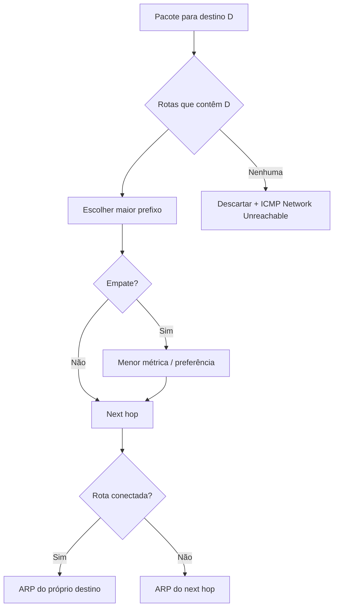
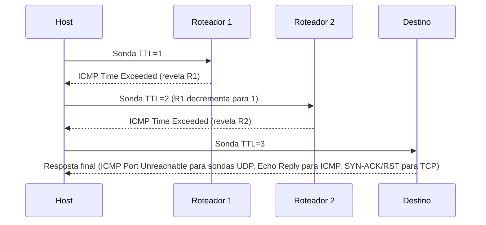

# Roteamento e Gateway

> [!info] Posição na trilha
> **Etapa 3 — Infraestrutura de Rede.** Pré-requisitos: [[04 - CIDR e Subnetting]], [[08 - DHCP e ARP]]. Próxima: [[10 - NAT e PAT]].
> Esta nota também cobre o **ICMP**, protocolo de diagnóstico e de mensagens de erro da camada de rede.

## 1. Definição

**Roteamento** é o processo de escolher o caminho que um pacote IP percorre entre redes diferentes. Cada dispositivo que encaminha pacotes (roteador, host Linux com `ip_forward`, roteador virtual de VPC) toma uma decisão **salto a salto (hop‑by‑hop)**, com base apenas em sua própria **tabela de rotas** e no **IP de destino** do pacote.

O **gateway padrão (default gateway)** é o próximo salto usado quando nenhuma rota mais específica corresponde ao destino. É representado pela rota `0.0.0.0/0` (IPv4) ou `::/0` (IPv6).

## 2. Por que isso importa

- "Consigo pingar a máquina do lado, mas não a Internet" → quase sempre é rota/gateway/NAT.
- VPNs, peering de VPCs, Transit Gateways, rede de Pods no Kubernetes: tudo é **manipulação de tabelas de rotas**.
- Rotas assimétricas (ida por um caminho, volta por outro) quebram firewalls stateful e causam timeouts misteriosos.

## 3. Como funciona

### 3.1 Tabela de rotas

Cada entrada tem, essencialmente:

| Campo | Significado |
|---|---|
| **Destino (prefixo)** | Rede de destino em CIDR |
| **Next hop (via)** | IP do próximo roteador (precisa estar em uma rede diretamente conectada) |
| **Interface (dev)** | Por onde o pacote sai |
| **Métrica** | Preferência entre rotas de mesmo prefixo (menor = preferida) |
| **Origem (proto)** | Como a rota foi criada: `kernel` (rede conectada), `static`, `dhcp`, protocolos dinâmicos |

### 3.2 Algoritmo de escolha: Longest Prefix Match

Para cada pacote, o roteador escolhe a rota **mais específica** (prefixo mais longo) que contém o destino. Em empate, decide pela métrica/distância administrativa.

Exemplo — tabela:

| Destino | Via |
|---|---|
| `0.0.0.0/0` | 192.168.1.1 |
| `10.0.0.0/8` | 192.168.1.254 |
| `10.20.0.0/16` | 192.168.1.253 |
| `192.168.1.0/24` | conectada (eth0) |

| Destino do pacote | Rotas que casam | Escolhida |
|---|---|---|
| `8.8.8.8` | /0 | `0.0.0.0/0` → 192.168.1.1 |
| `10.5.1.1` | /0, /8 | `10.0.0.0/8` → .254 |
| `10.20.3.4` | /0, /8, /16 | `10.20.0.0/16` → .253 |
| `192.168.1.50` | /0, /24 | Entrega direta (ARP para .50) |



### 3.3 Encaminhamento em cada salto

1. Recebe o frame, verifica o MAC de destino (é para mim?).
2. Lê o IP de destino; **decrementa o TTL**. Se chegar a 0 → descarta e envia ICMP *Time Exceeded*.
3. Consulta a tabela de rotas.
4. Reencapsula num novo frame com o MAC do próximo salto e envia.

O IP de origem e de destino **não mudam** (a menos que haja NAT — [[10 - NAT e PAT]]).

### 3.4 Rotas estáticas vs dinâmicas

| Tipo | Como | Quando |
|---|---|---|
| **Conectada** | Criada automaticamente ao configurar IP numa interface | Sempre |
| **Estática** | Configurada manualmente | Redes pequenas, servidores, rotas específicas para VPN |
| **Dinâmica** | Aprendida por protocolos de roteamento | Redes grandes e mutáveis |

Protocolos dinâmicos (conceitual):

- **IGP (dentro de uma organização):** **OSPF** (link‑state; cada roteador conhece a topologia e calcula o menor caminho), IS‑IS, RIP (distance‑vector, legado).
- **EGP (entre organizações/ASes):** **BGP**, o protocolo que interliga a Internet. Cada rede autônoma (AS, identificada por um ASN) anuncia os prefixos que alcança. Em DevOps, BGP aparece em VPNs com clouds, Direct Connect/ExpressRoute/Interconnect, e em CNIs como **Calico** e **Cilium**, que podem anunciar rotas de Pods via BGP.

### 3.5 Roteamento é por salto e precisa de ida **e** volta

Cada roteador decide sozinho. Para que uma comunicação funcione:

- A **ida** precisa de rotas do cliente até o servidor.
- A **volta** precisa de rotas do servidor até o cliente.

Esquecer a rota de retorno é um dos erros mais comuns ao configurar VPNs e peerings.

## 4. ICMP — Internet Control Message Protocol

O **ICMP** (RFC 792; ICMPv6 RFC 4443) é parte integrante da camada IP. Transporta **mensagens de erro e de diagnóstico**. Não tem portas.

| Tipo/Código (IPv4) | Nome | Quando ocorre |
|---|---|---|
| 0 | Echo Reply | Resposta ao `ping` |
| 8 | Echo Request | `ping` |
| 3 / 0 | Destination Unreachable — Net Unreachable | Roteador sem rota para a rede |
| 3 / 1 | Host Unreachable | Roteador da rede final não consegue entregar (ex.: ARP sem resposta) |
| 3 / 3 | Port Unreachable | Datagrama UDP para porta sem ninguém escutando |
| 3 / 4 | Fragmentation Needed and DF set | Pacote maior que a MTU com DF ligado — **essencial para o Path MTU Discovery** |
| 3 / 13 | Communication Administratively Prohibited | Filtrado por política (firewall com REJECT) |
| 11 / 0 | Time Exceeded — TTL exceeded in transit | TTL zerou; usado pelo `traceroute` |
| 5 | Redirect | Roteador sugere um caminho melhor (geralmente desabilitado em hosts por segurança) |

Em IPv6, o ICMPv6 é **ainda mais crítico**: carrega o NDP (substituto do ARP), anúncios de roteador e o *Packet Too Big*. **Bloquear ICMPv6 indiscriminadamente quebra o IPv6.**

### Como o `traceroute` funciona



O `traceroute` do Linux usa, por padrão, sondas **UDP** para portas altas (a partir de 33434); `-I` usa ICMP Echo; `-T` usa TCP SYN (útil quando só a porta 443 passa pelo firewall). No Windows, o `tracert` usa ICMP.

## 5. Exemplos práticos

### Exemplo 1 — Servidor com duas interfaces

```text
eth0: 203.0.113.10/24 (pública), gateway 203.0.113.1
eth1: 10.0.0.10/24 (rede de gerência)
Rede corporativa: 172.16.0.0/12, alcançável via 10.0.0.1
```

Rotas necessárias:

```bash
ip route add default via 203.0.113.1 dev eth0
ip route add 172.16.0.0/12 via 10.0.0.1 dev eth1
```

Sem a segunda rota, respostas para clientes `172.16.x.x` sairiam pela interface pública — roteamento assimétrico, quase certamente bloqueado.

### Exemplo 2 — Tabela de rotas de subnet em cloud

| Destino | Alvo | Significado |
|---|---|---|
| `10.50.0.0/16` | local | Tráfego dentro da VPC (sempre presente) |
| `0.0.0.0/0` | Internet Gateway | Esta é uma **subnet pública** |

| Destino | Alvo | Significado |
|---|---|---|
| `10.50.0.0/16` | local | |
| `0.0.0.0/0` | NAT Gateway | **Subnet privada** com saída para a Internet |
| `10.60.0.0/16` | Peering / Transit Gateway | Alcança outra VPC |

O que torna uma subnet "pública" em cloud é **ter rota para um Internet Gateway** (e as instâncias terem IP público). Ver [[22 - Redes em Cloud e DevOps]].

### Exemplo 3 — Host Linux como roteador

```bash
# Habilitar encaminhamento (temporário, até o reboot)
sudo sysctl -w net.ipv4.ip_forward=1
# Persistente: arquivo em /etc/sysctl.d/, ex.: echo 'net.ipv4.ip_forward=1' | sudo tee /etc/sysctl.d/99-forward.conf
```

Docker e Kubernetes habilitam isso automaticamente, pois os nós roteiam o tráfego dos containers.

## 6. Comandos e demonstrações

```bash
# Tabela de rotas principal
ip route show            # ou: ip r

# Rota que seria usada para um destino (o comando mais útil de todos)
ip route get 8.8.8.8
ip route get 10.20.3.4 from 10.0.0.10

# IPv6
ip -6 route show

# Adicionar/remover rota estática (não persistente)
sudo ip route add 10.99.0.0/16 via 192.168.1.254 dev eth0
sudo ip route del 10.99.0.0/16

# Policy routing: regras e tabelas adicionais (usadas por VPNs, Kubernetes CNIs, multi-homing)
ip rule show
ip route show table all | head -50

# Traceroute
traceroute -n 8.8.8.8          # -n: não resolver nomes (mais rápido)
traceroute -n -T -p 443 exemplo.com   # sondas TCP SYN para a porta 443 (requer root)
tracepath -n 8.8.8.8           # não requer root; mostra também a PMTU
mtr -n -r -c 50 8.8.8.8        # combina ping e traceroute; -r relatório, -c número de ciclos
```

> [!warning] Cuidado ao alterar rotas remotamente
> Remover ou alterar a rota padrão, ou a rota da rede pela qual você está conectado via SSH, **derruba sua sessão**. Em servidores remotos, use console fora de banda, agende um rollback (`sleep 300 && ip route add default via ...` em segundo plano) ou aplique via ferramenta com confirmação (ex.: `netplan try`).

Windows: `route print`, `Get-NetRoute`, `tracert -d 8.8.8.8`, `pathping`.

## 7. Interpretação

### `ip route show`

```text
default via 192.168.1.1 dev wlan0 proto dhcp src 192.168.1.42 metric 600
172.17.0.0/16 dev docker0 proto kernel scope link src 172.17.0.1 linkdown
192.168.1.0/24 dev wlan0 proto kernel scope link src 192.168.1.42 metric 600
```

| Trecho | Significado |
|---|---|
| `default via 192.168.1.1` | Gateway padrão |
| `proto dhcp` | Rota aprendida via DHCP |
| `proto kernel scope link` | Rede diretamente conectada (criada ao atribuir o IP) |
| `src` | IP de origem preferido |
| `metric 600` | Preferência (NetworkManager costuma atribuir métricas maiores a Wi‑Fi do que a cabo) |
| `linkdown` | Interface sem link (aqui: `docker0` sem containers) |

### `traceroute`

```text
traceroute to 8.8.8.8 (8.8.8.8), 30 hops max, 60 byte packets
 1  192.168.1.1  1.123 ms  1.050 ms  0.998 ms
 2  100.64.0.1  8.210 ms  8.100 ms  8.333 ms
 3  * * *
 4  187.x.x.x  12.400 ms  12.120 ms  12.500 ms
 ...
 9  8.8.8.8  15.900 ms  15.700 ms  16.100 ms
```

- Três tempos = três sondas por salto.
- `* * *` → aquele roteador não respondeu (comum: muitos roteadores limitam ou não enviam ICMP Time Exceeded). **Não é necessariamente um problema** se os saltos seguintes respondem.
- Latência que sobe num salto e **permanece alta** nos seguintes → gargalo real a partir dali. Latência alta **só** em um salto intermediário → geralmente o roteador prioriza encaminhar pacotes em vez de responder ICMP (normal).
- `100.64.0.1` no salto 2 → seu provedor usa CGNAT ([[10 - NAT e PAT]]).
- `!H`, `!N`, `!X` → host unreachable, network unreachable, comunicação proibida administrativamente.

### `ping` — mensagens de erro

| Mensagem | Origem | Significado |
|---|---|---|
| `connect: Network is unreachable` | Kernel local | Não há rota (nem default) para o destino |
| `From 192.168.1.42 ... Destination Host Unreachable` | Seu próprio host | ARP para o destino/gateway falhou |
| `From 10.0.0.1 ... Destination Net Unreachable` | Roteador intermediário | Esse roteador não tem rota |
| `From 10.0.0.1 ... Time to live exceeded` | Roteador | Loop de roteamento ou TTL baixo demais |
| Sem resposta, 100% loss | — | Filtro de ICMP, host fora do ar, rota de volta ausente |

## 8. Problemas comuns

| Problema | Sintoma | Causa |
|---|---|---|
| Sem rota padrão | `Network is unreachable` para a Internet | DHCP sem option 3, configuração estática incompleta |
| Gateway fora da sub-rede | Erro ao adicionar rota (`Nexthop has invalid gateway`) | Máscara/gateway inconsistentes |
| Rota de retorno ausente | Timeout; tcpdump no destino mostra pacote chegando e resposta saindo pelo lugar errado | Peering/VPN/rota estática configurados só de um lado |
| Roteamento assimétrico | Conexões TCP falham com firewall stateful no meio | Duas saídas diferentes para ida e volta |
| Loop de roteamento | `Time to live exceeded`; traceroute repetindo IPs | Duas rotas apontando uma para a outra |
| Sobreposição de rotas | Tráfego vai para o lugar errado | CIDRs de VPN, Docker e VPC sobrepostos; ganha o prefixo mais longo |
| `rp_filter` descartando | Pacotes chegam mas são descartados silenciosamente | *Reverse path filtering* estrito com roteamento assimétrico (`net.ipv4.conf.*.rp_filter`) |

## 9. Troubleshooting

1. **Na origem:** `ip route get <destino>` — qual interface, qual gateway?
2. **Gateway alcançável?** `ping <gateway>`, `ip neigh show <gateway>`.
3. **Onde para?** `mtr -n <destino>` ou `traceroute -n -T -p <porta> <destino>`.
4. **Chega ao destino?** No destino: `sudo tcpdump -n host <origem>`.
5. **A resposta sai pelo caminho certo?** No destino: `ip route get <origem>`.
6. **Em cloud:** revise as tabelas de rotas **das duas subnets**, Security Groups, NACLs, e se o alvo (NAT, peering, TGW) está ativo.

## 10. Aplicações em DevOps

- **Docker:** cada bridge cria uma rota conectada no host (`172.17.0.0/16 dev docker0`). Containers usam o IP da bridge como gateway. Ver [[20 - Redes em Docker]].
- **Kubernetes:** cada nó precisa de rotas para as faixas de Pods dos outros nós — via overlay (VXLAN/Geneve), rotas nativas da VPC, ou BGP. Ver [[21 - Redes em Kubernetes]].
- **Cloud:** tabelas de rotas por subnet; o roteador da VPC é implícito (primeiro IP utilizável da subnet). Ver [[22 - Redes em Cloud e DevOps]].
- **VPN site‑to‑site:** exige rotas para as redes remotas em ambos os lados (estáticas ou via BGP).

## 11. Considerações de segurança

- Rotas definem **o que é alcançável**, mas não substituem firewall: uma rota existente pode ser usada por qualquer tráfego.
- Desabilite `ip_forward` em hosts que não devem rotear (exceto nós de containers).
- Desabilite aceitação de ICMP Redirect em servidores (`net.ipv4.conf.all.accept_redirects=0`) para evitar redirecionamento malicioso de rotas.
- **BGP hijacking** (anúncios indevidos de prefixos) afeta a Internet inteira; mitigado com RPKI pelos provedores.
- Filtre ICMP **seletivamente**: permita Echo (se desejado), Destination Unreachable/Fragmentation Needed e Time Exceeded; em IPv6, siga as recomendações da RFC 4890.

## 12. Resumo

- Roteamento é salto a salto, baseado no IP de destino e no **prefixo mais longo**.
- O gateway padrão é a rota `0.0.0.0/0` e deve estar na mesma sub-rede do host.
- Toda comunicação precisa de rota de ida **e** de volta.
- ICMP reporta erros (unreachable, time exceeded, fragmentation needed) e é base de `ping` e `traceroute`.
- `ip route get` responde "por onde esse pacote sairia?".

## 13. Verificação de conhecimento

1. Com as rotas `10.0.0.0/8 via A`, `10.1.0.0/16 via B` e `default via C`, para onde vai um pacote a `10.1.200.3`? E a `10.2.0.1`?
2. O que diferencia uma subnet pública de uma privada em cloud?
3. Você configurou peering entre duas VPCs e adicionou a rota apenas na VPC A. O que acontece com um `curl` de A para B?
4. Por que `* * *` em um salto do traceroute não indica, necessariamente, um problema?
5. Por que bloquear todo ICMP pode quebrar conexões HTTPS?

> [!success]- Respostas
> 1. `10.1.200.3` → B (/16 é mais específico). `10.2.0.1` → A (/8).
> 2. A subnet pública tem rota `0.0.0.0/0` para um Internet Gateway; a privada não (usa NAT ou não tem saída).
> 3. O SYN chega a B, mas o SYN‑ACK não tem rota de volta para A → timeout.
> 4. O roteador pode simplesmente não responder ICMP Time Exceeded (rate limiting/política), enquanto encaminha o tráfego normalmente.
> 5. Porque o Path MTU Discovery depende do ICMP "Fragmentation Needed"/"Packet Too Big"; sem ele, pacotes grandes (como os do handshake TLS com certificados) são descartados silenciosamente quando há um enlace com MTU menor.

## 14. Tópicos relacionados

- Anterior: [[08 - DHCP e ARP]]
- Próxima: [[10 - NAT e PAT]]
- [[04 - CIDR e Subnetting]]
- [[19 - Ferramentas de Diagnóstico]]
- [[22 - Redes em Cloud e DevOps]]
- [[Mapa de Estudos de Redes]]
