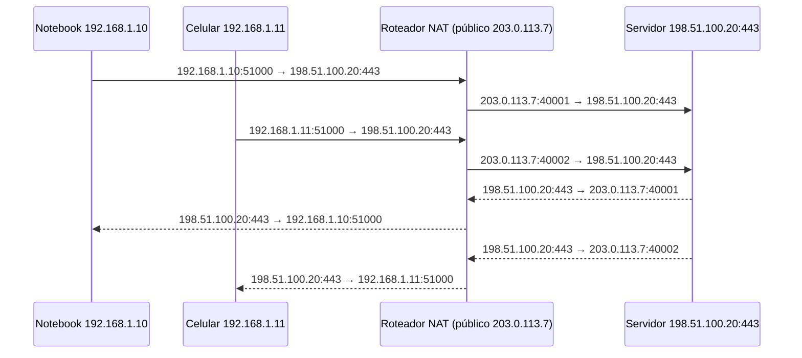

# NAT e PAT

> [!info] Posição na trilha
> **Etapa 3 — Infraestrutura de Rede.** Pré-requisitos: [[06 - Portas e Sockets]], [[09 - Roteamento e Gateway]]. Próxima: [[11 - HTTP e HTTPS]].

## 1. Definição

**NAT (Network Address Translation)** é a técnica de **reescrever endereços IP** (e, frequentemente, portas) nos cabeçalhos dos pacotes enquanto eles atravessam um dispositivo, mantendo uma **tabela de tradução** para reescrever as respostas de volta.

**PAT (Port Address Translation)**, também chamado **NAPT** ou **NAT overload** (e, no Linux, `MASQUERADE` é uma forma de SNAT/PAT), traduz **muitos IPs privados para um único IP público**, diferenciando as conexões pela **porta de origem**.

## 2. Por que isso importa

- O IPv4 tem endereços insuficientes; NAT permite que bilhões de dispositivos com IP privado acessem a Internet.
- Toda casa, quase toda empresa e praticamente toda subnet privada em cloud usam NAT para sair à Internet.
- **Docker publica portas usando DNAT** e permite que containers acessem a Internet usando **SNAT/MASQUERADE**.
- **Kubernetes Services** são implementados (no kube-proxy em modos iptables/IPVS e em muitos CNIs) via **DNAT**.
- NAT altera o IP de origem que o servidor enxerga — afeta logs, rate limiting e listas de permissão.

## 3. Como funciona

### 3.1 Tipos

| Tipo | O que traduz | Direção típica | Exemplo |
|---|---|---|---|
| **SNAT (Source NAT)** | IP (e porta) de **origem** | Saída: rede privada → Internet | Roteador doméstico, NAT Gateway em cloud |
| **Masquerade** | SNAT usando dinamicamente o IP da interface de saída | Saída com IP dinâmico | Docker, roteadores com IP via DHCP |
| **DNAT (Destination NAT)** | IP (e porta) de **destino** | Entrada: Internet → servidor interno | *Port forwarding*, `docker -p`, Services K8s |
| **NAT estático 1:1** | Um IP privado ↔ um IP público fixo | Ambas | IP público associado a uma VM (em várias clouds, o IP público é implementado como NAT 1:1 — a VM só vê o IP privado) |
| **PAT / NAPT** | Muitos IPs privados → um IP público, por porta | Saída | Praticamente todo NAT doméstico |

### 3.2 Fluxo de SNAT/PAT



Tabela de tradução do roteador:

| Interno (origem) | Externo (traduzido) | Destino | Protocolo |
|---|---|---|---|
| 192.168.1.10:51000 | 203.0.113.7:40001 | 198.51.100.20:443 | TCP |
| 192.168.1.11:51000 | 203.0.113.7:40002 | 198.51.100.20:443 | TCP |

Note que os dois clientes usaram a mesma porta de origem (51000); o NAT **escolheu portas externas diferentes** para distinguir as conexões.

### 3.3 Fluxo de DNAT (port forwarding)

```text
Internet: 198.51.100.99:60000 → 203.0.113.7:8080
DNAT:     198.51.100.99:60000 → 192.168.1.50:80   (servidor interno)
Resposta: 192.168.1.50:80 → 198.51.100.99:60000
Un-DNAT:  203.0.113.7:8080 → 198.51.100.99:60000
```

A resposta precisa **voltar pelo mesmo dispositivo NAT** para ser "desfeita". Se o servidor interno tiver outro gateway, a resposta sai com IP de origem `192.168.1.50` e o cliente a descarta.

### 3.4 Connection tracking (conntrack)

No Linux, o NAT depende do **netfilter conntrack**, que registra cada fluxo (TCP, UDP, ICMP). A tradução é decidida no **primeiro pacote** do fluxo; os pacotes seguintes seguem a entrada da tabela.

- A tabela tem tamanho máximo (`net.netfilter.nf_conntrack_max`). Quando enche, o kernel loga `nf_conntrack: table full, dropping packet`, e novas conexões falham.
- Entradas expiram após timeouts por protocolo/estado (UDP tem timeouts curtos; TCP estabelecido, longos).

### 3.5 Limites do PAT

- Um IP público tem ~64 mil portas por protocolo. O NAT pode reutilizar a mesma porta externa para **destinos diferentes**, mas para um **mesmo destino** (IP:porta) cada conexão simultânea consome uma porta externa. Muitos clientes falando com o mesmo destino podem esgotar portas → erros de conexão. Em cloud isso aparece como métricas de "port allocation errors" em NAT Gateways; a solução é adicionar IPs ao NAT, reutilizar conexões ou usar endpoints privados.
- Timeouts de inatividade: o NAT remove entradas ociosas. Conexões TCP longas e silenciosas (bancos de dados, websockets) podem ser "esquecidas" e quebrar. Use keep‑alives com intervalo menor que o timeout do NAT.

## 4. Conceitos centrais

| Conceito | Descrição |
|---|---|
| **Inside local / inside global** | Terminologia (estilo Cisco): IP privado do host interno / IP público que o representa |
| **Hairpin NAT (NAT loopback / reflection)** | Cliente interno acessando um serviço interno **pelo IP público**. Exige suporte especial; caso contrário, falha. Solução comum: split DNS |
| **CGNAT** | NAT do próprio provedor de Internet (faixa `100.64.0.0/10`). Seu roteador faz NAT, e o provedor faz outro: "NAT duplo". Impede receber conexões de entrada |
| **NAT traversal** | Técnicas para P2P atravessar NAT (STUN, TURN, ICE, usadas em WebRTC; UDP hole punching) |
| **NAT64 / DNS64** | Permite que clientes só‑IPv6 acessem servidores só‑IPv4 |

### NAT não é firewall

> [!warning] Equívoco comum
> NAT "esconde" hosts internos e bloqueia conexões de entrada não solicitadas **como efeito colateral**, mas **não é um mecanismo de segurança**. Ele não inspeciona tráfego, não controla saída, e qualquer regra de port forwarding expõe o serviço completamente. Use um firewall de verdade ([[14 - Firewall e Filtragem de Pacotes]]). Em IPv6, onde NAT normalmente não é usado, o firewall stateful cumpre explicitamente esse papel.

## 5. Exemplos práticos

### Exemplo 1 — O que o servidor vê

Um serviço atrás de um load balancer e de um NAT pode ver como IP de origem:

- O IP público do NAT do cliente (vários usuários de uma empresa aparecem como um único IP).
- O IP do load balancer (se ele fizer proxy/SNAT).

Para recuperar o IP real do cliente, use cabeçalhos como `X-Forwarded-For` / `Forwarded` (HTTP) ou o **PROXY protocol** (TCP). Ver [[15 - Proxy e Reverse Proxy]].

### Exemplo 2 — Liberação por IP em parceiro externo

Um parceiro pede "o IP de onde suas requisições vão sair" para colocá-lo numa allowlist. Se seus serviços estão em subnets privadas com NAT Gateway, a resposta é o **IP público (Elastic IP/IP estático) do NAT Gateway**. Se estiverem em Kubernetes com NAT em cada nó, a origem varia por nó — centralize a saída num NAT/egress gateway.

### Exemplo 3 — Docker publicando porta

`docker run -p 8080:80 nginx` cria regras que fazem **DNAT** de `host:8080` → `IP_do_container:80`, e uma regra de **MASQUERADE** para tráfego saindo dos containers para fora da bridge.

## 6. Comandos e demonstrações

```bash
# Regras NAT em iptables (backend legacy ou nft, conforme a distribuição)
sudo iptables -t nat -L -n -v --line-numbers
#   -t nat: tabela NAT | -L: listar | -n: numérico | -v: contadores de pacotes/bytes

# Visão direta do nftables (sistemas modernos)
sudo nft list ruleset

# Exemplo: SNAT/MASQUERADE para uma rede privada saindo por eth0
# (requer net.ipv4.ip_forward=1; apenas em laboratório)
sudo iptables -t nat -A POSTROUTING -s 10.10.0.0/24 -o eth0 -j MASQUERADE

# Exemplo: DNAT (port forwarding) da porta 8080 do host para 10.10.0.5:80
sudo iptables -t nat -A PREROUTING -i eth0 -p tcp --dport 8080 -j DNAT --to-destination 10.10.0.5:80

# Ver tabela de conexões rastreadas (pacote conntrack)
sudo conntrack -L | head
sudo conntrack -L -p tcp --dport 443 | head
sudo conntrack -S          # estatísticas (inclui drops e insert_failed)
cat /proc/sys/net/netfilter/nf_conntrack_count /proc/sys/net/netfilter/nf_conntrack_max

# Descobrir o IP público pelo qual você sai
curl -s https://ifconfig.me ; echo
```

> [!warning] Regras de NAT e firewall em produção
> Alterar regras de `iptables`/`nftables` em um host com Docker, Kubernetes ou firewall gerenciado (ufw, firewalld) pode conflitar com regras criadas automaticamente e interromper o tráfego. Pratique em VMs ou containers de laboratório. Regras adicionadas com `iptables` **não são persistentes** sem ferramentas como `iptables-persistent` ou `netfilter-persistent`.

## 7. Interpretação

### `iptables -t nat -L -n -v` em um host com Docker (trecho ilustrativo)

```text
Chain PREROUTING (policy ACCEPT)
 pkts bytes target     prot opt in     out     source       destination
  120  7200 DOCKER     all  --  *      *       0.0.0.0/0    0.0.0.0/0    ADDRTYPE match dst-type LOCAL

Chain POSTROUTING (policy ACCEPT)
 pkts bytes target     prot opt in     out       source         destination
   45  2700 MASQUERADE all  --  *      !docker0  172.17.0.0/16  0.0.0.0/0

Chain DOCKER (2 references)
 pkts bytes target     prot opt in        out   source      destination
   10   600 DNAT       tcp  --  !docker0  *     0.0.0.0/0   0.0.0.0/0    tcp dpt:8080 to:172.17.0.2:80
```

- `MASQUERADE ... 172.17.0.0/16 ... !docker0` → tráfego dos containers que sai por qualquer interface que não seja a bridge é mascarado com o IP do host.
- `DNAT ... dpt:8080 to:172.17.0.2:80` → porta publicada.
- `pkts`/`bytes` → contadores: se uma regra esperada fica em zero, o tráfego não está chegando até ela.

Os nomes das chains e o formato variam com a versão do Docker e com o backend de firewall usado.

### `conntrack -L`

```text
tcp 6 431999 ESTABLISHED src=172.17.0.2 dst=93.184.215.14 sport=40122 dport=443 src=93.184.215.14 dst=192.168.1.42 sport=443 dport=40122 [ASSURED] mark=0 use=1
```

- Primeira tupla: pacote **original** (container → servidor).
- Segunda tupla: **resposta esperada** — note `dst=192.168.1.42` (o IP do host): esta é a tradução SNAT.
- `431999` → segundos até expirar.
- `[ASSURED]` → tráfego visto nas duas direções.

## 8. Problemas comuns

| Sintoma | Causa provável |
|---|---|
| Subnet privada em cloud sem Internet | Falta rota `0.0.0.0/0` para o NAT Gateway; NAT em subnet sem rota para o Internet Gateway |
| Conexões intermitentes a um mesmo destino sob carga | Esgotamento de portas no NAT |
| `nf_conntrack: table full` no `dmesg` | Tabela conntrack cheia (muitas conexões, timeouts longos) |
| Conexões longas quebram após minutos ociosos | Timeout de inatividade do NAT |
| Port forwarding não funciona | Resposta não volta pelo NAT (gateway errado no servidor interno); serviço ouvindo em loopback; firewall bloqueando o encaminhamento |
| Acesso pelo IP público funciona de fora, mas não de dentro da LAN | Ausência de hairpin NAT |
| Não é possível hospedar serviço em casa | CGNAT do provedor |
| Allowlist de parceiro rejeita requisições | IP de saída não é o esperado (outro NAT, outro nó) |

## 9. Troubleshooting

1. **Qual é o IP de origem visto do lado de fora?** `curl ifconfig.me` a partir do host/container.
2. **Há regra de NAT?** `iptables -t nat -L -n -v` / `nft list ruleset`; contadores sobem?
3. **O fluxo aparece no conntrack?** `conntrack -L | grep <ip>`.
4. **O pacote traduzido sai?** `tcpdump -n -i <interface_de_saída> host <destino>`.
5. **A resposta volta?** `tcpdump` na interface interna e externa, comparando.
6. **Em cloud:** rota da subnet privada → NAT Gateway; NAT Gateway em subnet pública; IP público associado; métricas de erro de porta.

## 10. Aplicações em DevOps

- **Docker:** `-p` = DNAT; saída dos containers = MASQUERADE. Ver [[20 - Redes em Docker]].
- **Kubernetes:** ClusterIP e NodePort usam DNAT (em kube-proxy iptables/IPVS; ou programas eBPF em CNIs como Cilium). O tráfego de Pods para fora do cluster normalmente sofre SNAT para o IP do nó. `externalTrafficPolicy: Local` preserva o IP de origem do cliente, evitando um SNAT extra. Ver [[21 - Redes em Kubernetes]].
- **Cloud:** NAT Gateway gerenciado para subnets privadas; IPs públicos de instâncias via NAT 1:1. Ver [[22 - Redes em Cloud e DevOps]].
- **Observabilidade:** monitore uso de conntrack em nós, e métricas de erros/portas em NAT Gateways.

## 11. Considerações de segurança

- NAT não substitui firewall nem controle de egress.
- Cada port forwarding é uma **exposição completa** do serviço interno; restrinja por origem.
- NAT dificulta rastrear qual host interno originou um acesso; mantenha **logs de tradução** quando houver requisitos de auditoria.
- Centralizar a saída num NAT/egress gateway com IP fixo facilita allowlists e controle de egress.

## 12. Resumo

- SNAT muda a origem (saída para a Internet); DNAT muda o destino (port forwarding, Services).
- PAT multiplexa muitas conexões num IP público usando portas.
- O NAT depende de estado (conntrack); respostas devem voltar pelo mesmo dispositivo.
- Limites: portas por destino, tamanho da tabela, timeouts de inatividade.
- NAT não é firewall.

## 13. Verificação de conhecimento

1. Qual tipo de NAT o `docker run -p 8080:80` usa? E o tráfego do container para a Internet?
2. Por que dois notebooks na mesma rede podem usar a mesma porta de origem sem conflito através do NAT?
3. Uma subnet privada tem rota padrão para um NAT Gateway, mas o NAT Gateway está em outra subnet privada sem rota para o Internet Gateway. O que acontece?
4. Seu provedor doméstico entrega `100.64.12.34` ao seu roteador. Você consegue hospedar um servidor acessível da Internet? Por quê?
5. Por que conexões de banco de dados ociosas podem cair após alguns minutos ao atravessar um NAT?

> [!success]- Respostas
> 1. DNAT para a porta publicada; MASQUERADE (SNAT) para a saída.
> 2. Porque o NAT reescreve a porta de origem para valores externos distintos e mantém a tabela de tradução.
> 3. O tráfego chega ao NAT, mas o NAT não tem caminho para a Internet; as conexões expiram (timeout).
> 4. Não diretamente: é CGNAT (RFC 6598); o IP público pertence ao provedor e é compartilhado, e você não controla o port forwarding. Alternativas: IP público contratado, IPv6, túneis/serviços de exposição.
> 5. O NAT remove entradas ociosas após seu timeout; o próximo pacote não corresponde a nenhuma tradução e é descartado ou recebe RST.

## 14. Tópicos relacionados

- Anterior: [[09 - Roteamento e Gateway]]
- Próxima: [[11 - HTTP e HTTPS]]
- [[14 - Firewall e Filtragem de Pacotes]]
- [[20 - Redes em Docker]]
- [[22 - Redes em Cloud e DevOps]]
- [[Mapa de Estudos de Redes]]
