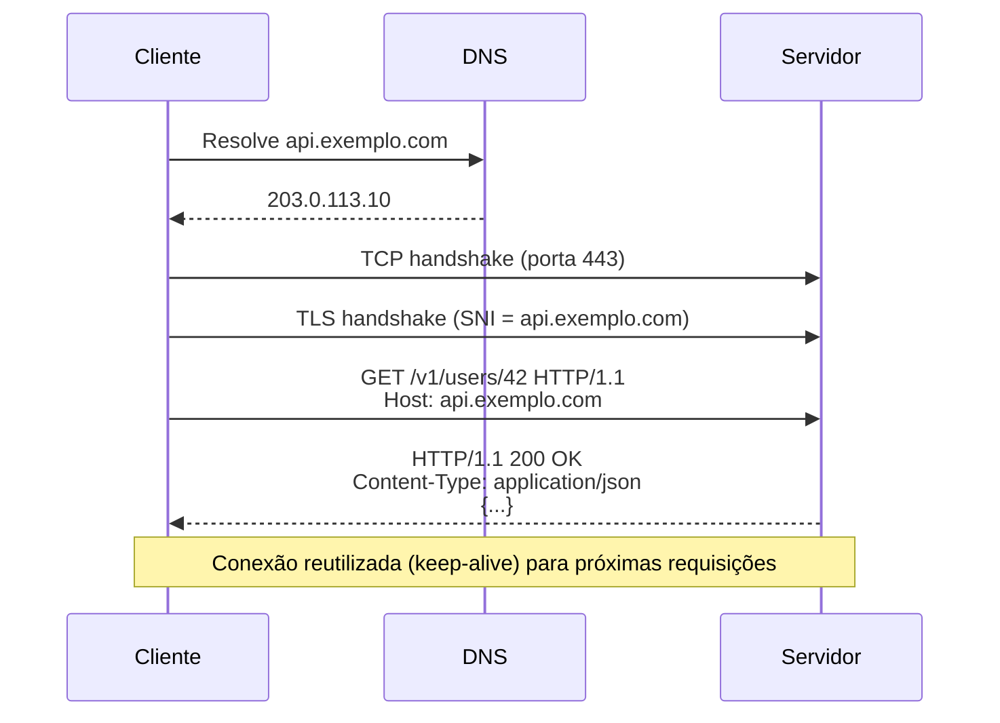
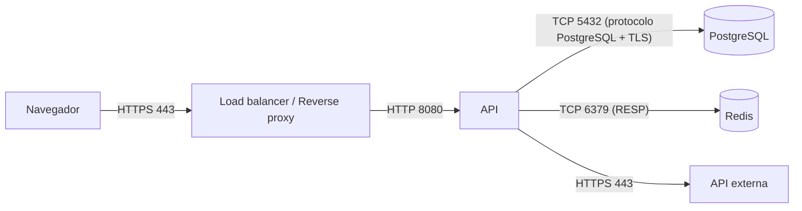

# HTTP e HTTPS

> [!info] Posição na trilha
> **Etapa 2 — Protocolos de Comunicação.** Pré-requisitos: [[05 - TCP e UDP]], [[06 - Portas e Sockets]], [[07 - DNS]]. Próxima: [[12 - TLS e Certificados]].

## 1. Definição

O **HTTP (Hypertext Transfer Protocol)** é um protocolo de aplicação **cliente‑servidor**, de **requisição e resposta**, e **sem estado (stateless)**: cada requisição é independente e carrega tudo o que o servidor precisa para processá-la. A semântica do HTTP (métodos, status, cabeçalhos) está na **RFC 9110**; as versões de transporte em RFCs separadas:

| Versão | RFC | Transporte | Características |
|---|---|---|---|
| HTTP/1.1 | 9112 | TCP | Texto; uma requisição por vez por conexão; keep‑alive |
| HTTP/2 | 9113 | TCP (na prática, com TLS) | Binário; **multiplexação** de várias requisições numa conexão; compressão de cabeçalhos (HPACK) |
| HTTP/3 | 9114 | **QUIC sobre UDP** | Elimina o *head‑of‑line blocking* do TCP; handshake de transporte e TLS 1.3 integrados |

**HTTPS** é HTTP transportado sobre **TLS**, que fornece confidencialidade, integridade e autenticação do servidor. Porta padrão: **443** (HTTP: **80**).

## 2. Por que isso importa

- APIs REST, webhooks, health checks, métricas Prometheus, registries de container, APIs de cloud e a API do Kubernetes falam HTTP(S).
- Load balancers L7, reverse proxies, Ingress e API gateways operam sobre HTTP.
- Interpretar status codes e cabeçalhos é indispensável para diagnosticar incidentes ("é 502 ou 504?").

## 3. Como funciona

### 3.1 Ciclo requisição/resposta



### 3.2 Anatomia de uma mensagem (HTTP/1.1)

**Requisição:**

```http
POST /v1/orders HTTP/1.1
Host: api.exemplo.com
User-Agent: curl/8.5.0
Accept: application/json
Content-Type: application/json
Authorization: Bearer eyJhbGciOi...
Content-Length: 38

{"product_id": 7, "quantity": 2}
```

- **Linha de requisição:** método, *request target* (caminho + query string), versão.
- **Cabeçalhos:** pares `Nome: valor`, insensíveis a maiúsculas no nome.
- **Linha em branco** (`\r\n`) separa cabeçalhos do corpo.
- **Corpo** opcional.

**Resposta:**

```http
HTTP/1.1 201 Created
Content-Type: application/json
Location: /v1/orders/981
Content-Length: 27

{"id": 981, "status": "ok"}
```

Em HTTP/2 e HTTP/3 a semântica é a mesma, mas o formato é binário, e campos como método, caminho e host viram **pseudo‑cabeçalhos** (`:method`, `:path`, `:authority`).

## 4. Conceitos centrais

### 4.1 Métodos

| Método | Uso | Seguro* | Idempotente** | Corpo na requisição |
|---|---|---|---|---|
| `GET` | Obter recurso | Sim | Sim | Não usual |
| `HEAD` | Igual ao GET, sem corpo na resposta | Sim | Sim | Não |
| `POST` | Criar/processar | Não | **Não** | Sim |
| `PUT` | Substituir recurso inteiro | Não | Sim | Sim |
| `PATCH` | Modificação parcial | Não | Não necessariamente | Sim |
| `DELETE` | Remover | Não | Sim | Raro |
| `OPTIONS` | Capacidades/opções (usado no *preflight* de CORS) | Sim | Sim | Não usual |

\* **Seguro:** não altera estado no servidor (por contrato).
\** **Idempotente:** repetir a requisição tem o mesmo efeito que fazê-la uma vez. Isso importa para **retries automáticos**: proxies e clientes podem reenviar requisições idempotentes com segurança, mas reenviar um `POST` pode, por exemplo, criar dois pedidos. Padrões como chaves de idempotência (*Idempotency-Key*) resolvem isso em APIs.

### 4.2 Códigos de status

| Classe | Significado | Exemplos importantes |
|---|---|---|
| **1xx** | Informativo | `101 Switching Protocols` (upgrade para WebSocket) |
| **2xx** | Sucesso | `200 OK`, `201 Created`, `202 Accepted`, `204 No Content` |
| **3xx** | Redirecionamento | `301 Moved Permanently`, `302 Found`, `304 Not Modified`, `307`/`308` (redirect preservando método) |
| **4xx** | Erro do **cliente** | `400 Bad Request`, `401 Unauthorized` (não autenticado), `403 Forbidden` (autenticado, sem permissão), `404 Not Found`, `405 Method Not Allowed`, `408 Request Timeout`, `409 Conflict`, `413 Content Too Large`, `429 Too Many Requests` |
| **5xx** | Erro do **servidor** | `500 Internal Server Error`, `502 Bad Gateway`, `503 Service Unavailable`, `504 Gateway Timeout` |

> [!important] 502 vs 503 vs 504 em infraestrutura com proxy
> Quando há um proxy/load balancer na frente da aplicação, esses códigos geralmente são **gerados pelo proxy**, não pela aplicação:
>
> | Código | Interpretação típica | Onde investigar |
> |---|---|---|
> | **502 Bad Gateway** | O proxy recebeu resposta **inválida** do backend, ou a conexão com o backend falhou/foi resetada | Backend caiu, porta errada, protocolo errado (HTTP vs HTTPS no upstream), backend fechou a conexão keep‑alive |
> | **503 Service Unavailable** | Nenhum backend saudável disponível, ou serviço em manutenção/sobrecarga | Health checks falhando, zero réplicas, Service sem endpoints, rate limit |
> | **504 Gateway Timeout** | O backend não respondeu **dentro do timeout** do proxy | Aplicação lenta, banco travado, timeout do proxy curto demais, firewall descartando entre proxy e backend |
>
> A semântica exata varia por implementação (nginx, Envoy, HAProxy, LBs de cloud). Consulte os logs do proxy: eles indicam o motivo.

### 4.3 Cabeçalhos comuns

| Cabeçalho | Direção | Função |
|---|---|---|
| `Host` | Req | Nome do site — permite **virtual hosting** (vários sites em um IP). Obrigatório em HTTP/1.1 |
| `User-Agent` | Req | Identifica o cliente |
| `Accept`, `Content-Type` | Req/Resp | Formatos aceitos / formato do corpo |
| `Content-Length` / `Transfer-Encoding: chunked` | Ambos | Tamanho do corpo / corpo em blocos |
| `Authorization` | Req | Credenciais (`Basic`, `Bearer`) |
| `Cookie` / `Set-Cookie` | Req / Resp | Estado de sessão sobre um protocolo stateless |
| `Cache-Control`, `ETag`, `If-None-Match`, `Last-Modified` | Ambos | Cache e requisições condicionais |
| `Location` | Resp | Destino de redirect ou recurso criado |
| `Connection`, `Keep-Alive` | Ambos | Gerenciamento de conexão (HTTP/1.1) |
| `X-Forwarded-For`, `X-Forwarded-Proto`, `X-Forwarded-Host`, `Forwarded` (RFC 7239) | Req | Inseridos por proxies para informar IP, protocolo e host originais do cliente |
| `Strict-Transport-Security` (HSTS) | Resp | Obriga o navegador a usar HTTPS |
| `Access-Control-Allow-Origin` e afins | Resp | CORS |
| `Retry-After` | Resp | Quando tentar de novo (com 429/503) |
| `Upgrade` | Req | Troca de protocolo (WebSocket, h2c) |

### 4.4 Conexões e desempenho

- **HTTP/1.1 keep‑alive** reutiliza a conexão TCP para várias requisições, mas **uma de cada vez**. Navegadores abrem várias conexões paralelas por origem.
- **HTTP/2** multiplexa streams numa conexão; uma perda TCP, porém, atrasa todos os streams (head‑of‑line blocking no TCP).
- **HTTP/3** resolve isso com streams independentes sobre QUIC/UDP. Requer que UDP 443 esteja liberado; caso contrário, clientes recuam para HTTP/2.
- **ALPN** (extensão do TLS) negocia qual versão HTTP será usada (`h2`, `http/1.1`) durante o handshake.

### 4.5 REST, gRPC e WebSocket (contexto)

- **REST:** estilo arquitetural que usa métodos e status HTTP sobre recursos identificados por URLs.
- **gRPC:** RPC sobre **HTTP/2** com Protobuf. Requer proxies/LBs que suportem HTTP/2 de ponta a ponta.
- **WebSocket:** começa como HTTP (`Upgrade: websocket`, resposta `101`) e vira um canal bidirecional persistente. Proxies precisam permitir o upgrade e ter timeouts longos.

## 5. Exemplos práticos

### Exemplo 1 — Virtual hosts

Dois sites no mesmo IP: o servidor decide qual responder pelo cabeçalho `Host` (e, em HTTPS, pelo **SNI** do TLS). Isso explica por que `curl http://203.0.113.10/` pode retornar um site padrão diferente de `curl http://site.exemplo.com/`.

Testar um site antes de mudar o DNS:

```bash
curl -v --resolve site.exemplo.com:443:203.0.113.10 https://site.exemplo.com/
```

`--resolve` força o IP para aquele nome e porta, mantendo `Host` e SNI corretos.

### Exemplo 2 — Como os bancos de dados se encaixam

Nem tudo é HTTP: uma aplicação web típica recebe **HTTP** do cliente e fala com o banco usando o **protocolo nativo** do banco (PostgreSQL na porta 5432, MySQL na 3306, Redis na 6379), diretamente sobre **TCP** e, idealmente, com TLS. Proxies HTTP (nginx, Ingress) não entendem esses protocolos; para balanceá-los usa-se um proxy L4 ou um proxy específico (PgBouncer, ProxySQL).



## 6. Comandos e demonstrações

```bash
# Requisição com detalhes de conexão, TLS e cabeçalhos
curl -v https://exemplo.com/

# Apenas cabeçalhos da resposta (HEAD)
curl -I https://exemplo.com/

# Seguir redirects
curl -L http://exemplo.com/

# POST com JSON
curl -X POST https://api.exemplo.com/v1/orders \
  -H 'Content-Type: application/json' \
  -d '{"product_id": 7, "quantity": 2}'

# Mostrar só o status code
curl -s -o /dev/null -w '%{http_code}\n' https://exemplo.com/health

# Medir fases da requisição (DNS, TCP, TLS, primeiro byte, total)
curl -s -o /dev/null -w 'dns=%{time_namelookup} tcp=%{time_connect} tls=%{time_appconnect} ttfb=%{time_starttransfer} total=%{time_total}\n' https://exemplo.com/

# Forçar versão HTTP
curl --http1.1 -I https://exemplo.com/
curl --http2 -I https://exemplo.com/
curl --http3 -I https://exemplo.com/   # requer curl compilado com suporte a HTTP/3

# Enviar cabeçalho Host diferente (teste de virtual host em HTTP puro)
curl -H 'Host: site.exemplo.com' http://203.0.113.10/

# Falar HTTP "na mão" para entender o protocolo (sem TLS)
printf 'GET / HTTP/1.1\r\nHost: exemplo.com\r\nConnection: close\r\n\r\n' | nc exemplo.com 80
```

## 7. Interpretação da saída do `curl -v`

```text
* Host exemplo.com:443 was resolved.
* IPv4: 93.184.215.14
*   Trying 93.184.215.14:443...
* Connected to exemplo.com (93.184.215.14) port 443
* ALPN: curl offers h2,http/1.1
* TLSv1.3 (OUT), TLS handshake, Client hello (1):
...
* SSL connection using TLSv1.3 / TLS_AES_256_GCM_SHA384
* ALPN: server accepted h2
* Server certificate:
*  subject: CN=exemplo.com
*  expire date: ...
*  subjectAltName: host "exemplo.com" matched cert's "exemplo.com"
*  SSL certificate verify ok.
> GET / HTTP/2
> Host: exemplo.com
> User-Agent: curl/8.x
> Accept: */*
>
< HTTP/2 200
< content-type: text/html; charset=UTF-8
< cache-control: max-age=604800
<
```

| Prefixo | Significado |
|---|---|
| `*` | Informações do curl (DNS, conexão, TLS) |
| `>` | Enviado pelo cliente |
| `<` | Recebido do servidor |

Leitura em camadas: DNS resolveu → TCP conectou → TLS 1.3 negociado → ALPN escolheu HTTP/2 → certificado válido para o nome → resposta 200. O texto exato varia entre versões do curl e bibliotecas TLS.

Saída de `-w` com tempos (segundos, **acumulados** desde o início):

```text
dns=0.004 tcp=0.020 tls=0.061 ttfb=0.180 total=0.182
```

- TCP − DNS ≈ 16 ms → RTT da rede.
- TLS − TCP ≈ 41 ms → handshake TLS.
- TTFB − TLS ≈ 119 ms → **tempo de processamento do servidor** (+ 1 RTT). Se esse número é o grande, o problema está na aplicação, não na rede.

## 8. Problemas comuns

| Sintoma | Causa provável |
|---|---|
| `curl: (6) Could not resolve host` | DNS — [[07 - DNS]] |
| `curl: (7) Failed to connect ... Connection refused` | Nada escutando / porta errada — [[06 - Portas e Sockets]] |
| `curl: (28) Connection timed out` / `Operation timed out` | Firewall, rota, ou servidor lento demais |
| `curl: (60) SSL certificate problem` | Certificado não confiável, cadeia incompleta, nome errado — [[12 - TLS e Certificados]] |
| `curl: (35)` erro de handshake TLS | Versão/cifra incompatível, SNI ausente, falando TLS com porta HTTP |
| `curl: (52) Empty reply from server` | Servidor fechou a conexão sem responder (ex.: HTTP numa porta TLS) |
| `400 Bad Request` "The plain HTTP request was sent to HTTPS port" | Mensagem do nginx: HTTP sem TLS enviado a uma porta HTTPS |
| Loop infinito de redirect | Proxy termina TLS e envia HTTP ao backend; a aplicação redireciona para HTTPS sem considerar `X-Forwarded-Proto` |
| 413 | Corpo maior que o limite do proxy (ex.: `client_max_body_size` no nginx) |
| 502 intermitente | Keep‑alive: o backend fecha conexões ociosas antes do proxy. Ajuste o idle timeout do backend para ser **maior** que o do proxy |

## 9. Troubleshooting

1. **Reproduza com `curl -v`** a partir do mesmo lugar que o cliente (ou o mais perto possível).
2. **Siga as fases:** DNS → TCP → TLS → HTTP (veja os prefixos `*`).
3. **Descubra quem respondeu:** cabeçalhos `Server`, `Via`, ou cabeçalhos específicos de proxy/CDN revelam se a resposta veio do proxy ou da aplicação.
4. **Pule camadas:** chame o backend diretamente (IP:porta interna) para separar problema do proxy de problema da aplicação.
5. **Correlacione logs** com um ID de requisição (`X-Request-ID`, trace ID).
6. **Meça tempos** com `-w` para separar rede de processamento.

## 10. Aplicações em DevOps

- **Health checks:** endpoints como `/healthz` (liveness) e `/readyz` (readiness) devem ser rápidos, sem dependências pesadas na liveness.
- **Reverse proxies / Ingress / API gateways:** terminação TLS, roteamento por `Host` e caminho, rate limiting. Ver [[15 - Proxy e Reverse Proxy]].
- **Observabilidade:** métricas RED (Rate, Errors, Duration) por rota e status; logs de acesso com tempos de upstream.
- **CI/CD:** smoke tests com `curl --fail` (retorna erro em status ≥ 400) após deploy:

```bash
curl --fail --silent --show-error --retry 5 --retry-delay 3 https://app.exemplo.com/healthz
```

## 11. Considerações de segurança

- **Nunca** envie credenciais por HTTP sem TLS: tudo, inclusive cabeçalhos `Authorization` e cookies, trafega em texto claro.
- Use **HSTS** para impedir downgrade para HTTP.
- Cookies de sessão: `Secure`, `HttpOnly`, `SameSite`.
- Cabeçalhos `X-Forwarded-*` podem ser **forjados pelo cliente**; só confie neles quando vierem de proxies confiáveis (configure a lista de proxies confiáveis na aplicação).
- Não exponha informações sensíveis em URLs (query strings aparecem em logs de proxies e no histórico).
- `curl -k`/`--insecure` desativa a verificação de certificado: aceitável apenas para diagnóstico pontual, nunca em scripts de produção.

## 12. Resumo

- HTTP é stateless, requisição/resposta; HTTPS = HTTP + TLS.
- Métodos têm semântica (seguro, idempotente) que afeta retries.
- 4xx = cliente, 5xx = servidor; 502/503/504 normalmente vêm do proxy.
- `Host` + SNI permitem vários sites num IP.
- `curl -v` e `curl -w` são as ferramentas principais de diagnóstico.

## 13. Verificação de conhecimento

1. Por que um proxy pode repetir automaticamente um `GET` que falhou, mas não um `POST`?
2. Diferencie `401` de `403`.
3. Um usuário recebe `504`. A aplicação registra a requisição como concluída com sucesso após 75 s. O que aconteceu?
4. Um site redireciona infinitamente para HTTPS atrás de um load balancer que termina TLS. Qual a causa provável e a correção?
5. Com `curl -w`, você vê `tls=0.05` e `ttfb=2.30`. Onde está a lentidão?

> [!success]- Respostas
> 1. `GET` é idempotente e seguro; repetir um `POST` pode duplicar efeitos.
> 2. `401`: não autenticado (faltam credenciais ou são inválidas). `403`: autenticado (ou não importa), mas sem permissão.
> 3. O timeout do proxy (ex.: 60 s) expirou antes da resposta; o proxy devolveu 504 enquanto a aplicação continuou processando.
> 4. A aplicação recebe HTTP do LB e acha que a requisição é insegura. Corrigir fazendo a aplicação confiar em `X-Forwarded-Proto` vindo do LB.
> 5. No servidor/aplicação (≈ 2,25 s entre o fim do TLS e o primeiro byte).

## 14. Tópicos relacionados

- Anterior: [[10 - NAT e PAT]]
- Próxima: [[12 - TLS e Certificados]]
- [[15 - Proxy e Reverse Proxy]]
- [[16 - Balanceamento de Carga]]
- [[19 - Ferramentas de Diagnóstico]]
- [[Mapa de Estudos de Redes]]
