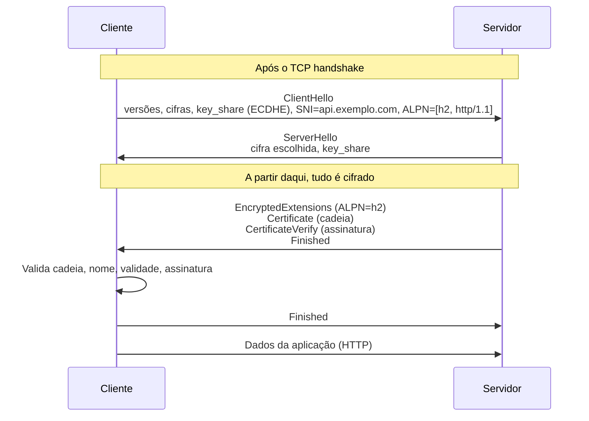
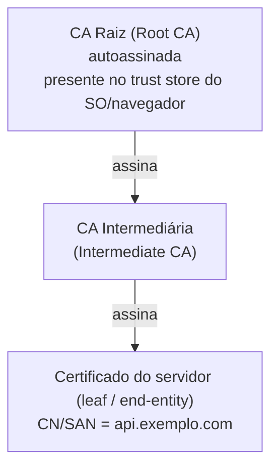
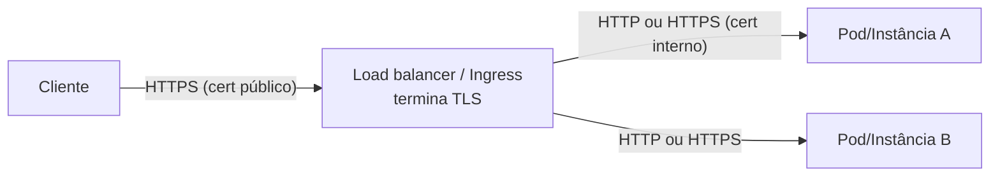
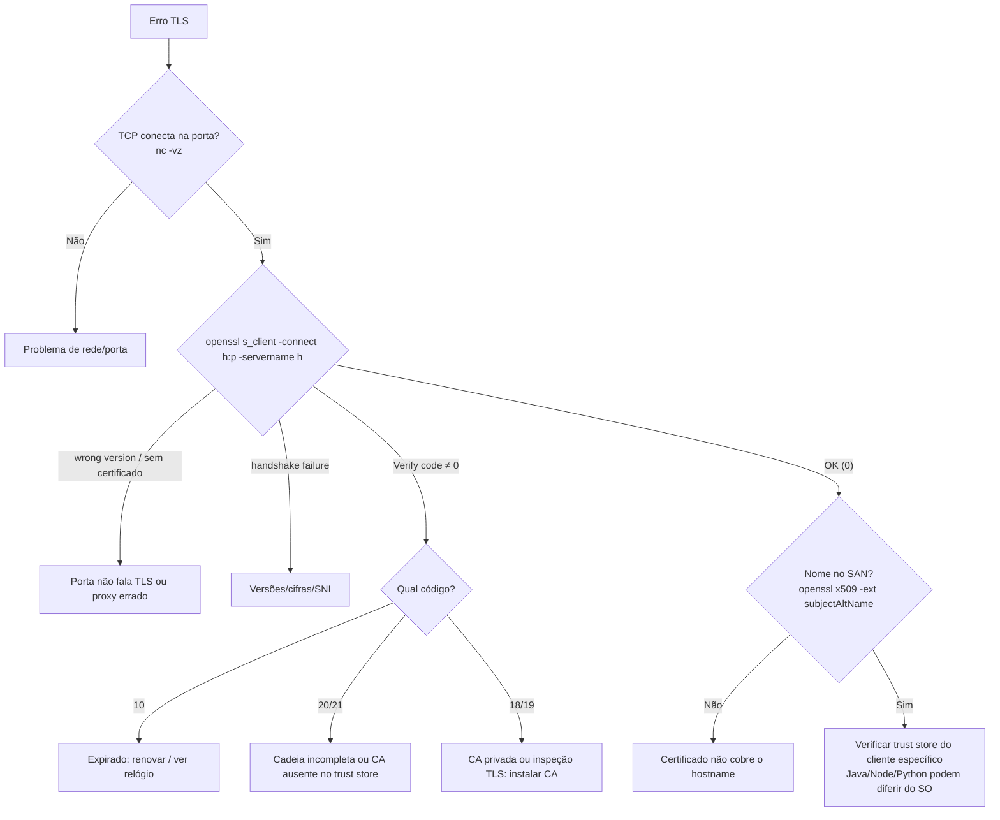

# TLS e Certificados

> [!info] Posição na trilha
> **Etapa 2 — Protocolos de Comunicação.** Pré-requisitos: [[05 - TCP e UDP]], [[07 - DNS]], [[11 - HTTP e HTTPS]]. Próxima: [[13 - SSH]].

## 1. Definição

O **TLS (Transport Layer Security)** é o protocolo que protege comunicações sobre uma conexão de transporte, oferecendo:

| Propriedade | O que garante | Mecanismo |
|---|---|---|
| **Confidencialidade** | Terceiros não leem os dados | Criptografia simétrica (ex.: AES‑GCM, ChaCha20‑Poly1305) |
| **Integridade** | Dados não são alterados sem detecção | AEAD (cifra autenticada) |
| **Autenticação** | Você fala com o servidor certo (e, opcionalmente, o servidor sabe quem é o cliente) | Certificados X.509 e assinaturas digitais |

Versões atuais: **TLS 1.3** (RFC 8446) e **TLS 1.2** (RFC 5246). **SSL 2.0/3.0, TLS 1.0 e 1.1 estão obsoletos** (RFC 8996) e não devem ser usados. "SSL" sobrevive apenas como nome popular ("certificado SSL", OpenSSL).

Um **certificado X.509** é um documento assinado digitalmente que vincula uma **chave pública** a uma **identidade** (nomes de domínio, organização), emitido por uma **Autoridade Certificadora (CA)**.

## 2. Por que isso importa

- HTTPS, gRPC, conexões a bancos, Kubernetes (API server, kubelet, etcd), service meshes (mTLS) e registries dependem de TLS.
- **Certificado expirado** é uma das causas mais comuns e evitáveis de indisponibilidade em produção.
- Erros de TLS ("unable to get local issuer certificate", "hostname mismatch") são frequentes em pipelines de CI/CD, containers e proxies corporativos.

## 3. Como funciona

### 3.1 Criptografia em duas fases

1. **Handshake (assimétrico):** autentica o servidor e estabelece, de forma segura, segredos compartilhados (troca de chaves Diffie‑Hellman efêmera — ECDHE).
2. **Dados (simétrico):** o restante da comunicação é cifrado com chaves simétricas derivadas do handshake (muito mais rápido).

Com **ECDHE**, cada sessão tem chaves efêmeras: isso garante **forward secrecy** (sigilo futuro) — se a chave privada do servidor vazar no futuro, sessões passadas gravadas continuam protegidas. No TLS 1.3, forward secrecy é obrigatória.

### 3.2 Handshake TLS 1.3 (simplificado)



- **TLS 1.3:** 1 RTT de handshake (e 0‑RTT opcional para retomada, com ressalvas de *replay*).
- **TLS 1.2:** 2 RTTs; o certificado é enviado em texto claro.
- **SNI (Server Name Indication):** o cliente informa o nome do site no ClientHello, permitindo que um servidor com vários certificados escolha o correto. Sem SNI, o servidor devolve um certificado padrão (frequentemente errado). No TLS 1.3 padrão, o SNI ainda trafega em claro; o **ECH (Encrypted Client Hello)** está sendo adotado para cifrá-lo.

### 3.3 Cadeia de confiança (PKI)



- O **trust store** (repositório de CAs confiáveis) vem do sistema operacional (`/etc/ssl/certs`, pacote `ca-certificates`), do navegador ou do runtime (Java usa o próprio *cacerts*; Node.js tem um bundle embutido; Python `requests` usa o pacote `certifi` por padrão).
- O servidor deve enviar **o certificado leaf + os intermediários**. A raiz não precisa ser enviada (o cliente já a tem).
- **Cadeia incompleta** (servidor sem o intermediário) é um erro clássico: navegadores às vezes compensam (cache ou download do intermediário via AIA), mas `curl`, Java, Go e outros clientes falham.

### 3.4 O que o cliente valida

1. **Assinaturas** de cada certificado da cadeia até uma raiz confiável.
2. **Validade temporal:** `notBefore` ≤ agora ≤ `notAfter`. **Relógio errado no cliente** causa falhas falsas.
3. **Nome do host:** o nome requisitado deve estar no **SAN (Subject Alternative Name)**. O campo CN (Common Name) não é mais usado para isso pelos clientes modernos. Wildcards cobrem **um** nível: `*.exemplo.com` vale para `api.exemplo.com`, mas **não** para `exemplo.com` nem para `v1.api.exemplo.com`.
4. **Uso da chave** (Key Usage / Extended Key Usage: `serverAuth`).
5. **Revogação** (OCSP/CRL) — o suporte e o rigor variam muito entre clientes.

## 4. Conceitos centrais

| Termo | Significado |
|---|---|
| **Chave privada** | Segredo do servidor; nunca sai dele. Prova a posse do certificado |
| **CSR (Certificate Signing Request)** | Pedido contendo a chave pública e os nomes, enviado à CA |
| **CA pública** | Confiável por padrão nos sistemas (ex.: Let's Encrypt, DigiCert) |
| **CA privada / interna** | Criada pela organização para serviços internos; os clientes precisam confiar explicitamente na raiz |
| **Autoassinado (self‑signed)** | Certificado assinado pela própria chave; não há cadeia confiável |
| **DV / OV / EV** | Níveis de validação (domínio, organização, estendida). Tecnicamente a criptografia é a mesma |
| **ACME** | Protocolo de emissão automatizada (RFC 8555), usado pela Let's Encrypt; desafios **HTTP‑01** (arquivo em `/.well-known/acme-challenge/`) ou **DNS‑01** (registro TXT) |
| **mTLS (mutual TLS)** | O cliente também apresenta certificado; o servidor o valida. Comum entre serviços e em service meshes |
| **Terminação TLS** | Ponto onde o TLS é decifrado (LB, proxy, Ingress). Depois disso, o tráfego pode seguir em claro ou ser recifrado (re‑encryption) |
| **TLS passthrough** | O proxy encaminha o TLS sem decifrar (roteando pelo SNI); o backend termina o TLS |
| **Certificate Transparency (CT)** | Logs públicos de todos os certificados emitidos por CAs públicas; permitem detectar emissões indevidas |
| **Formatos** | **PEM** (Base64 com `-----BEGIN CERTIFICATE-----`), **DER** (binário), **PKCS#12/PFX** (cert + chave em um arquivo protegido por senha) |

> [!note] Validade dos certificados está diminuindo
> O CA/Browser Forum aprovou em 2025 uma redução gradual da validade máxima de certificados TLS públicos, de 398 dias para 47 dias até 2029, em etapas. Na prática: **automatize a renovação** (ACME, cert-manager, serviços de certificados das clouds). Renovação manual não escala.

## 5. Exemplos práticos

### Exemplo 1 — Terminação TLS em um deploy típico



- O certificado público fica no LB/Ingress (ou em um serviço gerenciado de certificados).
- Entre LB e backend: HTTP simples (rede confiável) ou re‑encryption/mTLS (requisitos de compliance ou *zero trust*).

### Exemplo 2 — Kubernetes com cert-manager

O **cert-manager** observa recursos `Certificate` (ou anotações de Ingress), executa desafios ACME e grava o certificado num Secret `kubernetes.io/tls`, renovando-o automaticamente antes do vencimento (por padrão, quando restam aproximadamente 1/3 da validade).

### Exemplo 3 — Proxy corporativo com inspeção TLS

Empresas às vezes interceptam HTTPS com um proxy que gera certificados assinados por uma **CA corporativa**. Containers e runners de CI (que não têm essa CA no trust store) falham com `self signed certificate in certificate chain`. A solução correta é **adicionar a CA corporativa ao trust store** da imagem, não desligar a verificação.

```dockerfile
# Debian/Ubuntu
COPY corp-root-ca.crt /usr/local/share/ca-certificates/corp-root-ca.crt
RUN update-ca-certificates
```

## 6. Comandos e demonstrações

```bash
# Conectar e ver o handshake, a cadeia e o certificado
openssl s_client -connect api.exemplo.com:443 -servername api.exemplo.com </dev/null
#   -servername: envia SNI (essencial para servidores com vários certificados)
#   </dev/null: encerra logo após o handshake

# Mostrar a cadeia completa enviada pelo servidor
openssl s_client -connect api.exemplo.com:443 -servername api.exemplo.com -showcerts </dev/null

# Extrair datas, emissor, sujeito e SANs do certificado do servidor
openssl s_client -connect api.exemplo.com:443 -servername api.exemplo.com </dev/null 2>/dev/null \
  | openssl x509 -noout -subject -issuer -dates -ext subjectAltName

# Verificar se expira nos próximos 30 dias (código de saída 1 se expirar)
openssl s_client -connect api.exemplo.com:443 -servername api.exemplo.com </dev/null 2>/dev/null \
  | openssl x509 -noout -checkend $((30*24*3600))

# Testar versões específicas de TLS
openssl s_client -connect api.exemplo.com:443 -servername api.exemplo.com -tls1_2 </dev/null
openssl s_client -connect api.exemplo.com:443 -servername api.exemplo.com -tls1_3 </dev/null

# Inspecionar um arquivo de certificado local
openssl x509 -in cert.pem -noout -text

# Conferir se chave privada e certificado combinam (os hashes devem ser iguais)
openssl x509 -in cert.pem -noout -pubkey | openssl sha256
openssl pkey -in key.pem -pubout | openssl sha256

# Gerar certificado autoassinado para LABORATÓRIO (válido por 30 dias)
openssl req -x509 -newkey rsa:2048 -nodes -keyout lab.key -out lab.crt -days 30 \
  -subj "/CN=lab.local" -addext "subjectAltName=DNS:lab.local,DNS:localhost"

# curl usando uma CA específica
curl --cacert minha-ca.pem https://servico.interno/

# Verificar o certificado em um Secret do Kubernetes
kubectl get secret meu-tls -n app -o jsonpath='{.data.tls\.crt}' | base64 -d | openssl x509 -noout -dates -ext subjectAltName
```

## 7. Interpretação da saída do `openssl s_client`

Trechos importantes (o formato exato varia entre versões do OpenSSL):

```text
CONNECTED(00000003)
depth=2 C = US, O = Internet Security Research Group, CN = ISRG Root X1
verify return:1
depth=1 C = US, O = Let's Encrypt, CN = R11
verify return:1
depth=0 CN = api.exemplo.com
verify return:1
---
Certificate chain
 0 s:CN = api.exemplo.com
   i:C = US, O = Let's Encrypt, CN = R11
 1 s:C = US, O = Let's Encrypt, CN = R11
   i:C = US, O = Internet Security Research Group, CN = ISRG Root X1
---
...
New, TLSv1.3, Cipher is TLS_AES_256_GCM_SHA384
...
    Verify return code: 0 (ok)
```

| Elemento | Leitura |
|---|---|
| `depth=0` | Certificado leaf; `depth=1` intermediário; `depth=2` raiz |
| `s:` / `i:` | *Subject* (de quem é) / *Issuer* (quem assinou). O `i:` de um nível deve ser o `s:` do próximo |
| `Verify return code: 0 (ok)` | Cadeia válida e confiável |
| `TLSv1.3, Cipher is ...` | Versão e cifra negociadas |

Erros frequentes no `Verify return code`:

| Código | Mensagem | Causa |
|---|---|---|
| 10 | `certificate has expired` | Certificado (ou intermediário) vencido |
| 18 | `self-signed certificate` | Certificado autoassinado |
| 19 | `self-signed certificate in certificate chain` | Raiz não confiável (CA privada ou proxy de inspeção) |
| 20 | `unable to get local issuer certificate` | Intermediário ausente ou CA não está no trust store |
| 21 | `unable to verify the first certificate` | Servidor não enviou o intermediário |
| 62 | `hostname mismatch` (com `-verify_hostname`) | Nome não está no SAN |

> [!note] `s_client` não valida o nome por padrão
> O `openssl s_client` verifica a cadeia, mas **não** compara o hostname com o SAN, a menos que você use `-verify_hostname nome`. O `curl` valida ambos.

## 8. Problemas comuns

| Sintoma | Causa | Correção |
|---|---|---|
| `certificate has expired` | Renovação falhou ou não existe | Automatizar (ACME/cert-manager) e monitorar expiração |
| Funciona no navegador, falha no `curl`/Java | Cadeia incompleta | Configurar o servidor com o *fullchain* |
| `hostname mismatch` / `no alternative certificate subject name matches` | Acesso por nome não incluído no SAN, ou por IP | Emitir certificado com o nome correto; acessar pelo nome |
| Certificado "errado" retornado | Cliente sem SNI; ou SNI não configurado no servidor/LB | Usar `-servername`; configurar certificados por host |
| `self signed certificate in certificate chain` em CI | Proxy de inspeção corporativo | Adicionar CA corporativa ao trust store |
| Falhas de TLS em massa num servidor | Relógio errado (NTP parado) | Sincronizar horário (`timedatectl`) |
| `wrong version number` (OpenSSL) | Falando TLS com porta que responde HTTP puro (ou vice‑versa) | Conferir porta/protocolo do upstream |
| `handshake failure` / `no protocols available` | Versões ou cifras incompatíveis | Habilitar TLS 1.2/1.3 em ambos os lados |
| Clientes antigos falham após mudança de CA | Raiz nova não existe em trust stores antigos | Atualizar `ca-certificates`; avaliar cadeias alternativas |

## 9. Troubleshooting



## 10. Aplicações em DevOps

- **Automação de certificados:** cert-manager (Kubernetes), Certbot, serviços gerenciados das clouds.
- **Monitoramento:** alertas de expiração com antecedência (ex.: 30 e 7 dias) via probes de blackbox (Prometheus blackbox_exporter expõe `probe_ssl_earliest_cert_expiry`).
- **Kubernetes:** o próprio cluster usa uma PKI interna (API server, kubelets, etcd). Certificados gerados pelo kubeadm expiram em 1 ano por padrão e precisam ser renovados (`kubeadm certs check-expiration`).
- **Service mesh:** mTLS automático entre serviços, com rotação de certificados curtos.
- **Segredos:** chaves privadas devem ficar em gerenciadores de segredos (Vault, Secrets do Kubernetes com criptografia em repouso, secret managers de cloud), nunca em repositórios Git.

## 11. Considerações de segurança

- Desabilite SSL 3.0, TLS 1.0 e 1.1; prefira TLS 1.3 e mantenha TLS 1.2 para compatibilidade.
- **Nunca** desabilite a verificação de certificados em produção (`curl -k`, `verify=False`, `InsecureSkipVerify: true`, `NODE_TLS_REJECT_UNAUTHORIZED=0`). Isso anula a autenticação e permite man‑in‑the‑middle.
- Proteja a chave privada (permissões `600`, gerenciador de segredos, HSM/KMS quando aplicável). Se vazar: revogue e reemita.
- Use **HSTS** e redirecione HTTP → HTTPS.
- Use registros **CAA** e monitore **Certificate Transparency** para detectar emissões não autorizadas para seus domínios.
- TLS protege o **trânsito**; não protege dados em repouso nem substitui autenticação/autorização da aplicação.

## 12. Resumo

- TLS = confidencialidade + integridade + autenticação; use 1.2/1.3.
- Handshake assimétrico (ECDHE + certificado) → dados com cifras simétricas.
- Validação: cadeia até raiz confiável, validade, **SAN contém o hostname**.
- SNI permite vários certificados em um IP; sempre use `-servername` no `openssl`.
- Automatize renovação e monitore expiração.

## 13. Verificação de conhecimento

1. Um certificado `*.exemplo.com` é válido para `exemplo.com`? E para `a.b.exemplo.com`?
2. O site funciona no Chrome, mas o `curl` retorna `unable to get local issuer certificate`. Qual a causa mais provável?
3. Por que é preciso passar `-servername` ao `openssl s_client`?
4. O que é forward secrecy e qual mecanismo a fornece?
5. Um job de CI falha com `self signed certificate in certificate chain` ao baixar dependências, só dentro da rede da empresa. Qual a causa provável e a correção adequada?
6. Que comando verifica se o certificado de um site expira nos próximos 15 dias?

> [!success]- Respostas
> 1. Não para `exemplo.com` (precisa constar separadamente no SAN); não para `a.b.exemplo.com` (wildcard cobre um único nível).
> 2. O servidor não envia o certificado intermediário (cadeia incompleta); o navegador compensa, o curl não.
> 3. Para enviar SNI; sem ele, o servidor pode apresentar um certificado padrão diferente.
> 4. Garantia de que o vazamento futuro da chave privada não permite decifrar sessões passadas; fornecida pela troca de chaves efêmera (ECDHE/DHE).
> 5. Proxy corporativo com inspeção TLS usando uma CA própria. Correção: instalar a CA corporativa no trust store do runner/imagem, não desativar a verificação.
> 6. `openssl s_client -connect host:443 -servername host </dev/null 2>/dev/null | openssl x509 -noout -checkend $((15*24*3600))`.

## 14. Tópicos relacionados

- Anterior: [[11 - HTTP e HTTPS]]
- Próxima: [[13 - SSH]]
- [[15 - Proxy e Reverse Proxy]]
- [[21 - Redes em Kubernetes]]
- [[23 - Segurança de Redes]]
- [[Mapa de Estudos de Redes]]
