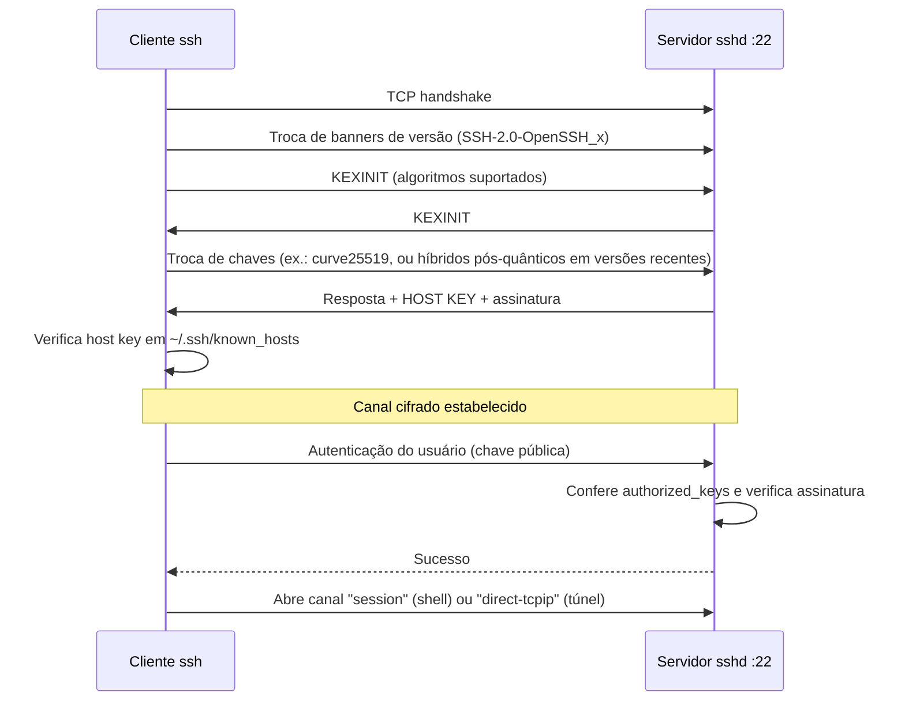
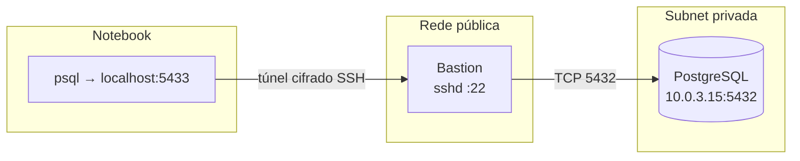

# SSH — Secure Shell

> [!info] Posição na trilha
> **Etapa 2 — Protocolos de Comunicação.** Pré-requisitos: [[06 - Portas e Sockets]], [[12 - TLS e Certificados]] (conceitos de chave pública). Próxima: [[14 - Firewall e Filtragem de Pacotes]].

## 1. Definição

O **SSH (Secure Shell)** é um protocolo para **acesso remoto seguro**, execução de comandos, transferência de arquivos e **tunelamento** sobre redes não confiáveis. A versão em uso é o **SSH‑2** (arquitetura na RFC 4251; transporte na 4253; autenticação na 4252; conexão/canais na 4254). Porta padrão: **TCP 22**.

A implementação dominante é o **OpenSSH** (cliente `ssh`, servidor `sshd`, utilitários `scp`, `sftp`, `ssh-keygen`, `ssh-agent`), presente no Linux, macOS e no Windows 10/11.

O protocolo tem três camadas:

| Camada | Função |
|---|---|
| **Transporte** | Troca de chaves, cifragem, integridade, **autenticação do servidor** (host key) |
| **Autenticação de usuário** | Senha, chave pública, certificados, MFA (keyboard‑interactive) |
| **Conexão** | Multiplexa **canais** sobre a mesma conexão: shell, comandos, SFTP, port forwarding |

## 2. Por que isso importa

- É a forma padrão de administrar servidores Linux, bastion hosts e equipamentos de rede.
- **Git** usa SSH para autenticação com GitHub/GitLab.
- Ferramentas de automação como **Ansible** usam SSH como transporte.
- Túneis SSH permitem acessar bancos de dados e dashboards em redes privadas sem expô-los.

## 3. Como funciona



### 3.1 Autenticação do **servidor** (host key)

Na primeira conexão, o cliente mostra a impressão digital (*fingerprint*) da chave do servidor e pergunta se você confia (**TOFU — Trust On First Use**). Depois, a chave é gravada em `~/.ssh/known_hosts`. Se mudar, o cliente alerta:

```text
@@@@@@@@@@@@@@@@@@@@@@@@@@@@@@@@@@@@@@@@@@@@@@@@@@@@@@@@@@@
@    WARNING: REMOTE HOST IDENTIFICATION HAS CHANGED!     @
@@@@@@@@@@@@@@@@@@@@@@@@@@@@@@@@@@@@@@@@@@@@@@@@@@@@@@@@@@@
```

Causas legítimas: servidor reinstalado, IP reaproveitado por outra VM (muito comum em cloud). Causa maliciosa: **man‑in‑the‑middle**. **Verifique o fingerprint por um canal confiável** antes de aceitar a nova chave.

### 3.2 Autenticação do **usuário** por chave pública

1. Você gera um par de chaves: **privada** (fica com você, protegida por passphrase) e **pública** (vai para o servidor).
2. A chave pública é adicionada a `~/.ssh/authorized_keys` do usuário no servidor.
3. Ao conectar, o cliente **prova que possui a chave privada** assinando dados da sessão. A chave privada **nunca** é transmitida.

Algoritmos recomendados: **Ed25519** (padrão moderno; chaves pequenas e rápidas) ou RSA com ≥ 3072 bits. Chaves DSA estão obsoletas, e o OpenSSH desabilita por padrão assinaturas RSA com SHA‑1 (`ssh-rsa`).

### 3.3 Chaves vs senhas

| Aspecto | Senha | Chave pública |
|---|---|---|
| Resistência a força bruta | Baixa (depende da senha) | Muito alta |
| Phishing / vazamento no servidor | Senha pode ser capturada | Só a chave pública fica no servidor |
| Automação | Ruim | Boa (com cuidado na guarda da chave) |
| Revogação | Trocar senha | Remover a linha de `authorized_keys` |

Em servidores expostos, desabilite a autenticação por senha.

## 4. Conceitos centrais

| Arquivo / conceito | Função |
|---|---|
| `~/.ssh/id_ed25519` / `id_ed25519.pub` | Chave privada / pública do usuário |
| `~/.ssh/authorized_keys` (servidor) | Chaves públicas autorizadas a entrar naquela conta; aceita opções como `from="10.0.0.0/8"`, `command="..."`, `no-port-forwarding` |
| `~/.ssh/known_hosts` (cliente) | Host keys de servidores já confiados |
| `~/.ssh/config` (cliente) | Aliases e opções por host |
| `/etc/ssh/sshd_config` (servidor) | Configuração do servidor (no Debian/Ubuntu modernos, também arquivos em `/etc/ssh/sshd_config.d/`) |
| **ssh-agent** | Mantém chaves decifradas em memória para não digitar a passphrase toda vez |
| **Agent forwarding** (`-A`) | Permite usar seu agent a partir de um servidor remoto — **risco**: root daquele servidor pode usar suas chaves enquanto você estiver conectado |
| **ProxyJump** (`-J`) | Conecta a um host interno passando por um bastion, sem precisar levar chaves para o bastion |
| **Certificados SSH** | Uma CA SSH assina chaves de usuários/hosts com validade curta; elimina gerenciar `authorized_keys`/`known_hosts` em escala |

### 4.1 Permissões exigidas

O `sshd` (com `StrictModes yes`, o padrão) recusa chaves se as permissões forem muito abertas:

```bash
chmod 700 ~/.ssh
chmod 600 ~/.ssh/authorized_keys ~/.ssh/id_ed25519
chmod 644 ~/.ssh/id_ed25519.pub
```

O cliente também se recusa a usar uma chave privada legível por outros (`UNPROTECTED PRIVATE KEY FILE!`).

### 4.2 SFTP, SCP e FTP — não confunda

| Protocolo | O que é | Porta | Segurança |
|---|---|---|---|
| **FTP** | Protocolo antigo e independente (RFC 959); usa conexões separadas de controle e dados (modos ativo/passivo, problemáticos com NAT e firewalls) | 21 (+ portas de dados) | **Texto claro**, inclusive senhas |
| **FTPS** | FTP com TLS | 21 (explícito) / 990 (implícito) | Cifrado, mas herda a complexidade de portas do FTP |
| **SFTP** | **Subsistema do SSH** (SSH File Transfer Protocol); **não tem relação com o FTP** além do nome | 22 (mesma conexão SSH) | Cifrado; autenticação do SSH |
| **SCP** | Cópia de arquivos sobre SSH. Nas versões recentes do OpenSSH (9.0+), o comando `scp` usa o protocolo SFTP por baixo, por padrão | 22 | Cifrado |

Para transferência de arquivos em servidores, prefira **SFTP** ou **rsync sobre SSH**.

### 4.3 Port forwarding (túneis)

| Tipo | Opção | Direção | Uso típico |
|---|---|---|---|
| **Local** | `-L [bind:]porta_local:destino:porta_destino` | Uma porta **no seu computador** leva a um destino alcançável **pelo servidor SSH** | Acessar um banco privado através de um bastion |
| **Remoto** | `-R [bind:]porta_remota:destino:porta_destino` | Uma porta **no servidor** leva a um destino alcançável **pelo seu computador** | Expor temporariamente um serviço local para um servidor remoto |
| **Dinâmico** | `-D porta_local` | Proxy **SOCKS** local; o destino é decidido por conexão | Navegar como se estivesse na rede do servidor |



Comando correspondente:

```bash
ssh -N -L 5433:10.0.3.15:5432 usuario@bastion.exemplo.com
#   -N: não executar comando remoto (só o túnel)
#   5433: porta local | 10.0.3.15:5432: destino, resolvido/conectado PELO bastion
psql -h 127.0.0.1 -p 5433 -U app appdb
```

> [!note] O destino do `-L` é resolvido no servidor
> Em `-L 5433:db.interno:5432`, o nome `db.interno` é resolvido e conectado **pelo servidor SSH**, não pelo seu notebook. Por isso funciona para nomes que só existem na rede privada. E `localhost` no destino significa **o próprio servidor SSH**.

## 5. Exemplos práticos

### Exemplo 1 — Criar e instalar uma chave

```bash
# Gerar chave Ed25519 com comentário identificador e passphrase
ssh-keygen -t ed25519 -C "maria@notebook-2026"

# Copiar a chave pública para o servidor (acrescenta a authorized_keys)
ssh-copy-id -i ~/.ssh/id_ed25519.pub maria@10.0.1.20

# Testar
ssh maria@10.0.1.20
```

### Exemplo 2 — `~/.ssh/config` com bastion

```text
Host bastion
    HostName bastion.exemplo.com
    User maria
    IdentityFile ~/.ssh/id_ed25519

Host app-*
    User ubuntu
    ProxyJump bastion
    IdentityFile ~/.ssh/id_ed25519

Host app-1
    HostName 10.0.2.11
```

Agora `ssh app-1` conecta passando pelo bastion automaticamente.

### Exemplo 3 — Endurecimento básico do servidor

Trecho de `/etc/ssh/sshd_config` (ou um arquivo em `sshd_config.d/`):

```text
PermitRootLogin no
PasswordAuthentication no
KbdInteractiveAuthentication no
PubkeyAuthentication yes
AllowUsers maria deploy
MaxAuthTries 3
X11Forwarding no
AllowAgentForwarding no
AllowTcpForwarding no      # se túneis não forem necessários neste host
```

> [!warning] Não se tranque fora do servidor
> Antes de recarregar o `sshd` após mudanças:
> 1. Valide a sintaxe: `sudo sshd -t`.
> 2. **Mantenha a sessão atual aberta** e teste o login em **outro terminal**.
> 3. Garanta acesso alternativo (console do provedor) em servidores remotos.
>
> Recarregar (`systemctl reload ssh` ou `sshd`, conforme a distribuição) não derruba sessões existentes.

## 6. Comandos e demonstrações

```bash
# Conectar em porta não padrão
ssh -p 2222 usuario@host

# Executar um comando remoto sem shell interativo
ssh usuario@host 'uptime && df -h /'

# Depuração detalhada da conexão (níveis -v, -vv, -vvv)
ssh -v usuario@host

# Ver o fingerprint da chave de um host antes de confiar
ssh-keyscan -t ed25519 host 2>/dev/null | ssh-keygen -lf -
# No servidor (por canal confiável):
ssh-keygen -lf /etc/ssh/ssh_host_ed25519_key.pub

# Remover host key antiga do known_hosts (após confirmar que a mudança é legítima)
ssh-keygen -R host

# Agent
eval "$(ssh-agent -s)"
ssh-add ~/.ssh/id_ed25519
ssh-add -l

# Bastion
ssh -J usuario@bastion usuario@10.0.2.11

# Túneis
ssh -N -L 8080:localhost:80 usuario@servidor           # porta 80 DO SERVIDOR em localhost:8080
ssh -N -R 9000:localhost:3000 usuario@servidor         # porta 9000 do servidor → sua porta 3000
ssh -N -D 1080 usuario@servidor                        # proxy SOCKS em localhost:1080
curl --socks5-hostname localhost:1080 http://intranet.local/

# Transferência
sftp usuario@host
scp arquivo.txt usuario@host:/tmp/
rsync -avz -e ssh ./site/ usuario@host:/var/www/site/

# Logs de autenticação no servidor
sudo journalctl -u ssh -u sshd --since "1 hour ago"   # o nome da unidade varia (ssh no Debian/Ubuntu, sshd no RHEL)
```

## 7. Interpretação do `ssh -v`

Trechos úteis:

```text
debug1: Connecting to 10.0.1.20 [10.0.1.20] port 22.
debug1: Connection established.
debug1: Remote protocol version 2.0, remote software version OpenSSH_9.6
debug1: Server host key: ssh-ed25519 SHA256:abc123...
debug1: Host '10.0.1.20' is known and matches the ED25519 host key.
debug1: Authentications that can continue: publickey
debug1: Offering public key: /home/maria/.ssh/id_ed25519 ED25519 SHA256:xyz...
debug1: Server accepts key: /home/maria/.ssh/id_ed25519 ED25519 SHA256:xyz...
Authenticated to 10.0.1.20 ([10.0.1.20]:22) using "publickey".
```

| Onde parou | Significado |
|---|---|
| Antes de `Connection established` | Problema de rede/porta: timeout (firewall/rota) ou refused (sshd parado) |
| `Host key verification failed` | Host key mudou ou não foi aceita |
| `Authentications that can continue: publickey` seguido de `Permission denied (publickey)` | Nenhuma chave oferecida foi aceita: chave errada, usuário errado, permissões em `~/.ssh` no servidor, chave não está em `authorized_keys` |
| `Too many authentication failures` | O agent ofereceu chaves demais; use `-o IdentitiesOnly=yes -i chave` |
| `no matching host key type found` / `no matching key exchange method` | Algoritmos incompatíveis (servidor/cliente muito antigos) |

## 8. Problemas comuns

| Problema | Diagnóstico | Solução |
|---|---|---|
| `Connection timed out` | `nc -vz host 22` | Security Group/firewall, IP errado, host sem IP público |
| `Connection refused` | `ss -tlnp` no servidor | `sshd` parado ou escutando em outra porta |
| `Permission denied (publickey)` | `ssh -v`; logs do servidor (`journalctl`) | Instalar chave, corrigir usuário/permissões |
| `REMOTE HOST IDENTIFICATION HAS CHANGED` | Comparar fingerprint por canal confiável | `ssh-keygen -R host` se legítimo |
| Sessão cai quando ociosa | NAT/firewall com timeout | `ServerAliveInterval 60` no cliente (`~/.ssh/config`) |
| Login lento (~10–30 s) | `ssh -v` para ver onde para | Frequentemente DNS reverso no servidor (`UseDNS no`, padrão em versões recentes) ou GSSAPI (`GSSAPIAuthentication no`) |
| Túnel `-L` com erro `channel ... open failed: connect failed` | O **servidor SSH** não alcança o destino | Testar do servidor: `nc -vz destino porta`; `AllowTcpForwarding` |

## 9. Troubleshooting

1. **Rede:** `nc -vz host 22`.
2. **Servidor escutando:** `ss -tlnp | grep ssh` (no servidor, via console).
3. **Detalhes do cliente:** `ssh -vvv usuario@host`.
4. **Logs do servidor:** `journalctl -u ssh` / `-u sshd` ou `/var/log/auth.log` (Debian/Ubuntu), `/var/log/secure` (RHEL).
5. **Permissões:** `ls -ld ~ ~/.ssh ~/.ssh/authorized_keys` no servidor; o diretório home também não pode ser gravável por outros.
6. **Configuração:** `sudo sshd -T | grep -Ei 'passwordauth|permitroot|allowusers|pubkey'` mostra a configuração efetiva.

## 10. Aplicações em DevOps

- **Ansible** conecta via SSH em cada host (agentless).
- **CI/CD:** deploy por SSH com chave dedicada, de privilégio mínimo, armazenada como segredo do pipeline. Use `known_hosts` fixo (não `StrictHostKeyChecking no`).
- **Bastion / jump host:** ponto único e auditado de entrada em redes privadas. Alternativas modernas sem porta 22 exposta: AWS Systems Manager Session Manager, Azure Bastion, GCP IAP TCP forwarding, ou soluções *zero trust*.
- **Git:** chaves de deploy (*deploy keys*) somente leitura por repositório.
- **Kubernetes:** `kubectl port-forward` é conceitualmente parecido com um túnel `-L`, mas passa pelo API server, não por SSH.

## 11. Considerações de segurança

- Desabilite login por senha e login direto como root em servidores expostos.
- Proteja chaves privadas com passphrase e use o agent; nunca as coloque em repositórios ou imagens de container.
- Evite **agent forwarding** em hosts não confiáveis; prefira **ProxyJump**.
- Restrinja a origem da porta 22 (Security Group/firewall) a IPs da VPN ou do bastion.
- Use **fail2ban** ou equivalentes para limitar tentativas de força bruta, e monitore logs de autenticação.
- Revogue chaves de pessoas que saíram da equipe; em escala, prefira **certificados SSH** com validade curta.
- Túneis SSH podem contornar controles de rede: desabilite `AllowTcpForwarding` onde não for necessário.

## 12. Resumo

- SSH = canal cifrado + autenticação do servidor (host key) + autenticação do usuário (preferencialmente por chave).
- `known_hosts` protege contra MITM; `authorized_keys` define quem entra.
- SFTP é um subsistema do SSH — nada a ver com FTP.
- `-L`, `-R` e `-D` criam túneis; `-J` usa bastion.
- `ssh -v` e os logs do `sshd` revelam onde a conexão falha.

## 13. Verificação de conhecimento

1. Qual a diferença entre a host key e a chave do usuário?
2. Você precisa acessar o Grafana (`10.0.4.8:3000`) numa subnet privada, alcançável apenas pelo bastion. Escreva o comando.
3. Por que agent forwarding é arriscado?
4. SFTP usa a porta 21? Explique.
5. Após recriar uma VM com o mesmo IP, o SSH mostra `REMOTE HOST IDENTIFICATION HAS CHANGED`. O que fazer?

> [!success]- Respostas
> 1. A host key identifica o servidor para o cliente (armazenada em `known_hosts`); a chave do usuário autentica o usuário para o servidor (pública em `authorized_keys`).
> 2. `ssh -N -L 3000:10.0.4.8:3000 usuario@bastion` e acessar `http://localhost:3000`.
> 3. Quem tem root no servidor intermediário pode usar o socket do seu agent para se autenticar em outros hosts como você enquanto a sessão estiver aberta.
> 4. Não. SFTP é um subsistema do SSH e usa a porta 22; FTP (21) é outro protocolo.
> 5. Confirmar o novo fingerprint por um canal confiável (console do provedor, saída de `ssh-keygen -lf` no servidor) e então remover a entrada antiga com `ssh-keygen -R ip`.

## 14. Tópicos relacionados

- Anterior: [[12 - TLS e Certificados]]
- Próxima: [[14 - Firewall e Filtragem de Pacotes]]
- [[06 - Portas e Sockets]]
- [[23 - Segurança de Redes]]
- [[22 - Redes em Cloud e DevOps]]
- [[Mapa de Estudos de Redes]]
