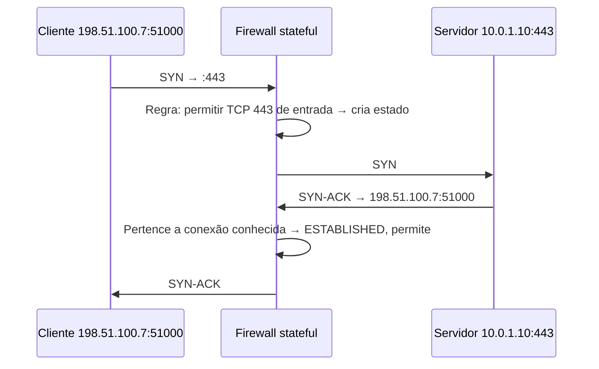
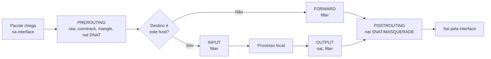
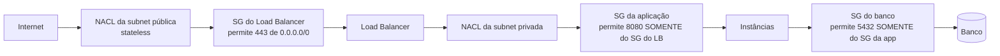

# Firewall e Filtragem de Pacotes

> [!info] Posição na trilha
> **Etapa 3 — Infraestrutura de Rede.** Pré-requisitos: [[05 - TCP e UDP]], [[06 - Portas e Sockets]], [[10 - NAT e PAT]]. Próxima: [[15 - Proxy e Reverse Proxy]].

## 1. Definição

Um **firewall** é um componente (hardware, software no host, ou serviço de cloud) que **permite ou bloqueia tráfego de rede** com base em um conjunto de **regras**. As regras avaliam atributos dos pacotes ou conexões, como:

- IP de origem e destino
- Protocolo (TCP, UDP, ICMP)
- Portas de origem e destino
- Interface de entrada/saída
- Estado da conexão (nova, estabelecida, relacionada)
- Em firewalls de camada 7: domínio, URL, conteúdo, identidade do usuário

## 2. Por que isso importa

- É o controle básico que implementa o **menor privilégio** na rede: apenas o tráfego necessário é permitido.
- Em DevOps, você lida com várias camadas de firewall ao mesmo tempo: firewall do host (nftables/iptables, ufw, firewalld), regras criadas pelo Docker/Kubernetes, Security Groups, Network ACLs, NetworkPolicies, WAF.
- Um "timeout" inexplicável quase sempre é **alguma dessas camadas descartando pacotes**.

## 3. Como funciona

### 3.1 Avaliação de regras

A maioria dos firewalls avalia regras **em ordem** e aplica a **primeira que casar** (first match). Se nenhuma casar, aplica a **política padrão**.

- **Default deny (lista de permissão):** bloqueia tudo, exceto o explicitamente permitido. **Recomendado.**
- **Default allow (lista de bloqueio):** permite tudo, exceto o explicitamente bloqueado. Frágil.

Exceção importante: **Security Groups** de cloud (e NetworkPolicies do Kubernetes) não têm ordem: são **apenas regras de permissão**, e o tráfego é permitido se **qualquer** regra permitir.

### 3.2 Ações

| Ação | Comportamento | Efeito no cliente |
|---|---|---|
| **ACCEPT / allow** | Deixa passar | — |
| **DROP / deny** | Descarta silenciosamente | **Timeout** (o cliente retransmite e desiste) |
| **REJECT** | Descarta e responde (TCP RST ou ICMP unreachable) | Erro imediato (`Connection refused` ou `No route to host`, conforme o tipo de rejeição) |
| **LOG** | Registra e continua avaliando | — |

DROP dificulta a varredura (sem resposta), mas torna o diagnóstico mais lento. REJECT dá feedback rápido. Em redes internas, REJECT costuma ser mais amigável para operação.

### 3.3 Stateless vs stateful

| Característica | **Stateless** | **Stateful** |
|---|---|---|
| Como decide | Cada pacote isoladamente | Conhece o **estado da conexão** (connection tracking) |
| Tráfego de resposta | Precisa de regra explícita (ex.: liberar portas efêmeras de retorno) | Permitido automaticamente (`ESTABLISHED,RELATED`) |
| Complexidade das regras | Maior, propensa a erros | Menor |
| Desempenho | Muito alto, sem memória por conexão | Consome memória (tabela de estados) |
| Exemplos | **Network ACLs** de cloud, ACLs de roteadores | nftables/iptables com conntrack, **Security Groups**, firewalls corporativos |



Com um firewall **stateless**, o SYN‑ACK de saída para `198.51.100.7:51000` só passaria se houvesse uma regra de saída liberando portas efêmeras.

### 3.4 Tipos de firewall

| Tipo | Camadas | Exemplos |
|---|---|---|
| Filtro de pacotes | 3–4 | ACLs de roteador, NACLs |
| Stateful | 3–4 | nftables, Security Groups |
| Firewall de aplicação / NGFW | 3–7 | Identificação de aplicações, inspeção TLS, IPS |
| **WAF (Web Application Firewall)** | 7 (HTTP) | Bloqueia SQL injection, XSS, bots; ModSecurity/Coraza, WAFs de cloud/CDN |
| Firewall de host | 3–4 (e processos) | nftables, ufw, firewalld, Windows Defender Firewall |
| Microsegmentação | 3–4 (às vezes 7) | NetworkPolicies, Cilium, service mesh authorization policies |

### 3.5 Ingress e egress

- **Ingress:** tráfego **entrando** na rede/host/workload.
- **Egress:** tráfego **saindo**.

Controlar **egress** é frequentemente negligenciado, mas é o que impede um servidor comprometido de baixar ferramentas de ataque, falar com servidores de comando e controle (C2) ou exfiltrar dados.

## 4. Conceitos centrais — netfilter no Linux

O **netfilter** é o framework de filtragem do kernel Linux. As interfaces de usuário são:

- **iptables / ip6tables** (clássico). Em distribuições modernas, o comando `iptables` costuma ser a variante **iptables-nft**, que traduz as regras para o backend nftables.
- **nftables (`nft`)**: sucessor; sintaxe unificada para IPv4/IPv6, mais eficiente. Padrão em Debian 10+, RHEL 8+ e outras.
- **Front‑ends:** **ufw** (Ubuntu), **firewalld** (RHEL/Fedora, com zonas).

### 4.1 Caminho de um pacote (simplificado)



| Chain (iptables) | Tráfego |
|---|---|
| `INPUT` | Destinado ao próprio host |
| `OUTPUT` | Gerado pelo próprio host |
| `FORWARD` | **Atravessando** o host (roteado) — é aqui que passa o tráfego de **containers** |
| `PREROUTING` / `POSTROUTING` | Antes/depois da decisão de roteamento (usadas para DNAT/SNAT) |

| Tabela (iptables) | Função |
|---|---|
| `filter` | Aceitar/bloquear (padrão) |
| `nat` | Tradução de endereços |
| `mangle` | Alterar campos/marcas |
| `raw` | Exceções ao conntrack |

### 4.2 Estados do conntrack usados em regras

| Estado | Significado |
|---|---|
| `NEW` | Primeiro pacote de uma conexão |
| `ESTABLISHED` | Conexão já vista nos dois sentidos |
| `RELATED` | Relacionada a uma existente (ex.: ICMP de erro, canal de dados de FTP com helper) |
| `INVALID` | Não corresponde a nada válido — normalmente descartado |

## 5. Exemplos práticos

### Exemplo 1 — Firewall de host mínimo com nftables

Arquivo `/etc/nftables.conf` (servidor web com SSH restrito):

```text
#!/usr/sbin/nft -f
flush ruleset

table inet filter {
    chain input {
        type filter hook input priority 0; policy drop;

        ct state established,related accept
        ct state invalid drop
        iif "lo" accept

        # ICMP/ICMPv6 essencial (diagnóstico, PMTUD, Neighbor Discovery)
        ip protocol icmp accept
        ip6 nexthdr icmpv6 accept

        # SSH somente da rede de administração
        ip saddr 10.0.100.0/24 tcp dport 22 accept

        # HTTP/HTTPS para todos
        tcp dport { 80, 443 } accept
    }

    chain forward {
        type filter hook forward priority 0; policy drop;
    }

    chain output {
        type filter hook output priority 0; policy accept;
    }
}
```

> [!warning] Aplicar política `drop` remotamente
> Ao aplicar `policy drop` via SSH, garanta que a regra que permite **sua** sessão (e `established,related`) está presente **antes**. Teste com um rollback agendado, por exemplo:
> ```bash
> sudo nft -c -f /etc/nftables.conf      # -c: apenas verifica a sintaxe
> sudo nft -f /etc/nftables.conf && sleep 120 && sudo nft flush ruleset   # rollback automático se você perder acesso
> ```
> O exemplo de rollback acima **remove todas as regras** após 2 minutos — use apenas em laboratório ou adapte. Em hosts com Docker/Kubernetes, `flush ruleset` também apaga as regras deles: **não** use nesses hosts.

### Exemplo 2 — Equivalente com ufw (Ubuntu)

```bash
sudo ufw default deny incoming
sudo ufw default allow outgoing
sudo ufw allow from 10.0.100.0/24 to any port 22 proto tcp
sudo ufw allow 80,443/tcp
sudo ufw enable
sudo ufw status verbose
```

### Exemplo 3 — Firewall com firewalld (RHEL/Fedora)

```bash
sudo firewall-cmd --get-active-zones
sudo firewall-cmd --zone=public --add-service=https --permanent
sudo firewall-cmd --zone=public --add-rich-rule='rule family="ipv4" source address="10.0.100.0/24" service name="ssh" accept' --permanent
sudo firewall-cmd --reload
sudo firewall-cmd --zone=public --list-all
```

### Exemplo 4 — Camadas de filtragem em cloud



Referenciar **Security Groups como origem** (em vez de CIDRs) cria regras que acompanham a escala automaticamente. Ver [[22 - Redes em Cloud e DevOps]].

### Exemplo 5 — Docker e firewall do host

O Docker insere regras próprias (chains `DOCKER`, `DOCKER-USER`, etc.) e as portas publicadas com `-p` passam pela chain **FORWARD/NAT**, **antes** de regras do ufw na chain INPUT. Consequência: **uma porta publicada pelo Docker pode ficar acessível mesmo com o ufw "bloqueando"**. A documentação do Docker recomenda colocar filtros próprios na chain `DOCKER-USER`, ou publicar apenas em `127.0.0.1` (`-p 127.0.0.1:8080:80`). Ver [[20 - Redes em Docker]].

## 6. Comandos e demonstrações

```bash
# nftables
sudo nft list ruleset
sudo nft list ruleset -a          # mostra handles (para remover regras específicas)

# iptables (com contadores e números de linha)
sudo iptables -L -n -v --line-numbers
sudo iptables -S                  # formato de comandos (fácil de ler e versionar)
sudo ip6tables -L -n -v           # não esqueça o IPv6!

# Exemplo iptables: permitir SSH de uma rede e registrar descartes
sudo iptables -A INPUT -p tcp -s 10.0.100.0/24 --dport 22 -j ACCEPT
sudo iptables -A INPUT -j LOG --log-prefix "FW-DROP: " --log-level 4
sudo iptables -A INPUT -j DROP

# Ver logs dos descartes
sudo journalctl -k | grep FW-DROP     # ou: dmesg | grep FW-DROP

# Testar de outro host
nc -vz -w 3 servidor 22
```

## 7. Interpretação

```text
Chain INPUT (policy DROP 1532 packets, 91920 bytes)
num   pkts bytes target  prot opt in  out  source          destination
1     8.1M  12G  ACCEPT  all  --  *   *    0.0.0.0/0       0.0.0.0/0    ctstate RELATED,ESTABLISHED
2      120  7200 ACCEPT  tcp  --  *   *    10.0.100.0/24   0.0.0.0/0    tcp dpt:22
3     5400  324K ACCEPT  tcp  --  *   *    0.0.0.0/0       0.0.0.0/0    multiport dports 80,443
```

- `policy DROP 1532 packets` → 1532 pacotes não casaram com nenhuma regra e foram descartados.
- Contadores `pkts`/`bytes` que **sobem** durante seu teste mostram qual regra está agindo. Zere com `iptables -Z` para observar só o teste.
- A ordem importa: uma regra `DROP` genérica na linha 1 anularia todas as seguintes.

Linha de log típica:

```text
FW-DROP: IN=eth0 OUT= MAC=... SRC=203.0.113.50 DST=10.0.1.10 LEN=60 ... PROTO=TCP SPT=51515 DPT=5432 ... SYN
```

→ Alguém (`203.0.113.50`) tentou abrir conexão (`SYN`) na porta 5432 e foi bloqueado.

## 8. Problemas comuns

| Sintoma | Causa provável |
|---|---|
| Timeout ao conectar | Regra DROP em alguma camada (host, SG, NACL, firewall corporativo) |
| Conexão funciona em IPv4, falha em IPv6 (ou vice‑versa) | Regras só para uma família (iptables vs ip6tables; SG sem `::/0`) |
| Entrada liberada, mas a resposta não chega | Firewall **stateless** (NACL) sem regra de saída para portas efêmeras |
| Porta de container exposta apesar do ufw | Regras do Docker contornam a chain INPUT |
| Após reboot, regras sumiram | Regras aplicadas com `iptables` não foram persistidas |
| Docker/Kubernetes pararam de funcionar após "limpar o firewall" | `iptables -F` / `nft flush ruleset` apagou regras de NAT e encaminhamento deles |
| PMTUD quebrado, conexões grandes travam | ICMP totalmente bloqueado |
| Conexões longas cortadas | Timeout de estado no firewall stateful |

## 9. Troubleshooting

1. **Mapeie todas as camadas** entre origem e destino: firewall do cliente, proxy, firewall corporativo, NACL, SG, firewall do host, regras de container, NetworkPolicy.
2. **Teste de dentro para fora:** no servidor, `nc -vz 127.0.0.1 porta` → `nc -vz <IP_do_servidor> porta` (do próprio servidor) → de um host na mesma subnet → de fora.
3. **Capture no destino:** `tcpdump -n port <porta>`. Se o SYN **não chega**, o bloqueio está antes do host. Se chega e não há resposta, é o firewall do host ou a aplicação.
4. **Observe contadores e logs** (`iptables -L -v`, regras `LOG`, *flow logs* da cloud).
5. **Lembre do caminho de volta** em firewalls stateless.

## 10. Aplicações em DevOps

- **Infraestrutura como Código:** Security Groups e regras de firewall versionadas em Terraform, revisadas em pull requests.
- **Kubernetes NetworkPolicies:** firewall L3/L4 entre Pods, por labels. Ver [[21 - Redes em Kubernetes]].
- **Flow logs** (VPC Flow Logs e equivalentes) registram tráfego aceito/rejeitado, essenciais para auditoria e diagnóstico.
- **Egress controlado:** proxies de saída, NAT com IP fixo, regras de egress por workload.
- **Políticas como código:** ferramentas que verificam se nenhuma regra libera `0.0.0.0/0` para portas sensíveis.

## 11. Considerações de segurança

- **Default deny**, em entrada **e** saída onde for viável.
- Liberar por **origem específica** (CIDR estreito ou SG) em vez de `0.0.0.0/0`, especialmente para SSH, RDP, bancos e painéis administrativos.
- Mantenha **paridade IPv4/IPv6**.
- Documente o motivo de cada regra; remova regras temporárias.
- Firewall de rede **não substitui** autenticação e TLS: atacantes podem estar dentro da rede permitida.
- Revise periodicamente as regras e as portas efetivamente expostas.

## 12. Resumo

- Firewalls filtram por IP, protocolo, porta, interface e estado.
- Stateful lembra conexões (respostas liberadas automaticamente); stateless não.
- DROP → timeout; REJECT → erro imediato.
- No Linux: netfilter com nftables/iptables; chains INPUT/OUTPUT/FORWARD; containers passam por FORWARD.
- Em cloud: SGs (stateful, só allow) e NACLs (stateless, ordenadas, allow/deny).

## 13. Verificação de conhecimento

1. Por que um firewall stateless precisa de regras para portas efêmeras?
2. Qual a diferença observável no cliente entre DROP e REJECT?
3. Em que chain do iptables o tráfego de um container que acessa a Internet é filtrado?
4. Escreva uma regra nftables que permita PostgreSQL apenas a partir de `10.0.2.0/24`.
5. Por que referenciar um Security Group como origem é melhor que usar uma lista de IPs?

> [!success]- Respostas
> 1. Porque ele não reconhece respostas de conexões; o tráfego de retorno vai para portas efêmeras do cliente e precisa ser permitido explicitamente.
> 2. DROP: o cliente espera até o timeout. REJECT: erro imediato (RST → "Connection refused", ou ICMP unreachable).
> 3. FORWARD (o tráfego é roteado pelo host; não é destinado ao host nem gerado por ele).
> 4. `ip saddr 10.0.2.0/24 tcp dport 5432 accept` (dentro da chain `input` de uma tabela `inet filter`).
> 5. Porque acompanha automaticamente instâncias criadas/destruídas (auto scaling) e expressa a intenção ("app pode falar com o banco") em vez de endereços que mudam.

## 14. Tópicos relacionados

- Anterior: [[13 - SSH]]
- Próxima: [[15 - Proxy e Reverse Proxy]]
- [[10 - NAT e PAT]]
- [[17 - VLAN e Segmentação de Redes]]
- [[23 - Segurança de Redes]]
- [[Mapa de Estudos de Redes]]
