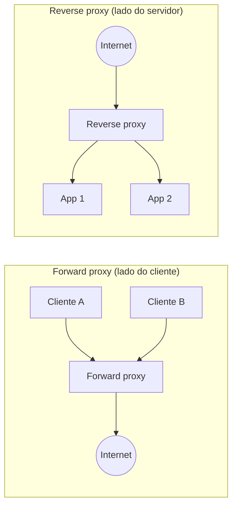
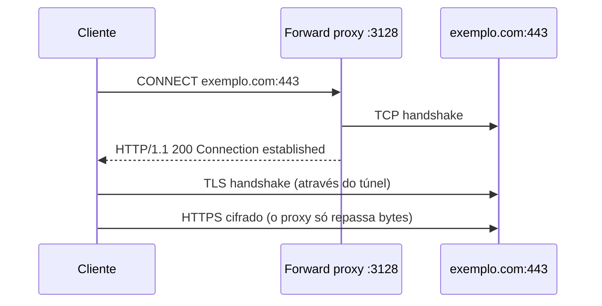
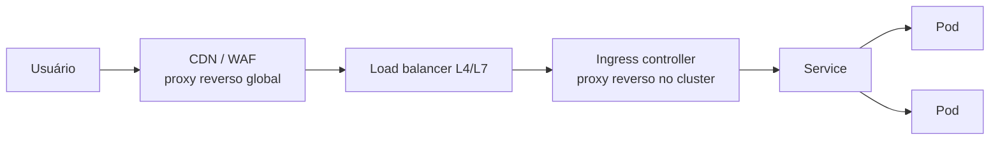

# Proxy e Reverse Proxy

> [!info] Posição na trilha
> **Etapa 3 — Infraestrutura de Rede.** Pré-requisitos: [[11 - HTTP e HTTPS]], [[12 - TLS e Certificados]]. Próxima: [[16 - Balanceamento de Carga]].

## 1. Definição

Um **proxy** é um intermediário que **recebe conexões ou requisições de um lado e as reenvia para o outro**, em nome de alguém. Existem dois papéis principais, que diferem em **quem o proxy representa**:

| | **Forward proxy** | **Reverse proxy** |
|---|---|---|
| Representa | Os **clientes** | Os **servidores** |
| Quem o configura | O cliente (ou a rede do cliente) | O dono do serviço |
| O cliente sabe que existe? | Geralmente sim (configuração explícita) ou é transparente | Normalmente não: para o cliente, o proxy **é** o servidor |
| Uso típico | Controle/auditoria de saída, cache, acesso a redes externas | Terminação TLS, roteamento, balanceamento, cache, segurança |
| Exemplos | Squid, proxy corporativo, egress proxy | nginx, HAProxy, Envoy, Traefik, Caddy, Ingress controllers, API gateways, CDNs |



## 2. Por que isso importa

- Quase toda aplicação em produção fica atrás de pelo menos um reverse proxy (LB, Ingress, CDN, service mesh sidecar).
- Ambientes corporativos e de CI frequentemente exigem **forward proxy** para acessar a Internet — fonte comum de falhas em builds (`apt`, `pip`, `npm`, `docker pull`).
- Proxies alteram o que a aplicação "vê": IP do cliente, protocolo, host, caminho. Entender isso evita bugs de redirect, logs com IPs errados e falhas de segurança.

## 3. Como funciona

### 3.1 Forward proxy HTTP e o método CONNECT

- Para **HTTP**, o cliente envia ao proxy a URL completa: `GET http://exemplo.com/ HTTP/1.1`. O proxy busca e devolve.
- Para **HTTPS**, o cliente pede um túnel: `CONNECT exemplo.com:443 HTTP/1.1`. O proxy abre uma conexão TCP com o destino e passa bytes cifrados nos dois sentidos, **sem ver o conteúdo** (a menos que faça inspeção TLS com uma CA própria — ver [[12 - TLS e Certificados]]).



### 3.2 Reverse proxy

O reverse proxy recebe a requisição, **termina** a conexão do cliente e **abre outra** conexão com o backend (upstream). São **duas conexões TCP distintas**, o que implica:

- O backend vê como origem o **IP do proxy**, não o do cliente.
- Timeouts, keep‑alive e limites existem **em cada perna**.
- O proxy pode alterar cabeçalhos, caminho e protocolo (HTTPS na frente, HTTP atrás).

### 3.3 L4 vs L7

| | Proxy L4 (TCP/UDP) | Proxy L7 (HTTP) |
|---|---|---|
| Enxerga | IPs e portas | Métodos, caminhos, cabeçalhos, cookies |
| Roteamento | Por porta / SNI (em passthrough TLS) | Por host, caminho, cabeçalho, método |
| Protocolos | Qualquer um sobre TCP/UDP (bancos, MQTT, gRPC opaco) | HTTP/1.1, HTTP/2, gRPC, WebSocket |
| Exemplos | HAProxy `mode tcp`, nginx `stream`, NLBs | nginx `http`, Envoy HTTP, ALBs, Ingress |

### 3.4 Preservando informações do cliente

| Mecanismo | Camada | Como |
|---|---|---|
| `X-Forwarded-For` | HTTP | Lista de IPs: `cliente, proxy1, proxy2`. Cada proxy **acrescenta** o IP de quem se conectou a ele |
| `X-Forwarded-Proto` / `X-Forwarded-Host` / `X-Forwarded-Port` | HTTP | Protocolo, host e porta originais |
| `Forwarded` (RFC 7239) | HTTP | Padrão formal: `Forwarded: for=203.0.113.7;proto=https;host=app.exemplo.com` |
| `X-Real-IP` | HTTP | Convenção do nginx com um único IP |
| **PROXY protocol** (v1 texto / v2 binário, especificação do HAProxy) | TCP | Cabeçalho inserido no início da conexão TCP com IP/porta originais. Ambos os lados precisam estar configurados para usá-lo |

> [!warning] Confie apenas em proxies conhecidos
> O cliente pode enviar um `X-Forwarded-For` falso. A aplicação deve considerar **apenas os valores acrescentados por proxies confiáveis** (configuração de *trusted proxies*: `set_real_ip_from` no nginx, `ForwardedHeaders` no ASP.NET, `trust proxy` no Express, `proxy_fix` no Flask/Werkzeug).

## 4. Conceitos centrais — funções de um reverse proxy

| Função | Descrição |
|---|---|
| **Terminação TLS** | Centraliza certificados; backends recebem HTTP |
| **Roteamento** | `api.exemplo.com` → serviço API; `/static` → bucket/CDN |
| **Balanceamento** | Distribui entre várias instâncias — ver [[16 - Balanceamento de Carga]] |
| **Cache** | Armazena respostas cacheáveis (`Cache-Control`) |
| **Compressão** | gzip/brotli |
| **Rate limiting** | Limita requisições por IP/chave |
| **Autenticação na borda** | OIDC, mTLS, chaves de API (API gateway) |
| **Reescrita** | Altera caminhos e cabeçalhos |
| **Buffering** | Absorve clientes lentos, protegendo backends |
| **Observabilidade** | Logs de acesso com tempos de upstream, métricas, tracing |
| **Ocultação** | Esconde a topologia e os servidores internos |

**API gateway** = reverse proxy com foco em APIs (autenticação, cotas, versionamento). **CDN** = rede global de reverse proxies com cache perto dos usuários. **Ingress controller** = reverse proxy configurado a partir de recursos do Kubernetes.

## 5. Exemplos práticos

### Exemplo 1 — nginx como reverse proxy com TLS

```nginx
upstream api_backend {
    server 10.0.2.11:8080;
    server 10.0.2.12:8080;
    keepalive 32;                       # conexões persistentes para o upstream
}

server {
    listen 80;
    server_name app.exemplo.com;
    return 301 https://$host$request_uri;   # redireciona HTTP → HTTPS
}

server {
    listen 443 ssl;
    http2 on;                            # nginx >= 1.25.1; versões anteriores usam "listen 443 ssl http2;"
    server_name app.exemplo.com;

    ssl_certificate     /etc/ssl/app/fullchain.pem;   # leaf + intermediários
    ssl_certificate_key /etc/ssl/app/privkey.pem;
    ssl_protocols TLSv1.2 TLSv1.3;

    client_max_body_size 10m;

    location /api/ {
        proxy_pass http://api_backend;          # sem URI após o upstream: o caminho é repassado como veio
        proxy_http_version 1.1;
        proxy_set_header Connection "";         # necessário para keepalive com upstream
        proxy_set_header Host $host;
        proxy_set_header X-Real-IP $remote_addr;
        proxy_set_header X-Forwarded-For $proxy_add_x_forwarded_for;
        proxy_set_header X-Forwarded-Proto $scheme;
        proxy_connect_timeout 5s;
        proxy_read_timeout 60s;
    }

    location / {
        root /var/www/app;
        try_files $uri /index.html;
    }
}
```

> [!note] A barra no `proxy_pass` muda o comportamento
> `proxy_pass http://api_backend;` (sem URI) repassa o caminho original (`/api/users`). `proxy_pass http://api_backend/;` (com `/`) **substitui** o prefixo da `location` (`/api/users` → `/users`). Essa diferença causa muitos 404 inesperados.

Antes de recarregar: `sudo nginx -t && sudo systemctl reload nginx`.

### Exemplo 2 — Forward proxy em ambientes de CI e containers

Ferramentas de linha de comando geralmente respeitam variáveis de ambiente:

```bash
export HTTP_PROXY=http://proxy.corp:3128
export HTTPS_PROXY=http://proxy.corp:3128
export NO_PROXY=localhost,127.0.0.1,.corp.local,10.0.0.0/8,.svc,.cluster.local
```

Diferenças importantes:

- Há programas que só leem as variáveis em minúsculas (`http_proxy`), outros só em maiúsculas; defina ambas quando necessário.
- O suporte a CIDR em `NO_PROXY` **varia** entre ferramentas (curl, Go, Python, Java têm regras diferentes).
- O **daemon do Docker** não usa as variáveis do seu shell para `docker pull`: precisa de configuração própria (por exemplo, um drop‑in do systemd para o serviço `docker` ou a seção `proxies` do `daemon.json` em versões recentes).
- Builds (`docker build`) precisam receber o proxy via `--build-arg HTTP_PROXY=...` (as variáveis de proxy são *build args* predefinidos).
- Esquecer `NO_PROXY` para endereços internos faz o tráfego interno ir para o proxy e falhar.

### Exemplo 3 — Fluxo completo com CDN, LB e Ingress



Cada salto é um proxy com seus próprios timeouts, limites de tamanho e cabeçalhos. Um `X-Forwarded-For` aqui pode ter 3 ou mais IPs.

## 6. Comandos e demonstrações

```bash
# Usar um forward proxy explicitamente
curl -x http://proxy.corp:3128 -v https://exemplo.com/

# Ignorar proxies configurados no ambiente
curl --noproxy '*' http://servico.interno/

# Ver quais variáveis de proxy estão definidas
env | grep -i _proxy

# Testar o backend diretamente, contornando o reverse proxy
curl -v http://10.0.2.11:8080/api/health

# Testar o reverse proxy enviando o Host correto para o IP dele
curl -v --resolve app.exemplo.com:443:203.0.113.10 https://app.exemplo.com/api/health

# Ver cabeçalhos que revelam proxies no caminho
curl -sI https://exemplo.com/ | grep -iE '^(server|via|x-cache|age|cf-ray|x-amz-cf-id)'

# nginx: validar configuração e ver a configuração efetiva
sudo nginx -t
sudo nginx -T | less
```

## 7. Interpretação

- `HTTP/1.1 200 Connection established` em `curl -v -x` → o proxy aceitou o túnel CONNECT. Um `407 Proxy Authentication Required` → o proxy exige credenciais.
- Cabeçalho `Via:` → lista proxies HTTP intermediários.
- `X-Cache: HIT` / `Age:` → resposta veio de cache (o nome do cabeçalho varia por produto).
- Log de acesso do nginx com `$upstream_response_time` e `$upstream_status` separa o tempo/código do backend do tempo/código final.

## 8. Problemas comuns

| Sintoma | Causa provável |
|---|---|
| 502 Bad Gateway | Backend fora, porta/protocolo errado no `proxy_pass`, backend fechou conexão keep‑alive |
| 504 Gateway Timeout | Backend lento; `proxy_read_timeout` menor que o necessário |
| 413 Request Entity Too Large / Content Too Large | `client_max_body_size` (ou limite equivalente) |
| Redirect para `http://` ou para o host interno | Aplicação não recebe/usa `X-Forwarded-Proto` / `Host` |
| Logs da aplicação mostram só o IP do proxy | Falta `X-Forwarded-For`/PROXY protocol, ou a aplicação não confia no proxy |
| WebSocket não conecta / cai | Proxy sem suporte a `Upgrade` ou timeout curto |
| 404 só atrás do proxy | Reescrita de caminho (barra no `proxy_pass`, `rewrite`, `stripPrefix`) |
| `pip`/`npm`/`apt` falham em CI | Proxy corporativo não configurado, `NO_PROXY` incompleto, ou CA de inspeção ausente |
| Tráfego interno indo para o proxy corporativo | `NO_PROXY` sem os domínios/IPs internos |

## 9. Troubleshooting

1. **Identifique os proxies no caminho** (desenhe o fluxo; veja cabeçalhos `Via`, `Server`).
2. **Teste cada salto separadamente:** cliente → proxy; proxy → backend (do host do proxy); backend local.
3. **Compare** a resposta do backend direto com a resposta via proxy (cabeçalhos, caminho, status).
4. **Leia os logs do proxy**: códigos de upstream, tempos, mensagens de erro (ex.: nginx `upstream timed out`, `connect() failed (111: Connection refused)`, `no live upstreams`).
5. **Revise timeouts e limites** de todos os saltos.

## 10. Aplicações em DevOps

- **Kubernetes Ingress / Gateway API:** reverse proxies declarativos. Ver [[21 - Redes em Kubernetes]].
- **Service mesh:** um proxy (sidecar Envoy ou proxy por nó) em cada workload para mTLS, retries e telemetria.
- **Egress proxy:** força todo tráfego de saída por um ponto controlado, com allowlist de domínios.
- **Blue/green e canary:** o reverse proxy divide o tráfego por peso ou cabeçalho.
- **Zero‑downtime deploys:** proxies drenam conexões de instâncias removidas.

## 11. Considerações de segurança

- Reverse proxies reduzem a superfície de ataque (só eles ficam expostos), mas se tornam alvos críticos: mantenha-os atualizados.
- Não crie **open proxies** (forward proxies aceitando qualquer origem): são abusados para ataques e spam.
- Valide cabeçalhos de encaminhamento; nunca use `X-Forwarded-For` para autorização sem configurar proxies confiáveis.
- **SSRF (Server‑Side Request Forgery):** aplicações que buscam URLs fornecidas pelo usuário podem ser induzidas a acessar serviços internos (incluindo metadata de cloud). Use allowlists e bloqueie destinos internos.
- **HTTP request smuggling:** discrepâncias na interpretação de `Content-Length`/`Transfer-Encoding` entre proxy e backend; mantenha componentes atualizados e use HTTP/2 de ponta a ponta quando possível.

## 12. Resumo

- Forward proxy representa clientes (saída); reverse proxy representa servidores (entrada).
- HTTPS via forward proxy usa CONNECT (túnel); o proxy não vê o conteúdo sem inspeção TLS.
- Reverse proxy = duas conexões; o backend vê o IP do proxy — use `X-Forwarded-*`/`Forwarded`/PROXY protocol.
- 502/504 geralmente são o proxy relatando problemas com o upstream.

## 13. Verificação de conhecimento

1. Qual a diferença fundamental entre forward e reverse proxy?
2. Por que um forward proxy não consegue ler o conteúdo de uma requisição HTTPS comum?
3. A aplicação gera links `http://` embora o site seja acessado por HTTPS. O que está faltando?
4. Com `location /api/` e `proxy_pass http://backend/;`, para qual caminho vai a requisição `/api/users`?
5. Um build Docker na rede corporativa falha ao rodar `apt-get update`. Liste duas causas relacionadas a proxy.

> [!success]- Respostas
> 1. A quem representa: o forward proxy age em nome dos clientes; o reverse proxy em nome dos servidores.
> 2. Porque ele apenas encaminha o túnel TCP aberto via CONNECT; o TLS é negociado diretamente entre cliente e servidor.
> 3. O proxy não envia `X-Forwarded-Proto: https`, ou a aplicação não está configurada para confiar nesse cabeçalho.
> 4. `/users` (a barra final substitui o prefixo `/api/`).
> 5. Variáveis de proxy não passadas ao build (`--build-arg HTTP_PROXY`); CA de inspeção TLS ausente na imagem; `NO_PROXY` incorreto para repositórios internos.

## 14. Tópicos relacionados

- Anterior: [[14 - Firewall e Filtragem de Pacotes]]
- Próxima: [[16 - Balanceamento de Carga]]
- [[11 - HTTP e HTTPS]]
- [[12 - TLS e Certificados]]
- [[21 - Redes em Kubernetes]]
- [[Mapa de Estudos de Redes]]
