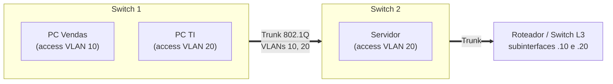

# VLAN e Segmentação de Redes

> [!info] Posição na trilha
> **Etapa 3 — Infraestrutura de Rede.** Pré-requisitos: [[08 - DHCP e ARP]], [[09 - Roteamento e Gateway]], [[14 - Firewall e Filtragem de Pacotes]]. Próxima: [[18 - Diagnóstico e Troubleshooting]].
> Esta nota também cobre os **fundamentos de VPN**, uma forma de estender segmentos de rede com segurança.

## 1. Definição

**Segmentação de rede** é dividir uma rede em partes menores e isoladas, controlando **quais partes podem se comunicar e como**. Ela pode acontecer em várias camadas:

| Mecanismo | Camada | Exemplo |
|---|---|---|
| **VLAN** | 2 | Separar "usuários", "servidores" e "câmeras" no mesmo switch físico |
| **Sub-redes + roteamento + firewall** | 3/4 | Subnets públicas/privadas em uma VPC com Security Groups |
| **VRF (Virtual Routing and Forwarding)** | 3 | Tabelas de rotas isoladas no mesmo roteador |
| **Overlays (VXLAN, Geneve)** | 2 sobre 3 | Redes virtuais de data center, Kubernetes, clouds |
| **Microsegmentação** | 3–7 | NetworkPolicies, políticas por workload/identidade |
| **VPN** | 3 (ou 2) | Conectar redes/usuários remotos de forma cifrada |

Uma **VLAN (Virtual LAN)**, padronizada no **IEEE 802.1Q**, cria **domínios de broadcast separados** dentro da mesma infraestrutura física de switches.

## 2. Por que isso importa

- **Segurança:** limita o "raio de explosão" (*blast radius*) de um comprometimento e a movimentação lateral.
- **Desempenho:** domínios de broadcast menores reduzem tráfego desnecessário.
- **Organização e compliance:** separar dados sensíveis (ex.: ambiente de cartões, PCI DSS) e ambientes (produção vs desenvolvimento).
- Em DevOps, os mesmos princípios aparecem como VPCs separadas, subnets por camada, namespaces e NetworkPolicies.

## 3. Como funciona — VLANs

### 3.1 Tag 802.1Q

Frames de uma VLAN carregam um **cabeçalho de 4 bytes** inserido no frame Ethernet, contendo o **VLAN ID (VID)** de 12 bits: valores 1–4094 utilizáveis (0 e 4095 são reservados).

### 3.2 Portas access e trunk

| Tipo de porta | Comportamento | Conecta |
|---|---|---|
| **Access** | Pertence a **uma** VLAN; frames saem **sem tag** | Computadores, impressoras, servidores comuns |
| **Trunk** | Carrega **várias** VLANs; frames levam **tag** 802.1Q (exceto a *native VLAN*) | Switch ↔ switch, switch ↔ roteador, switch ↔ hipervisor |



### 3.3 Comunicação entre VLANs

VLANs diferentes são redes L2 diferentes, normalmente com **sub-redes IP diferentes**. Para conversarem, o tráfego precisa passar por um **roteador** ou **switch L3** (*inter‑VLAN routing*, ou *router on a stick* com subinterfaces). Esse ponto de roteamento é o **lugar natural para aplicar firewall/ACL** entre segmentos.

| VLAN | Nome | Sub-rede | Gateway |
|---|---|---|---|
| 10 | Usuários | 10.10.10.0/24 | 10.10.10.1 |
| 20 | Servidores | 10.10.20.0/24 | 10.10.20.1 |
| 30 | Gerência | 10.10.30.0/24 | 10.10.30.1 |
| 40 | IoT / câmeras | 10.10.40.0/24 | 10.10.40.1 |

Política exemplo: usuários → servidores apenas em 443; ninguém → gerência, exceto a VLAN de TI; IoT → apenas o NVR (gravador de vídeo) e nada mais.

### 3.4 VLANs no Linux

```bash
# Criar uma interface VLAN 20 sobre eth0 (requer módulo 8021q; não persistente)
sudo ip link add link eth0 name eth0.20 type vlan id 20
sudo ip addr add 10.10.20.50/24 dev eth0.20
sudo ip link set eth0.20 up

# Ver detalhes da VLAN
ip -d link show eth0.20
```

Útil em hipervisores e servidores conectados a portas trunk. Para persistência, use netplan, NetworkManager (`nmcli connection add type vlan ...`) ou systemd-networkd.

## 4. Conceitos centrais

### 4.1 Segmentação além das VLANs

| Conceito | Descrição |
|---|---|
| **Defesa em profundidade** | Vários controles sobrepostos (perímetro, segmento, host, aplicação) |
| **Zonas de segurança** | Agrupar sistemas com mesmo nível de confiança (DMZ, interna, gerência, dados) |
| **DMZ** | Zona intermediária para serviços expostos à Internet, isolada da rede interna |
| **Microsegmentação** | Políticas por workload (não por sub-rede), geralmente baseadas em identidade/labels |
| **Zero Trust** | Não confiar em nada por estar "dentro da rede"; autenticar e autorizar cada acesso (NIST SP 800‑207) |
| **Rede de gerência separada (out‑of‑band)** | Acesso administrativo a equipamentos/hosts por um caminho isolado |

### 4.2 Overlays: VXLAN

VLANs são limitadas a ~4094 IDs e a um domínio L2 físico. **VXLAN** (RFC 7348) encapsula frames L2 em **UDP (porta 4789)**, com um identificador de 24 bits (**VNI**, ~16 milhões de segmentos), permitindo redes L2 virtuais sobre uma rede IP. É usado em data centers, clouds e em CNIs de Kubernetes (ex.: Flannel em modo VXLAN, Calico em modo VXLAN). Adiciona 50 bytes de overhead → MTU interna menor ([[02 - Modelo TCP-IP]]).

### 4.3 Fundamentos de VPN

Uma **VPN (Virtual Private Network)** cria um **túnel cifrado** sobre uma rede não confiável (normalmente a Internet), fazendo com que redes ou dispositivos remotos se comportem como se estivessem conectados diretamente.

| Tipo | Uso | Exemplo |
|---|---|---|
| **Site‑to‑site** | Conecta redes inteiras (escritório ↔ data center, on‑prem ↔ cloud) | IPsec com BGP para uma VPC |
| **Remote access (client‑to‑site)** | Usuário remoto acessa a rede da empresa | WireGuard, OpenVPN, IPsec IKEv2, clientes corporativos |
| **Mesh / overlay de dispositivos** | Cada nó fala diretamente com os outros | Soluções baseadas em WireGuard |

| Tecnologia | Camada/transporte | Características |
|---|---|---|
| **IPsec** (IKEv2 + ESP) | L3; ESP é o protocolo IP 50; IKE em UDP 500/4500 | Padrão da indústria; interoperável com equipamentos e clouds; configuração complexa |
| **WireGuard** | L3 sobre UDP | Moderno, código pequeno, criptografia fixa e atual; no kernel Linux desde a versão 5.6 |
| **OpenVPN** | L3 (tun) ou L2 (tap), sobre UDP ou TCP, com TLS | Flexível, maduro, atravessa proxies quando em TCP 443 |

Conceitos importantes:

- **Split tunnel vs full tunnel:** apenas o tráfego destinado às redes corporativas vai pelo túnel (split) ou todo o tráfego (full). Full tunnel dá mais controle; split reduz carga e latência.
- **Rotas:** a VPN só funciona se ambos os lados tiverem rotas para as redes remotas ([[09 - Roteamento e Gateway]]).
- **Sobreposição de CIDRs** entre as redes conectadas impede o roteamento correto ([[04 - CIDR e Subnetting]]).
- **MTU:** o túnel reduz a MTU efetiva; ajuste MTU/MSS (MSS clamping) para evitar travamentos.

Exemplo mínimo de configuração WireGuard (cliente), apenas para ilustrar a estrutura:

```ini
[Interface]
PrivateKey = <chave privada do cliente>
Address = 10.200.0.2/32
DNS = 10.0.0.2

[Peer]
PublicKey = <chave pública do servidor>
Endpoint = vpn.exemplo.com:51820
AllowedIPs = 10.0.0.0/16, 10.200.0.0/24   # split tunnel: só estas redes vão pelo túnel
PersistentKeepalive = 25                   # mantém o mapeamento NAT ativo
```

No WireGuard, `AllowedIPs` funciona como **tabela de rotas e filtro**: define quais destinos são enviados ao peer e quais origens são aceitas dele.

## 5. Exemplos práticos

### Exemplo 1 — Segmentação em uma VPC (equivalente moderno das VLANs)

```text
VPC 10.50.0.0/16
├── Subnets públicas    → somente load balancers e NAT gateways
├── Subnets de app      → instâncias/nós; aceitam tráfego apenas do LB
├── Subnets de dados    → bancos; aceitam apenas das subnets/SGs de app; sem rota para a Internet
└── Subnet de gerência  → bastion / agentes de acesso
```

### Exemplo 2 — Ambientes separados

Produção, staging e desenvolvimento em **VPCs (ou contas/projetos/assinaturas) diferentes**, sem conectividade direta por padrão. Peering ou Transit Gateway apenas onde estritamente necessário, com regras explícitas.

### Exemplo 3 — Kubernetes

Namespaces **não** isolam a rede por padrão: todo Pod pode falar com todo Pod. Para segmentar, use **NetworkPolicies** (com um CNI que as implemente) — começando por *default deny* por namespace. Ver [[21 - Redes em Kubernetes]].

## 6. Comandos e demonstrações

```bash
# Interfaces VLAN e bridges no host
ip -d link show type vlan
bridge vlan show                 # VLANs em bridges Linux com vlan_filtering

# Capturar frames com tag 802.1Q
sudo tcpdump -i eth0 -e -n vlan

# WireGuard: estado dos túneis (handshakes recentes, bytes transferidos)
sudo wg show

# Rotas que a VPN instalou
ip route show
ip rule show

# Testar se um segmento está isolado (deve FALHAR quando a política proíbe)
nc -vz -w 3 10.10.30.5 22
```

## 7. Interpretação

`tcpdump -e vlan`:

```text
... 52:54:00:aa:bb:cc > ff:ff:ff:ff:ff:ff, ethertype 802.1Q (0x8100), length 46: vlan 20, p 0, ethertype ARP (0x0806), Request who-has 10.10.20.1 tell 10.10.20.50
```

→ Frame marcado com `vlan 20` (EtherType 0x8100 indica a tag 802.1Q).

`wg show`:

```text
peer: AbCd...=
  endpoint: 203.0.113.20:51820
  allowed ips: 10.0.0.0/16, 10.200.0.0/24
  latest handshake: 1 minute, 12 seconds ago
  transfer: 1.20 MiB received, 350.11 KiB sent
```

- `latest handshake` ausente ou muito antigo (> ~3 min com tráfego) → o túnel não está estabelecido: chave errada, endpoint/porta UDP bloqueados.
- `transfer` só com *sent* e nada *received* → os pacotes saem, mas nada volta (firewall, rotas do outro lado, `AllowedIPs` errado no peer).

## 8. Problemas comuns

| Sintoma | Causa provável |
|---|---|
| Host não obtém IP após mudar de porta | Porta em VLAN errada (sem servidor DHCP/relay naquela VLAN) |
| Comunicação entre VLANs falha | Sem roteamento inter‑VLAN, ou ACL bloqueando |
| Algumas VLANs não passam entre switches | VLAN não permitida no trunk; *native VLAN* divergente nas pontas |
| VPN conecta mas nada é alcançável | Rotas ausentes, `AllowedIPs`/seletores de tráfego errados, firewall, CIDRs sobrepostos |
| VPN funciona para pings, mas HTTPS/SSH travam | MTU/MSS do túnel |
| VPN cai após minutos ociosa | NAT expira o mapeamento UDP; use keepalive |
| "Isolamento" não funciona no Kubernetes | NetworkPolicy criada, mas o CNI não a implementa |

## 9. Troubleshooting

1. Confirme **em qual segmento** cada host está (VLAN/sub-rede/subnet/namespace).
2. Confirme **qual caminho** liga os segmentos (roteador, firewall, peering, túnel).
3. Verifique **rotas nos dois sentidos**.
4. Verifique **políticas** no ponto de interconexão.
5. Em túneis: estado do túnel (handshake/SA), rotas, MTU, regras de firewall dos dois lados.
6. **Teste que o proibido está realmente proibido** — segmentação não testada é suposição.

## 10. Aplicações em DevOps

- **Desenho de VPC** com subnets por função e zona; Security Groups e NACLs como controles entre segmentos.
- **Conectividade híbrida:** VPN site‑to‑site ou links dedicados entre on‑premises e cloud, com BGP.
- **Kubernetes:** NetworkPolicies por namespace/aplicação; clusters separados para cargas de diferentes níveis de confiança.
- **Docker:** redes customizadas separadas por aplicação; containers só se comunicam se estiverem numa rede em comum ([[20 - Redes em Docker]]).
- **Acesso administrativo:** VPN ou acesso zero trust em vez de expor SSH/RDP.

## 11. Considerações de segurança

- **VLAN hopping:** ataques como *switch spoofing* (negociar trunk) e *double tagging* (explora a native VLAN). Mitigações: desabilitar negociação automática de trunk (DTP) em portas de acesso, usar uma native VLAN não utilizada, não colocar hosts na VLAN nativa.
- **VLAN não é firewall:** separa domínios de broadcast, mas o roteamento entre elas precisa de ACL/firewall para ter efeito de segurança.
- **VPN não é zero trust:** uma VPN de acesso amplo dá a um dispositivo comprometido acesso a toda a rede. Restrinja o que cada usuário/grupo alcança e verifique a postura dos dispositivos.
- Proteja chaves e credenciais de VPN; revogue acessos de ex‑colaboradores.
- Registre e monitore tráfego entre segmentos (flow logs).

## 12. Resumo

- Segmentação limita o alcance de falhas e ataques; ocorre em L2 (VLAN), L3/L4 (subnets + firewall) e por workload (microsegmentação).
- VLANs (802.1Q) criam domínios de broadcast separados; portas access vs trunk; comunicação entre VLANs exige roteamento.
- VXLAN estende L2 sobre IP com 16 milhões de segmentos.
- VPNs (IPsec, WireGuard, OpenVPN) criam túneis cifrados; dependem de rotas, CIDRs sem sobreposição e MTU adequada.

## 13. Verificação de conhecimento

1. Qual a diferença entre uma porta access e uma porta trunk?
2. Dois hosts estão em VLANs diferentes no mesmo switch. Eles podem se comunicar diretamente via ARP?
3. Por que namespaces do Kubernetes não são, sozinhos, uma fronteira de rede?
4. Explique split tunnel e full tunnel.
5. O túnel WireGuard mostra handshake recente, mas o tráfego para `10.0.5.0/24` não passa. O que você verifica?

> [!success]- Respostas
> 1. Access pertence a uma VLAN e envia frames sem tag; trunk transporta várias VLANs com tags 802.1Q.
> 2. Não. São domínios de broadcast distintos; precisam de um roteador/switch L3.
> 3. Porque, por padrão, a rede de Pods é plana: qualquer Pod alcança qualquer outro. É preciso aplicar NetworkPolicies com um CNI que as suporte.
> 4. Split: só o tráfego para redes específicas vai pelo túnel. Full: todo o tráfego (inclusive Internet) vai pelo túnel.
> 5. Se `10.0.5.0/24` está em `AllowedIPs` dos dois lados conforme o caso; rotas no cliente e no servidor; encaminhamento IP habilitado e firewall/NAT no servidor de VPN; rota de retorno na rede de destino.

## 14. Tópicos relacionados

- Anterior: [[16 - Balanceamento de Carga]]
- Próxima: [[18 - Diagnóstico e Troubleshooting]]
- [[14 - Firewall e Filtragem de Pacotes]]
- [[22 - Redes em Cloud e DevOps]]
- [[23 - Segurança de Redes]]
- [[Mapa de Estudos de Redes]]
