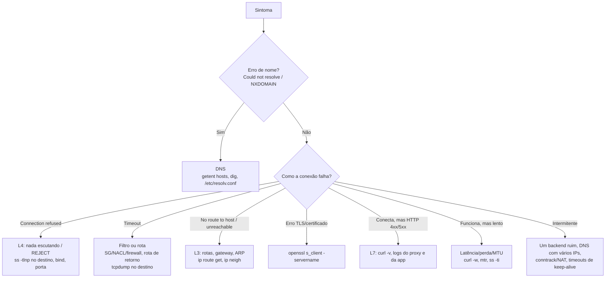
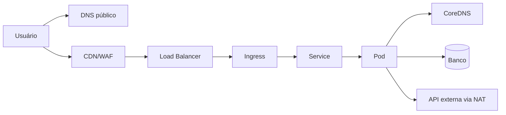

# Diagnóstico e Troubleshooting de Redes

> [!info] Posição na trilha
> **Etapa 4 — Diagnóstico e Segurança.** Pré-requisitos: Etapas 1–3 (especialmente [[01 - Modelo OSI]], [[05 - TCP e UDP]], [[07 - DNS]], [[09 - Roteamento e Gateway]], [[14 - Firewall e Filtragem de Pacotes]]). Use junto com [[19 - Ferramentas de Diagnóstico]].

## 1. Definição

**Troubleshooting de rede** é o processo sistemático de **identificar, isolar e corrigir** falhas de comunicação, aplicando hipóteses e testes em vez de tentativa e erro. Esta nota apresenta **metodologia** e **cenários**; a referência de cada comando está em [[19 - Ferramentas de Diagnóstico]].

## 2. Por que isso importa

- Em incidentes, o tempo até a mitigação depende de **isolar o problema rapidamente**.
- Sistemas modernos têm muitas camadas (DNS, LB, proxy, service mesh, overlay, NAT, firewall de host, Security Group). Sem método, é fácil gastar horas olhando o lugar errado.
- Bons diagnósticos produzem **evidências** que podem ser compartilhadas com outras equipes ("o SYN chega ao host, mas o SYN‑ACK não sai").

## 3. Como funciona — metodologia

### 3.1 Princípios

1. **Defina o problema com precisão.** "Não funciona" não é diagnóstico. Responda:
   - **Origem:** de onde? (host, Pod, rede, região)
   - **Destino:** para onde? (nome, IP, porta, protocolo)
   - **Sintoma exato:** mensagem de erro, código, tempo até falhar.
   - **Escopo:** todos os clientes ou alguns? Todos os destinos ou um?
   - **Tempo:** desde quando? Algo mudou (deploy, regra, certificado, DNS)?
2. **Reproduza** com a ferramenta mais simples possível.
3. **Formule hipóteses** a partir do sintoma e **teste uma de cada vez**.
4. **Divida para conquistar:** teste em pontos intermediários do caminho.
5. **Compare com o que funciona** (outro host, outro Pod, ontem vs hoje).
6. **Documente** comandos, saídas e conclusões.

### 3.2 Abordagens por camada

| Abordagem | Quando usar |
|---|---|
| **Bottom‑up** (física → aplicação) | Nada funciona; suspeita de infraestrutura |
| **Top‑down** (aplicação → física) | Um serviço específico falha, o resto funciona |
| **Divide and conquer** (começa no meio, ex.: L3/L4) | Padrão eficiente: `nc -vz host porta` responde muito rapidamente se a rede até L4 funciona |
| **Seguir o caminho do pacote** | Topologias com vários saltos (proxy → LB → Pod) |

### 3.3 O mapa de decisão principal



### 3.4 A tabela de sintomas mais útil

| Sintoma | O que significa na rede | Primeira suspeita |
|---|---|---|
| `Could not resolve host` / `Name or service not known` / `Temporary failure in name resolution` | Resolução de nome falhou | DNS, `/etc/resolv.conf`, resolver inacessível |
| `Connection refused` | RST recebido | Serviço parado, porta errada, bind em 127.0.0.1 |
| `Connection timed out` | Nenhuma resposta | Firewall com DROP, SG, rota de retorno |
| `No route to host` | ICMP unreachable ou ARP falhou | Host fora do ar, rota, REJECT com icmp-host-prohibited |
| `Network is unreachable` | Sem rota local | Rota padrão ausente |
| `Connection reset by peer` | RST no meio da conexão | App caiu, timeout de proxy/LB/NAT |
| `SSL certificate problem` | Validação TLS falhou | Cadeia, expiração, nome, CA |
| HTTP 502 | Proxy não obteve resposta válida | Backend fora/porta/protocolo/keep‑alive |
| HTTP 503 | Sem backends disponíveis | Health checks, réplicas, endpoints |
| HTTP 504 | Backend lento demais | Timeout, app/banco lento, DROP entre proxy e backend |
| Pequenos funcionam, grandes travam | Pacotes grandes perdidos | MTU/PMTUD |
| Funciona por IP, não por nome | — | DNS |
| Funciona de um lugar, não de outro | — | Firewall por origem, split DNS, rotas, proxy |

## 4. Conceitos centrais — perguntas‑chave por camada

| Camada | Pergunta | Comando |
|---|---|---|
| Interface | Está UP com carrier? Tem IP? | `ip -br link`, `ip -br addr` |
| Vizinho | O gateway responde ARP? | `ip neigh` |
| Rota | Por onde sai o tráfego para o destino? | `ip route get <ip>` |
| Alcance | O destino responde? | `ping`, `mtr`, `traceroute -T -p <porta>` |
| DNS | O nome resolve para o IP esperado, do ponto de vista da aplicação? | `getent hosts`, `dig` |
| Porta | Algo escuta? A porta aceita conexão a partir daqui? | `ss -tlnp`, `nc -vz` |
| TLS | Handshake e certificado ok? | `openssl s_client` |
| Aplicação | A resposta está correta? | `curl -v`, logs |
| Pacotes | O que realmente passa no fio? | `tcpdump` |

## 5. Cenários práticos de troubleshooting

Cada cenário apresenta **sintoma**, **comandos de diagnóstico**, **observações esperadas** e **causa provável**. Tente pensar no diagnóstico antes de abrir a solução.

### Cenário 1 — "A aplicação não acessa o banco"

**Sintoma:** logs da API mostram `connection to server at "db.interno" (10.0.3.15), port 5432 failed: Connection timed out`.

**Diagnóstico sugerido (a partir do host da API):**

```bash
getent hosts db.interno          # o nome resolve para 10.0.3.15 (já indicado no erro)
ip route get 10.0.3.15           # rota esperada?
nc -vz -w 3 10.0.3.15 5432       # timeout?
```

> [!success]- Análise
> O DNS funcionou (o erro já mostra o IP). Um **timeout** indica que o SYN não obteve resposta: o caminho mais provável é **filtragem**. Verifique: Security Group do banco permite 5432 a partir do SG/subnet da API? NACL das subnets (inclusive retorno em portas efêmeras)? Firewall do host do banco? No host do banco, `tcpdump -n port 5432` mostra os SYNs chegando? Se chegam e não há SYN‑ACK, o firewall do host ou o `listen_addresses` do PostgreSQL estão restringindo; se não chegam, o bloqueio está antes.

### Cenário 2 — "Funciona com curl no servidor, mas não de fora"

**Sintoma:** `curl localhost:8080` no servidor retorna 200. De outro host: `Connection refused`.

```bash
sudo ss -tlnp 'sport = :8080'
```

> [!success]- Análise
> Se `ss` mostra `127.0.0.1:8080`, a aplicação faz bind apenas no loopback. `Connection refused` de fora confirma: o kernel responde RST porque não há socket escutando no IP externo. Corrija o bind para `0.0.0.0` (ou o IP da interface) — e garanta que o firewall restrinja quem pode acessar.

### Cenário 3 — "Container não acessa a Internet"

**Sintoma:** dentro do container, `apt-get update` falha com `Temporary failure resolving 'deb.debian.org'`.

```bash
docker exec -it app cat /etc/resolv.conf
docker exec -it app getent hosts deb.debian.org
docker exec -it app ping -c 2 1.1.1.1         # se a imagem tiver ping
sysctl net.ipv4.ip_forward                     # no host
sudo iptables -t nat -S | grep MASQUERADE      # no host
```

> [!success]- Análise
> - Se `ping 1.1.1.1` falha: problema de encaminhamento/NAT no host (`ip_forward=0`, regras do Docker apagadas por um "flush" do firewall, conflito de faixa da bridge com a rede local).
> - Se o ping por IP funciona e o nome não: DNS. O Docker copia/adapta o resolv.conf do host; se o host usa `127.0.0.53` (systemd‑resolved), o Docker usa o arquivo de resolvers reais ou servidores públicos como fallback. Redes corporativas que bloqueiam DNS externo exigem configurar `dns` no `daemon.json`.
> Ver [[20 - Redes em Docker]].

### Cenário 4 — "502 Bad Gateway intermitente"

**Sintoma:** ~1% das requisições retornam 502 via load balancer; os logs da aplicação não mostram erros correspondentes.

> [!success]- Análise
> Padrão clássico de **keep‑alive**: o backend fecha conexões ociosas (ex.: timeout de 5 s do Node.js `server.keepAliveTimeout`, padrão das versões atuais) antes do LB (ex.: 60 s). O LB reutiliza uma conexão que o backend acabou de fechar e recebe RST/EOF → 502. Correção: keep‑alive do backend **maior** que o idle timeout do LB. Outra causa: instâncias encerradas sem draining durante deploys. Ver [[16 - Balanceamento de Carga]].

### Cenário 5 — "SSH conecta, mas `git clone` e `scp` de arquivos grandes travam"

> [!success]- Análise
> Pequenos pacotes passam, grandes não → **MTU**. Provável túnel (VPN/overlay) com MTU menor e ICMP "Fragmentation Needed" bloqueado. Teste:
> ```bash
> ping -M do -s 1472 -c 3 destino     # falha?
> ping -M do -s 1372 -c 3 destino     # passa? → MTU efetiva entre 1400 e 1500
> tracepath -n destino                # mostra a "pmtu" descoberta
> ```
> Correção: liberar ICMP necessário, ajustar a MTU da interface/túnel ou aplicar MSS clamping.

### Cenário 6 — "Após trocar o IP do servidor no DNS, alguns usuários ainda vão ao antigo"

> [!success]- Análise
> Caches DNS respeitando o TTL anterior (ou caches que ignoram TTL, como alguns runtimes). Verifique o TTL com `dig`; consulte o autoritativo (`dig @ns nome`) para garantir que o registro novo está publicado. Planejamento futuro: reduzir o TTL antes da mudança. Ver [[07 - DNS]].

### Cenário 7 — "Pod não alcança um Service no Kubernetes"

**Sintoma:** `curl http://api.loja.svc.cluster.local` a partir de um Pod dá timeout.

```bash
kubectl get svc api -n loja -o wide
kubectl get endpointslices -n loja -l kubernetes.io/service-name=api
kubectl get pods -n loja -l app=api -o wide
kubectl get networkpolicy -n loja
kubectl run tmp --rm -it --image=nicolaka/netshoot -n loja -- bash   # Pod de diagnóstico
```

> [!success]- Análise
> - Sem endpoints → seletor do Service não casa com os labels dos Pods, ou Pods não estão *Ready*.
> - Endpoints existem → teste direto no IP do Pod e no `targetPort`. Se o Pod responde mas o Service não: `port`/`targetPort` errados ou problema no kube-proxy/CNI.
> - NetworkPolicy com default deny sem regra de permissão → timeout.
> Ver [[21 - Redes em Kubernetes]].

### Cenário 8 — "Erro de certificado só no pipeline de CI"

**Sintoma:** `curl: (60) SSL certificate problem: unable to get local issuer certificate` ao chamar um serviço interno no job de CI; no notebook funciona.

> [!success]- Análise
> O serviço usa uma **CA interna** instalada nos notebooks corporativos, mas não na imagem do runner; ou o servidor não envia o intermediário e o navegador do notebook compensava. Teste com `openssl s_client -showcerts`. Correção: instalar a CA interna na imagem do CI ou configurar o *fullchain* no servidor. Ver [[12 - TLS e Certificados]].

### Cenário 9 — "Lentidão de exatamente ~5 segundos em algumas requisições"

> [!success]- Análise
> Um atraso fixo e "redondo" sugere **timeout seguido de nova tentativa**. Suspeitas clássicas: o primeiro `nameserver` de `/etc/resolv.conf` não responde (timeout padrão da glibc é 5 s); consultas A/AAAA paralelas com perda de uma delas (problema conhecido com conntrack em alguns ambientes de containers); tentativa IPv6 que falha antes de recorrer ao IPv4. Meça com `curl -w` (`time_namelookup` alto confirma DNS) e `dig` em cada resolver.

### Cenário 10 — "Nova subnet privada não sai para a Internet"

> [!success]- Análise
> Verifique na ordem: tabela de rotas associada à subnet tem `0.0.0.0/0 → NAT Gateway`? O NAT Gateway está numa subnet **pública** (com rota para o Internet Gateway) e tem IP público? NACLs da subnet permitem saída e retorno (portas efêmeras)? Security Group permite egress? DNS da VPC habilitado? Ver [[22 - Redes em Cloud e DevOps]].

## 6. Comandos — kit de primeiros socorros

```bash
# 1) Identidade e estado local
hostname -I; ip -br addr; ip route; cat /etc/resolv.conf

# 2) Nome → IP (como a aplicação vê)
getent ahosts destino.exemplo.com

# 3) Rota para o destino
ip route get <IP>

# 4) Porta alcançável?
nc -vz -w 3 <IP> <porta>

# 5) Protocolo de aplicação
curl -v --max-time 10 https://destino.exemplo.com/health

# 6) TLS
openssl s_client -connect destino.exemplo.com:443 -servername destino.exemplo.com </dev/null

# 7) Caminho e perda
mtr -n -r -c 30 <IP>

# 8) O que passa no fio (no destino ou na origem)
sudo tcpdump -n -i any host <IP_remoto> and port <porta>
```

Quando a imagem do container não tem ferramentas, use um container de diagnóstico **compartilhando o namespace de rede** do container problemático:

```bash
docker run --rm -it --network container:<nome_ou_id> nicolaka/netshoot
kubectl debug -it <pod> --image=nicolaka/netshoot --target=<container>   # container efêmero no Pod
```

## 7. Interpretação — usando `tcpdump` para localizar o problema

Capture **no destino** enquanto o cliente tenta conectar:

| O que o tcpdump mostra no destino | Conclusão |
|---|---|
| Nenhum pacote | Bloqueado/roteado errado **antes** do destino (SG, NACL, firewall de rede, rota de ida, DNS apontando para outro IP) |
| SYN chega, nada sai | Firewall do host descartando, ou nenhum socket e RST suprimido; verifique `nft`/`iptables` |
| SYN chega, RST sai | Nada escutando naquela porta/IP → `Connection refused` no cliente |
| SYN chega, SYN‑ACK sai, cliente não recebe | **Caminho de volta**: rota de retorno, NAT assimétrico, firewall de saída, NACL sem portas efêmeras |
| Handshake completo, depois RST | Aplicação/proxy encerra (TLS falhou, protocolo errado, limite de conexões) |
| Retransmissões repetidas de segmentos grandes | MTU/perda |

## 8. Problemas comuns de método (antipadrões)

| Antipadrão | Por que é ruim |
|---|---|
| "Ping não responde, então o servidor está fora do ar" | ICMP pode estar bloqueado; teste a porta real |
| Testar a partir do lugar errado | O problema pode depender da origem (firewall, DNS, proxy) |
| Mudar várias coisas ao mesmo tempo | Não se sabe o que resolveu, e pode-se introduzir novos problemas |
| Usar `dig` para validar o que a aplicação resolve | `dig` ignora `/etc/hosts`/nsswitch; use `getent` |
| `curl -k` "para funcionar" | Esconde problema real de TLS |
| Desativar o firewall para testar em produção | Exposição de risco; prefira regras temporárias específicas e com prazo |
| Ignorar o "o que mudou?" | A maioria dos incidentes segue uma mudança |

## 9. Fluxo de diagnóstico em ambientes DevOps



Teste **segmento por segmento**, de fora para dentro e de dentro para fora:

1. `dig` do nome público → aponta para a CDN/LB correto?
2. `curl -v` direto no LB (com `--resolve`) → contorna a CDN.
3. `curl` no Ingress a partir de dentro do cluster.
4. `curl` no Service (ClusterIP) a partir de um Pod de diagnóstico.
5. `curl` no IP do Pod e porta do container.
6. A partir do Pod: DNS interno, banco, APIs externas (egress/NAT).

## 10. Aplicações em DevOps

- **Runbooks:** transforme os cenários desta nota em procedimentos da equipe.
- **Observabilidade proativa:** probes sintéticos (blackbox), métricas de DNS, conntrack, retransmissões TCP, erros 5xx por upstream e expiração de certificados reduzem o tempo de detecção.
- **CI/CD:** passos de verificação de conectividade no início do pipeline (DNS, proxy, registry) tornam falhas de rede óbvias em vez de misteriosas:

```bash
set -euo pipefail
getent hosts registry.exemplo.com
curl --fail -sS -o /dev/null --max-time 10 https://registry.exemplo.com/v2/ || echo "registry inacessível (código $?)"
```

(Uma resposta `401` do endpoint `/v2/` de um registry é normal sem credenciais; com `--fail`, ela também gera erro — ajuste a verificação ao que você espera.)

- **Postmortems:** registre a linha do tempo, evidências de rede e ações preventivas.

## 11. Considerações de segurança

- Capturas de tráfego (`tcpdump`) podem conter **credenciais, tokens e dados pessoais**: restrinja quem captura, filtre o mínimo necessário, armazene com cuidado e apague após o uso.
- Containers de diagnóstico com privilégios elevados (`--privileged`, `NET_ADMIN`, `hostNetwork`) devem ser temporários e controlados.
- Não deixe regras "temporárias" de liberação esquecidas após o incidente.
- Varreduras e testes só em sistemas próprios ou com autorização.

## 12. Resumo

- Defina o problema (origem, destino, porta, sintoma, desde quando).
- A mensagem de erro aponta a camada: refused (L4, nada escutando), timeout (filtro/rota), resolve (DNS), certificado (TLS), 5xx (proxy/app).
- Divida o caminho e teste cada segmento; capture pacotes no destino para saber se o problema está antes, no host ou no retorno.
- Compare com o que funciona; pergunte o que mudou.

## 13. Verificação de conhecimento

1. Por que `nc -vz host porta` é um bom "primeiro teste no meio" da pilha?
2. Um tcpdump no servidor mostra SYN chegando e SYN‑ACK saindo, mas o cliente dá timeout. Liste duas causas.
3. O que um atraso constante de 5 s sugere?
4. Como diagnosticar a rede de um container cuja imagem não tem nenhuma ferramenta?
5. Você precisa provar à equipe de rede que o problema não está no servidor. Que evidência você coleta?

> [!success]- Respostas
> 1. Porque valida de uma vez L1–L4 (interface, rota, alcance, porta e filtros) sem depender de ICMP nem de TLS/aplicação; o tipo de falha (refused/timeout) ainda indica a direção.
> 2. Rota de retorno ausente/assimétrica; firewall stateless (NACL) sem regra para portas efêmeras de saída; NAT no caminho de volta inconsistente.
> 3. Um timeout seguido de nova tentativa, frequentemente de DNS (resolver inacessível) ou de tentativa IPv6 falhando antes do IPv4.
> 4. Rodar uma imagem de diagnóstico compartilhando o namespace de rede (`docker run --network container:<id> nicolaka/netshoot` ou `kubectl debug`).
> 5. Capturas `tcpdump` simultâneas na origem e no destino (mostrando, por exemplo, SYNs saindo da origem e nunca chegando ao destino), com horários, IPs e portas, além de `ip route get` e regras do host.

## 14. Tópicos relacionados

- [[19 - Ferramentas de Diagnóstico]]
- [[24 - Laboratórios Práticos]]
- [[01 - Modelo OSI]]
- [[20 - Redes em Docker]]
- [[21 - Redes em Kubernetes]]
- [[22 - Redes em Cloud e DevOps]]
- [[Mapa de Estudos de Redes]]
