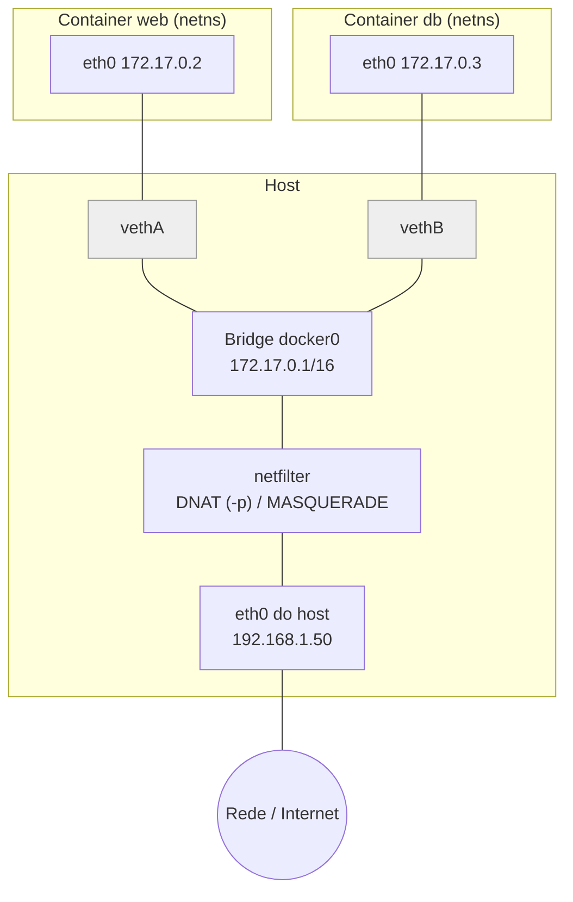

# Redes em Docker

> [!info] Posição na trilha
> **Etapa 5 — Redes em DevOps.** Pré-requisitos: [[03 - Endereçamento IP e Sub-redes]], [[06 - Portas e Sockets]], [[07 - DNS]], [[10 - NAT e PAT]], [[14 - Firewall e Filtragem de Pacotes]]. Próxima: [[21 - Redes em Kubernetes]].

## 1. Definição

O Docker fornece a cada container uma pilha de rede isolada usando recursos do kernel Linux e conecta essas pilhas por meio de **drivers de rede**. Os principais blocos são:

| Recurso do Linux | Papel |
|---|---|
| **Network namespace** | Cada container tem suas próprias interfaces, IPs, rotas, regras de firewall, tabela ARP e sockets |
| **Par veth** | "Cabo virtual" com duas pontas: uma dentro do container (`eth0`), outra no host |
| **Bridge Linux** | Switch virtual no host (`docker0` ou `br-<id>`) que interliga as pontas veth |
| **netfilter (iptables/nftables)** | NAT para saída (MASQUERADE), publicação de portas (DNAT) e isolamento entre redes |
| **DNS embutido** | Servidor DNS em `127.0.0.11` dentro de containers de redes customizadas |

> [!note] Docker Desktop (Windows/macOS)
> No Docker Desktop, os containers rodam dentro de uma **VM Linux**. A rede descrita aqui existe dentro dessa VM; o acesso do Windows/macOS passa por uma camada de encaminhamento adicional. Por isso, por exemplo, você não consegue pingar diretamente o IP `172.17.x.x` de um container a partir do Windows, e `host.docker.internal` é o nome fornecido para o container alcançar o host.

## 2. Por que isso importa

- "Funciona no meu computador, mas não no container" é frequentemente rede: `localhost`, bind em `127.0.0.1`, DNS, portas.
- Docker Compose, ambientes de desenvolvimento e CI dependem da comunicação entre containers.
- Entender o modelo do Docker é o degrau natural para entender o Kubernetes ([[21 - Redes em Kubernetes]]).

## 3. Como funciona

### 3.1 Arquitetura da rede bridge



1. Container `web` envia um pacote para a Internet: sai pela sua `eth0` → par veth → bridge → host roteia (`ip_forward`) → **MASQUERADE** troca o IP de origem `172.17.0.2` pelo IP do host → sai pela `eth0` do host.
2. Um cliente externo acessa `192.168.1.50:8080` → **DNAT** troca o destino para `172.17.0.2:80` → bridge → container.
3. `web` fala com `db` diretamente pela bridge (mesma rede L2), sem NAT.

### 3.2 Drivers de rede

| Driver | Descrição | Uso |
|---|---|---|
| **bridge** (padrão) | Rede privada no host, com NAT para saída | Maioria dos casos em um único host |
| **host** | Container usa **o namespace de rede do host** (sem isolamento de rede) | Desempenho máximo, ferramentas de rede; portas do container = portas do host |
| **none** | Apenas loopback | Isolamento total, jobs sem rede |
| **overlay** | Rede que abrange vários hosts (VXLAN) | Docker Swarm |
| **macvlan** | Container recebe um MAC próprio e aparece como um dispositivo físico na LAN | Integração com redes legadas; o host geralmente não consegue falar com esses containers diretamente |
| **ipvlan** | Semelhante ao macvlan, compartilhando o MAC do host | Quando o switch limita MACs por porta |

### 3.3 Bridge padrão vs bridge customizada (user‑defined)

| Característica | Bridge padrão (`docker0`, rede `bridge`) | Bridge customizada (`docker network create`) |
|---|---|---|
| DNS por nome de container | **Não** (só o legado `--link`) | **Sim**, via DNS embutido `127.0.0.11` |
| Isolamento | Todos os containers sem rede definida caem nela | Somente containers conectados àquela rede |
| Conectar/desconectar em execução | Não | Sim (`docker network connect/disconnect`) |
| Recomendação | Evitar para aplicações | **Recomendada** |

O **Docker Compose** cria automaticamente uma rede customizada por projeto (`<projeto>_default`) e todos os serviços se resolvem pelo **nome do serviço**.

### 3.4 Publicação de portas

| Sintaxe | Efeito |
|---|---|
| `-p 8080:80` | Porta 8080 em **todas as interfaces** do host → porta 80 do container |
| `-p 127.0.0.1:8080:80` | Só no loopback do host (acesso local) |
| `-p 8080:80/udp` | UDP |
| `-p 80` | Porta aleatória do host → 80 do container |
| `-P` | Publica todas as portas declaradas com `EXPOSE`, em portas aleatórias |
| `EXPOSE 80` (Dockerfile) | **Apenas documentação/metadado**; não publica nada sozinho |

> [!warning] Portas publicadas e firewall do host
> As regras de NAT do Docker atuam antes da filtragem de entrada tradicional. Uma porta publicada com `-p 8080:80` pode ficar **acessível de fora mesmo com ufw/firewalld configurado para bloquear**. Mitigue publicando em `127.0.0.1`, usando a chain `DOCKER-USER` para filtros, ou colocando um reverse proxy como único serviço exposto. Ver [[14 - Firewall e Filtragem de Pacotes]].

### 3.5 DNS dentro dos containers

- **Redes customizadas:** `/etc/resolv.conf` aponta para `127.0.0.11`. O DNS embutido resolve nomes de containers, nomes de serviços do Compose e **aliases** de rede; nomes externos são encaminhados aos resolvers configurados para o daemon/host.
- **Bridge padrão:** o container recebe uma cópia (filtrada) do `resolv.conf` do host. Se o host usa um resolver em loopback (como `127.0.0.53` do systemd‑resolved), o Docker não pode usá-lo de dentro do container e recorre aos servidores reais ou a servidores públicos padrão.
- Configurações: `--dns`, `--dns-search` por container, ou `"dns": [...]` em `/etc/docker/daemon.json`.

### 3.6 Comunicação: quem fala com quem

| De → Para | Como |
|---|---|
| Container → container (mesma rede customizada) | Pelo **nome** do container/serviço e a **porta interna** (não a publicada!) |
| Container → container (redes diferentes) | Não, por padrão. Conecte ambos a uma rede comum |
| Host → container | `localhost:<porta_publicada>`; ou, no Linux, o IP do container diretamente |
| Container → host | Linux: IP do gateway da bridge (ex.: `172.17.0.1`) ou `host.docker.internal` se mapeado com `--add-host=host.docker.internal:host-gateway`; Docker Desktop: `host.docker.internal` já existe |
| Container → Internet | MASQUERADE pelo IP do host |
| Externo → container | Via porta publicada (DNAT) |

> [!important] `localhost` dentro de um container é o próprio container
> Um container que acessa `localhost:5432` procura o banco **dentro de si mesmo**. Para acessar outro container, use o nome do serviço (`db:5432`); para o host, use os mecanismos acima.

## 4. Conceitos centrais

- **IPAM do Docker:** aloca sub-redes para redes (por padrão a partir de pools privados) e IPs para containers. A rede padrão usa `172.17.0.0/16`. Sobreposição com redes corporativas/VPN é um problema comum; configure `bip` e `default-address-pools` no `daemon.json`.
- **MTU:** containers herdam a MTU configurada para a rede (padrão 1500). Em hosts com MTU menor (ex.: VMs em clouds com MTU diferente, VPNs), ajuste a opção `mtu` da rede/daemon.
- **IPv6:** desativado por padrão em redes bridge; precisa ser habilitado explicitamente.
- **Aliases:** um container pode ter nomes adicionais numa rede (`--network-alias`), útil para simular nomes de produção.
- **Modo `container:<id>`:** um container compartilha o namespace de rede de outro (mesmo IP e `localhost`). É exatamente o modelo de rede de um **Pod do Kubernetes**.

## 5. Exemplos práticos

### Exemplo 1 — Rede customizada com DNS por nome

```bash
docker network create --subnet 10.30.0.0/24 app-net

docker run -d --name db --network app-net \
  -e POSTGRES_PASSWORD=lab postgres:16

docker run -d --name api --network app-net \
  -p 127.0.0.1:8080:8080 minha-api:latest
# Dentro de "api", a string de conexão é: postgres://postgres:lab@db:5432/postgres
```

### Exemplo 2 — Docker Compose com redes separadas

```yaml
services:
  proxy:
    image: nginx:1.27
    ports:
      - "80:80"            # único serviço exposto
    networks: [frontend]

  api:
    image: minha-api:latest
    networks: [frontend, backend]
    environment:
      DATABASE_URL: postgres://app:segredo@db:5432/app

  db:
    image: postgres:16
    environment:
      POSTGRES_USER: app
      POSTGRES_PASSWORD: segredo
      POSTGRES_DB: app
    networks: [backend]    # inacessível pelo proxy e sem porta publicada

networks:
  frontend:
  backend:
    internal: true         # sem acesso à Internet (sem MASQUERADE para fora)
```

- `proxy` alcança `api`, mas **não** `db`.
- `api` alcança ambos.
- `db` não tem saída para a Internet nem porta publicada.

> [!note] Senhas em exemplos
> Senhas em texto claro em arquivos Compose são aceitáveis apenas em laboratório. Em ambientes reais, use secrets (`secrets:` do Compose, variáveis injetadas pelo CI, gerenciadores de segredos).

### Exemplo 3 — Rede host

```bash
docker run --rm --network host nginx:1.27
# nginx escuta diretamente na porta 80 do host; -p é ignorado neste modo.
```

## 6. Comandos e demonstrações

```bash
# Listar redes e inspecionar uma
docker network ls
docker network inspect app-net

# IP de um container
docker inspect -f '{{range .NetworkSettings.Networks}}{{.IPAddress}} {{end}}' api

# Portas publicadas
docker port api

# Ver interfaces/rotas/DNS de dentro do container
docker exec api ip addr          # se a imagem tiver iproute2
docker exec api cat /etc/resolv.conf

# Diagnóstico usando o namespace de rede do container (imagem com ferramentas)
docker run --rm -it --network container:api nicolaka/netshoot
#   dentro: ss -tlnp ; dig db ; curl -v http://db:5432 ; tcpdump -n -i eth0

# Conectar um container existente a outra rede
docker network connect backend api

# No host: bridges, veths e regras
ip -br link show type bridge
ip -br link show type veth
bridge link
sudo iptables -t nat -S | grep -i docker      # ou: sudo nft list ruleset

# Configuração do daemon (exemplo de /etc/docker/daemon.json)
# {
#   "bip": "10.200.0.1/24",
#   "default-address-pools": [{"base": "10.201.0.0/16", "size": 24}],
#   "dns": ["10.0.0.2"],
#   "mtu": 1450
# }
# Requer: sudo systemctl restart docker  (reinicia containers sem política de restart adequada!)
```

## 7. Interpretação

`docker network inspect app-net` (trecho):

```json
"IPAM": { "Config": [ { "Subnet": "10.30.0.0/24", "Gateway": "10.30.0.1" } ] },
"Containers": {
  "a1b2...": { "Name": "db",  "IPv4Address": "10.30.0.2/24" },
  "c3d4...": { "Name": "api", "IPv4Address": "10.30.0.3/24" }
}
```

→ Sub-rede, gateway (IP da bridge no host) e containers conectados.

`docker port api`:

```text
8080/tcp -> 127.0.0.1:8080
```

→ Porta 8080 do container publicada somente no loopback do host.

Dentro do container, `cat /etc/resolv.conf` com `nameserver 127.0.0.11` → DNS embutido ativo (rede customizada).

## 8. Problemas comuns

| Sintoma | Causa provável | Correção |
|---|---|---|
| Porta publicada não responde (`connection reset`/`empty reply`) | Aplicação escuta em `127.0.0.1` **dentro** do container | Bind em `0.0.0.0` |
| `getaddrinfo ENOTFOUND db` | Containers em redes diferentes, ou na bridge padrão (sem DNS) | Rede customizada comum |
| App tenta `localhost:5432` e falha | `localhost` é o próprio container | Usar o nome do serviço |
| Container usa porta publicada para falar com outro (`db:15432`) | Confusão porta host vs porta interna | Usar a porta **interna** (`db:5432`) |
| Containers sem Internet | `ip_forward` desligado, regras do Docker apagadas, `internal: true`, proxy corporativo | Ver [[18 - Diagnóstico e Troubleshooting]] (cenário 3) |
| VPN/rede corporativa inacessível com Docker rodando | Sobreposição de faixa (`172.17.0.0/16` ou pools) com redes internas | `bip`, `default-address-pools` |
| Porta exposta apesar do firewall | Docker contorna INPUT | `127.0.0.1:` ou `DOCKER-USER` |
| `bind: address already in use` ao publicar | Porta do host já ocupada | `ss -tlnp` no host |
| Downloads grandes travam dentro de containers | MTU da rede do Docker maior que a do caminho real | Ajustar `mtu` |

## 9. Troubleshooting

1. **Em qual rede o container está?** `docker inspect` / `docker network inspect`.
2. **A aplicação escuta onde?** `docker run --rm --network container:<c> nicolaka/netshoot ss -tlnp`.
3. **DNS:** `dig <nome>` e `cat /etc/resolv.conf` dentro do namespace do container.
4. **Conectividade container → container:** `nc -vz <nome> <porta_interna>`.
5. **Publicação:** `docker port`, `ss -tlnp` no host, regras NAT.
6. **Saída:** `curl -v https://exemplo.com` no namespace; no host, `sysctl net.ipv4.ip_forward`, regras MASQUERADE, `tcpdump -i any host <IP_container>` para ver o NAT.

## 10. Aplicações em DevOps

- **Desenvolvimento local e CI** com Docker Compose: bancos e dependências em redes isoladas por projeto.
- **Testes de integração** em pipelines: serviços auxiliares (*service containers*) acessados por nome.
- **Reverse proxy** (Traefik, nginx, Caddy) como único container exposto.
- **Segurança de imagens e runtime:** menos portas publicadas, redes `internal`, sem `--network host` sem necessidade.
- **Ponte para o Kubernetes:** o modelo "vários containers compartilhando um namespace de rede" (`--network container:`) é o Pod.

## 11. Considerações de segurança

- **Não exponha o socket/API do Docker** (`/var/run/docker.sock`, TCP 2375) a containers ou à rede: equivale a dar root no host.
- `--network host` remove o isolamento de rede; use somente quando necessário.
- Publique apenas o necessário e, para serviços locais, em `127.0.0.1`.
- Por padrão, containers na mesma rede se comunicam livremente; separe redes por função.
- Containers com `NET_ADMIN`/`--privileged` podem alterar a rede do host ou de outros containers.
- Restrinja egress de containers sensíveis (redes `internal`, proxies, regras em `DOCKER-USER`).

## 12. Resumo

- Cada container tem um network namespace; veth + bridge os conectam; NAT dá saída e publica portas.
- Use **redes customizadas**: DNS por nome e isolamento.
- `-p host:container` publica (DNAT); `EXPOSE` só documenta.
- `localhost` no container é o container; fale com outros por nome e porta interna.
- Cuidado com faixas sobrepostas, MTU e portas publicadas contornando o firewall.

## 13. Verificação de conhecimento

1. Por que dois containers na rede `bridge` padrão não se resolvem por nome?
2. Um container `api` precisa falar com `db` publicado como `-p 15432:5432`. Qual endereço `api` deve usar se ambos estão na mesma rede customizada?
3. Qual a diferença entre `EXPOSE 80` e `-p 80:80`?
4. Como fazer um container acessar um serviço que roda no host Linux?
5. O que acontece em termos de rede com `--network container:api`?

> [!success]- Respostas
> 1. A bridge padrão não oferece o DNS embutido de nomes de containers; apenas redes customizadas oferecem.
> 2. `db:5432` (porta interna; a publicada é para acesso a partir do host/rede externa).
> 3. `EXPOSE` é só metadado; `-p` cria a publicação real (regras DNAT e proxy de portas).
> 4. Pelo IP do gateway da bridge (ex.: `172.17.0.1`) ou adicionando `--add-host=host.docker.internal:host-gateway` e usando `host.docker.internal`, com o serviço do host escutando nesse endereço.
> 5. O novo container compartilha o namespace de rede de `api`: mesmas interfaces, IP, portas e `localhost`.

## 14. Tópicos relacionados

- Anterior: [[19 - Ferramentas de Diagnóstico]]
- Próxima: [[21 - Redes em Kubernetes]]
- [[10 - NAT e PAT]]
- [[14 - Firewall e Filtragem de Pacotes]]
- [[24 - Laboratórios Práticos]]
- [[Mapa de Estudos de Redes]]
