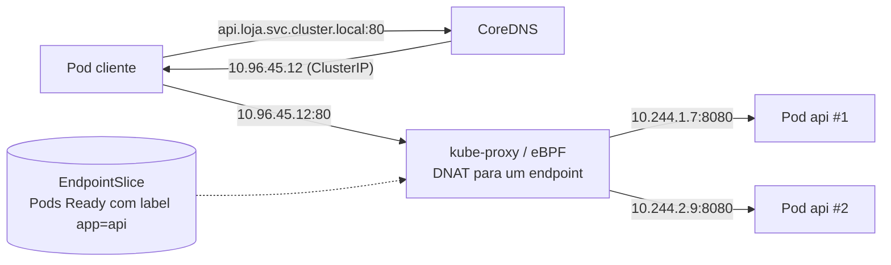
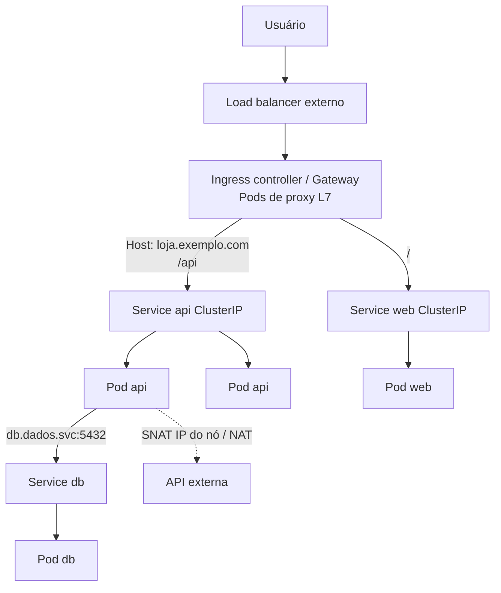
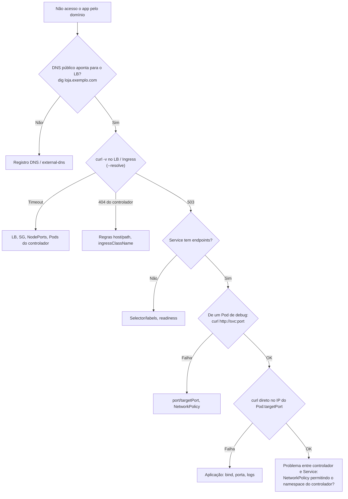

# Redes em Kubernetes

> [!info] Posição na trilha
> **Etapa 5 — Redes em DevOps.** Pré-requisitos: [[20 - Redes em Docker]], [[07 - DNS]], [[10 - NAT e PAT]], [[15 - Proxy e Reverse Proxy]], [[16 - Balanceamento de Carga]]. Próxima: [[22 - Redes em Cloud e DevOps]].
> Não é necessário ter um cluster para estudar esta nota; os laboratórios em [[24 - Laboratórios Práticos]] indicam como criar um cluster local (kind/minikube/k3d) quando você quiser praticar.

## 1. Definição

O Kubernetes define um **modelo de rede** e delega sua implementação a plugins. O modelo exige que:

1. **Todo Pod tenha um IP próprio**, único no cluster.
2. **Pods possam se comunicar com todos os outros Pods**, em qualquer nó, **sem NAT** (cada Pod vê o IP real do outro).
3. Agentes no nó (ex.: kubelet) possam se comunicar com todos os Pods daquele nó.

A rede do cluster envolve quatro problemas distintos:

| Problema | Solução no Kubernetes |
|---|---|
| Container ↔ container no mesmo Pod | Compartilham o **namespace de rede** → `localhost` |
| Pod ↔ Pod | **CNI plugin** (Calico, Cilium, Flannel, plugins de cloud...) |
| Pod ↔ Service (endereço estável) | **Services** + kube-proxy (ou implementação eBPF do CNI) |
| Externo ↔ Service | **NodePort**, **LoadBalancer**, **Ingress**, **Gateway API** |

## 2. Por que isso importa

- Pods são efêmeros: são recriados com outros IPs. Aplicações precisam de **nomes e endereços estáveis** (Services + DNS).
- Quase todo incidente de "serviço inacessível" em Kubernetes passa por labels/selectors, endpoints, portas, DNS, NetworkPolicies ou o controlador de Ingress.
- A rede é **plana e aberta por padrão** — entender NetworkPolicies é essencial para segurança.

## 3. Como funciona

### 3.1 Pod

- Um **Pod** é um ou mais containers que compartilham namespace de rede (mesmo IP, mesmas portas, `localhost` comum) — exatamente o modo `--network container:` do Docker ([[20 - Redes em Docker]]).
- Um container "pause" (sandbox) mantém o namespace de rede vivo.
- Dois containers do mesmo Pod **não podem** escutar na mesma porta.

### 3.2 CNI (Container Network Interface)

Quando um Pod é criado, o **kubelet** pede ao runtime de containers (containerd, CRI-O) para criar o sandbox, e o **plugin CNI**:

1. Cria a interface do Pod (geralmente um par veth).
2. Aloca um IP da faixa do nó (**IPAM**).
3. Configura rotas para que outros nós alcancem esse IP.

Abordagens de CNI:

| Abordagem | Como Pods em nós diferentes se alcançam | Exemplos |
|---|---|---|
| **Overlay** | Encapsulamento (VXLAN, Geneve, IP‑in‑IP) entre nós | Flannel (VXLAN), Calico (VXLAN/IPIP), Cilium (VXLAN/Geneve) |
| **Roteamento nativo** | Rotas reais para as faixas de Pods (BGP ou tabelas da cloud) | Calico com BGP, Cilium em modo nativo |
| **IPs da VPC** | Pods recebem IPs da própria rede da cloud | AWS VPC CNI, Azure CNI, GKE VPC‑native |
| **eBPF** | Datapath programado no kernel, podendo substituir o kube-proxy | Cilium, Calico eBPF |

Implicações práticas: overlays reduzem a MTU; CNIs com IPs da VPC exigem subnets grandes ([[04 - CIDR e Subnetting]]); nem todo CNI implementa NetworkPolicy (Flannel sozinho não implementa).

### 3.3 Services

Um **Service** dá um **IP virtual estável** (ClusterIP) e um **nome DNS** a um conjunto de Pods selecionados por **labels**. O controlador de endpoints mantém **EndpointSlices** com os IPs dos Pods **prontos** (*Ready*).



- O ClusterIP **não pertence a nenhuma interface**: é um destino virtual. O kube-proxy (modos **iptables**, **IPVS** ou o mais recente **nftables**) ou o datapath eBPF intercepta o tráfego e faz **DNAT** para o IP de um Pod.
- Por isso, **`ping` para um ClusterIP normalmente não funciona** (só as portas definidas no Service são tratadas). Teste com `curl`/`nc` na porta.

Tipos de Service:

| Tipo | Acesso | Como funciona |
|---|---|---|
| **ClusterIP** (padrão) | Somente dentro do cluster | IP virtual + DNS |
| **NodePort** | `IP_de_qualquer_nó:nodePort` (faixa padrão 30000–32767) | ClusterIP + porta aberta em todos os nós |
| **LoadBalancer** | IP/nome externo | NodePort/ClusterIP + LB provisionado pelo provedor (cloud controller) ou por soluções como MetalLB em bare metal |
| **ExternalName** | Nome DNS | CNAME para um nome externo (sem proxy) |
| **Headless** (`clusterIP: None`) | DNS retorna os **IPs dos Pods** diretamente | Usado com StatefulSets e clientes que fazem o próprio balanceamento |

**Portas de um Service:**

```yaml
apiVersion: v1
kind: Service
metadata:
  name: api
  namespace: loja
spec:
  type: ClusterIP
  selector:
    app: api              # deve casar com os labels dos Pods
  ports:
    - name: http
      port: 80            # porta do Service (o que clientes usam)
      targetPort: 8080    # porta do container no Pod
      protocol: TCP
```

| Campo | Onde vive |
|---|---|
| `containerPort` (no Pod) | Informativo/descoberta; não abre nem bloqueia nada |
| `targetPort` | Porta em que o container realmente escuta (número ou **nome** da porta) |
| `port` | Porta do Service no ClusterIP |
| `nodePort` | Porta em cada nó (NodePort/LoadBalancer) |

**`externalTrafficPolicy`** (NodePort/LoadBalancer): `Cluster` (padrão) pode encaminhar para Pods em outros nós, com **SNAT** (perde o IP do cliente); `Local` só entrega a Pods no próprio nó e **preserva o IP de origem** (nós sem Pods falham no health check do LB).

### 3.4 DNS no cluster (CoreDNS)

| Registro | Formato | Resolve para |
|---|---|---|
| Service | `<service>.<namespace>.svc.cluster.local` | ClusterIP |
| Service headless | mesmo nome | IPs dos Pods prontos |
| Pod de StatefulSet (com headless) | `<pod>.<service>.<namespace>.svc.cluster.local` | IP do Pod |
| SRV de portas nomeadas | `_<porta>._<proto>.<service>.<ns>.svc.cluster.local` | Porta + alvo |

Dentro do mesmo namespace, basta `api`; de outro namespace, `api.loja`. O domínio `cluster.local` é o padrão, mas é configurável. O `resolv.conf` dos Pods usa `ndots:5` e domínios de busca — o que gera consultas extras para nomes externos ([[07 - DNS]], Exemplo 1).

### 3.5 Ingress

O **Ingress** é um recurso L7 (HTTP/HTTPS) que descreve regras de roteamento por **host** e **caminho** para Services. Só funciona se houver um **Ingress controller** instalado (ingress-nginx, Traefik, HAProxy, controladores de cloud, etc.).

```yaml
apiVersion: networking.k8s.io/v1
kind: Ingress
metadata:
  name: loja
  namespace: loja
spec:
  ingressClassName: nginx
  tls:
    - hosts: [loja.exemplo.com]
      secretName: loja-tls          # Secret kubernetes.io/tls (ex.: gerado pelo cert-manager)
  rules:
    - host: loja.exemplo.com
      http:
        paths:
          - path: /api
            pathType: Prefix
            backend:
              service:
                name: api
                port:
                  number: 80
          - path: /
            pathType: Prefix
            backend:
              service:
                name: web
                port:
                  number: 80
```

> [!note] Ingress e o projeto ingress-nginx
> A API Ingress é estável, mas está "congelada": novos recursos são desenvolvidos na **Gateway API**. Além disso, o projeto comunitário **ingress-nginx** anunciou sua aposentadoria (*retirement*), com manutenção encerrada em março de 2026. Para clusters novos, avalie a Gateway API ou outro controlador mantido, e confira o estado atual na documentação oficial do Kubernetes.

### 3.6 Gateway API (fundamentos)

A **Gateway API** (recursos do grupo `gateway.networking.k8s.io`) é a evolução do Ingress, mais expressiva e orientada a papéis:

| Recurso | Responsável típico | Função |
|---|---|---|
| **GatewayClass** | Provedor da infraestrutura | Tipo de implementação (qual controlador) |
| **Gateway** | Operador do cluster/plataforma | Ponto de entrada: listeners (porta, protocolo, TLS, hostnames) |
| **HTTPRoute** (também GRPCRoute, TLSRoute, TCPRoute...) | Time da aplicação | Regras de roteamento para Services |

```yaml
apiVersion: gateway.networking.k8s.io/v1
kind: Gateway
metadata:
  name: publico
  namespace: infra
spec:
  gatewayClassName: exemplo-gc
  listeners:
    - name: https
      protocol: HTTPS
      port: 443
      hostname: "*.exemplo.com"
      tls:
        certificateRefs:
          - name: wildcard-exemplo-tls
      allowedRoutes:
        namespaces:
          from: All
---
apiVersion: gateway.networking.k8s.io/v1
kind: HTTPRoute
metadata:
  name: loja
  namespace: loja
spec:
  parentRefs:
    - name: publico
      namespace: infra
  hostnames: ["loja.exemplo.com"]
  rules:
    - matches:
        - path: { type: PathPrefix, value: /api }
      backendRefs:
        - name: api
          port: 80
          weight: 90
        - name: api-canary
          port: 80
          weight: 10            # divisão de tráfego nativa (canary)
```

Os nomes `exemplo-gc` e os Secrets são ilustrativos; dependem da implementação instalada. A Gateway API **não vem instalada** por padrão em todos os clusters: os CRDs e um controlador compatível precisam ser instalados.

### 3.7 NetworkPolicies

Por padrão, **todo Pod aceita tráfego de qualquer Pod** (e de fora, se exposto). Uma **NetworkPolicy** seleciona Pods por labels e define regras de **ingress** e/ou **egress** em L3/L4 (IPs/CIDRs, namespaces, Pods, portas).

Regras fundamentais:

- Políticas são **aditivas** (só permissões). Assim que um Pod é selecionado por alguma política para uma direção, **tudo naquela direção que não for permitido é negado**.
- Só têm efeito se o **CNI implementa** NetworkPolicy.
- A resposta de uma conexão permitida é liberada automaticamente (stateful).

```yaml
# 1) Default deny de entrada para todos os Pods do namespace
apiVersion: networking.k8s.io/v1
kind: NetworkPolicy
metadata:
  name: default-deny-ingress
  namespace: loja
spec:
  podSelector: {}
  policyTypes: [Ingress]
---
# 2) Permitir que somente Pods "web" acessem a "api" na porta 8080
apiVersion: networking.k8s.io/v1
kind: NetworkPolicy
metadata:
  name: api-allow-web
  namespace: loja
spec:
  podSelector:
    matchLabels:
      app: api
  policyTypes: [Ingress]
  ingress:
    - from:
        - podSelector:
            matchLabels:
              app: web
      ports:
        - protocol: TCP
          port: 8080          # porta do Pod (não a do Service)
```

> [!warning] Egress default deny e DNS
> Ao aplicar **default deny de egress**, lembre-se de liberar **DNS** (UDP e TCP 53 para o CoreDNS no namespace `kube-system`); caso contrário, **toda** resolução de nomes falha e os sintomas parecem "a rede inteira caiu".

> [!warning] Armadilha de YAML: `from` com um ou dois itens
> ```yaml
> from:
>   - namespaceSelector: {matchLabels: {time: a}}
>     podSelector: {matchLabels: {app: x}}      # UM item: Pods app=x NOS namespaces time=a (E)
> ```
> ```yaml
> from:
>   - namespaceSelector: {matchLabels: {time: a}}
>   - podSelector: {matchLabels: {app: x}}      # DOIS itens: qualquer Pod dos namespaces time=a OU Pods app=x do namespace local
> ```
> Um hífen a mais muda completamente a regra.

## 4. Conceitos centrais — fluxos de comunicação

| Fluxo | Caminho |
|---|---|
| Container ↔ container (mesmo Pod) | `localhost:<porta>` |
| Pod ↔ Pod (mesmo nó) | veth → bridge/rotas do nó → veth |
| Pod ↔ Pod (nós diferentes) | Overlay ou roteamento nativo entre nós |
| Pod → Service | DNS → ClusterIP → DNAT → Pod |
| Externo → NodePort | IP do nó:nodePort → DNAT → Pod (possivelmente em outro nó) |
| Externo → LoadBalancer | LB da cloud → nós/Pods → Pod |
| Externo → Ingress/Gateway | LB → Pods do controlador (proxy L7) → Service/Pods |
| Pod → Internet | SNAT para o IP do nó (ou NAT da VPC/egress gateway) |



## 5. Exemplos práticos

### Exemplo 1 — Service sem endpoints

```bash
kubectl get endpointslices -n loja -l kubernetes.io/service-name=api
# NAME        ADDRESSTYPE   PORTS     ENDPOINTS   AGE
# api-x7k2p   IPv4          <unset>   <unset>     5m
```

Sem endpoints → o seletor `app: api` não casa com nenhum Pod **pronto**. Compare:

```bash
kubectl get svc api -n loja -o jsonpath='{.spec.selector}'; echo
kubectl get pods -n loja --show-labels
```

### Exemplo 2 — `port-forward` para depurar

```bash
kubectl port-forward -n loja svc/api 8080:80
curl -v http://localhost:8080/health
```

O tráfego segue por um túnel via API server e kubelet até o Pod, **sem** passar pelo LB, pelo Ingress/Gateway nem pelo ClusterIP do Service (o `svc/api` é usado apenas para escolher um Pod). Em geral, ele também não é avaliado pelas NetworkPolicies como o tráfego vindo de outros Pods. Útil para separar "a aplicação funciona?" de "o caminho de rede funciona?".

## 6. Comandos e demonstrações

```bash
# IPs dos Pods e nós em que estão
kubectl get pods -A -o wide

# Services, portas e endpoints
kubectl get svc -n loja
kubectl describe svc api -n loja
kubectl get endpointslices -n loja

# Ingress / Gateway API
kubectl get ingress -A
kubectl describe ingress loja -n loja
kubectl get gateway,httproute -A          # se os CRDs estiverem instalados

# NetworkPolicies
kubectl get networkpolicy -n loja
kubectl describe networkpolicy api-allow-web -n loja

# Pod temporário de diagnóstico
kubectl run netshoot --rm -it --image=nicolaka/netshoot -n loja -- bash
#   dentro: cat /etc/resolv.conf ; dig api.loja.svc.cluster.local ; curl -v http://api ; nc -vz <IP_do_pod> 8080

# Container efêmero no Pod problemático (mesmo namespace de rede)
kubectl debug -it -n loja pod/api-7d9f -c debug --image=nicolaka/netshoot --target=api

# CoreDNS
kubectl get pods -n kube-system -l k8s-app=kube-dns
kubectl logs -n kube-system -l k8s-app=kube-dns

# kube-proxy (se o cluster o utiliza; o label pode variar por distribuição)
kubectl get pods -n kube-system -l k8s-app=kube-proxy

# Faixas configuradas (varia por distribuição): ver podCIDR dos nós
kubectl get nodes -o jsonpath='{range .items[*]}{.metadata.name}{"\t"}{.spec.podCIDR}{"\n"}{end}'
```

## 7. Interpretação

`kubectl get svc`:

```text
NAME   TYPE           CLUSTER-IP     EXTERNAL-IP     PORT(S)        AGE
api    ClusterIP      10.96.45.12    <none>          80/TCP         3d
web    LoadBalancer   10.96.101.7    203.0.113.40    80:31234/TCP   3d
```

- `80:31234/TCP` → porta do Service 80, NodePort 31234.
- `EXTERNAL-IP <pending>` em um LoadBalancer → não há controlador para provisionar o LB (comum em clusters locais; use `minikube tunnel`, MetalLB ou o LB embutido do k3s/k3d).

`kubectl describe ingress` mostra os backends e, em **Events**, erros do controlador (ex.: Secret TLS ausente, Service inexistente).

Dentro do Pod, `dig api.loja.svc.cluster.local` retornando o ClusterIP confirma o DNS; retornando NXDOMAIN → nome/namespace errados ou CoreDNS com problema.

## 8. Problemas comuns

| Sintoma | Causa provável |
|---|---|
| Service sem endpoints → 503 no Ingress / timeout | Selector ≠ labels; Pods não *Ready* (readiness probe falhando) |
| Endpoints ok, mas conexão recusada | `targetPort` diferente da porta em que o container escuta; app em `127.0.0.1` |
| Funciona por IP do Pod, não pelo Service | `port`/`targetPort` errados; kube-proxy/CNI com problema |
| `ping` ao ClusterIP falha | Esperado (IP virtual só trata as portas do Service) |
| DNS falha em todos os Pods de um namespace | NetworkPolicy de egress sem liberar DNS; CoreDNS fora |
| Lentidão em nomes externos | `ndots:5` + domínios de busca; considere FQDN com ponto final ou NodeLocal DNSCache |
| Ingress retorna 404 do controlador | Regra de host/caminho não casa; `ingressClassName` errado/ausente |
| LoadBalancer `<pending>` | Sem integração de cloud/MetalLB |
| IP do cliente aparece como IP de nó | `externalTrafficPolicy: Cluster` (SNAT); use `Local` ou cabeçalhos do proxy |
| Pods sem IP / `failed to allocate` | Pool de IPs do CNI esgotado; subnets pequenas demais |
| Pacotes grandes travam entre nós | MTU do overlay |

## 9. Troubleshooting



Checklist rápido:

1. `kubectl get pods -o wide` — Pods *Running* e *Ready*?
2. `kubectl get endpointslices` — o Service tem endpoints?
3. Teste em camadas: IP do Pod → Service → Ingress/Gateway → LB → DNS público.
4. `kubectl get networkpolicy -A` — há políticas selecionando os Pods de origem/destino?
5. Eventos: `kubectl get events -n <ns> --sort-by=.lastTimestamp`.

## 10. Aplicações em DevOps

- **Deploys sem downtime:** readiness probes controlam quando o Pod entra nos endpoints; `preStop` + `terminationGracePeriodSeconds` permitem drenar conexões.
- **Canary/blue‑green:** pesos em HTTPRoute, ou recursos do controlador/service mesh.
- **Certificados:** cert-manager + Ingress/Gateway. Ver [[12 - TLS e Certificados]].
- **DNS externo automatizado:** external-dns cria registros a partir de Services/Ingresses/Gateways.
- **Segurança:** namespaces com default deny + políticas explícitas; egress controlado.
- **Observabilidade:** métricas do controlador de Ingress, CoreDNS, CNI (ex.: Hubble no Cilium), conntrack nos nós.

## 11. Considerações de segurança

- A rede de Pods é **plana e aberta** por padrão: aplique NetworkPolicies (default deny) com um CNI que as suporte.
- Restrinja acesso ao **API server** (6443), **kubelet** (10250) e **etcd** (2379/2380).
- Evite `hostNetwork: true` e `hostPort` sem necessidade.
- Bloqueie o acesso dos Pods ao endpoint de metadata da cloud (`169.254.169.254`) quando não necessário, ou use mecanismos de identidade de workload do provedor.
- Use mTLS entre serviços (service mesh) para autenticação e criptografia em trânsito quando o modelo de ameaça exigir.
- Revise Services do tipo LoadBalancer/NodePort: cada um é uma exposição externa potencial.

## 12. Resumo

- Cada Pod tem IP próprio; Pods se alcançam sem NAT; o CNI implementa isso.
- Services dão IP virtual + DNS estáveis; kube-proxy/eBPF faz DNAT para Pods prontos (EndpointSlices).
- ClusterIP (interno), NodePort (porta em cada nó), LoadBalancer (LB externo), headless (IPs dos Pods).
- Ingress e Gateway API fazem roteamento L7; precisam de um controlador.
- NetworkPolicies são permissões aditivas; um Pod selecionado passa a negar o que não for permitido. Não esqueça o DNS no egress.

## 13. Verificação de conhecimento

1. Qual a diferença entre `port`, `targetPort` e `nodePort`?
2. Um Service retorna timeout e `kubectl get endpointslices` mostra endpoints vazios. Quais são as duas causas mais comuns?
3. Por que `ping 10.96.0.10` (ClusterIP do CoreDNS) pode falhar mesmo com o DNS funcionando?
4. Depois de aplicar uma política de egress default deny, nenhum Pod resolve nomes. Por quê?
5. Qual é o nome DNS completo do Service `pagamentos` no namespace `financeiro`?
6. Em que a Gateway API difere do Ingress quanto à divisão de responsabilidades?

> [!success]- Respostas
> 1. `port`: porta do Service (ClusterIP); `targetPort`: porta do container no Pod; `nodePort`: porta aberta em todos os nós para acesso externo.
> 2. O selector não casa com os labels dos Pods; os Pods não estão *Ready* (readiness falhando).
> 3. ClusterIP é virtual; apenas as portas/protocolos definidos no Service são encaminhados. ICMP não é tratado.
> 4. O egress para o CoreDNS (UDP/TCP 53) não foi permitido.
> 5. `pagamentos.financeiro.svc.cluster.local` (assumindo o domínio padrão).
> 6. A Gateway API separa recursos por papel: o provedor define a GatewayClass, a plataforma define o Gateway (listeners, TLS) e os times das aplicações definem rotas (HTTPRoute), com controle de quais namespaces podem se anexar.

## 14. Tópicos relacionados

- Anterior: [[20 - Redes em Docker]]
- Próxima: [[22 - Redes em Cloud e DevOps]]
- [[16 - Balanceamento de Carga]]
- [[15 - Proxy e Reverse Proxy]]
- [[07 - DNS]]
- [[24 - Laboratórios Práticos]]
- [[Mapa de Estudos de Redes]]
