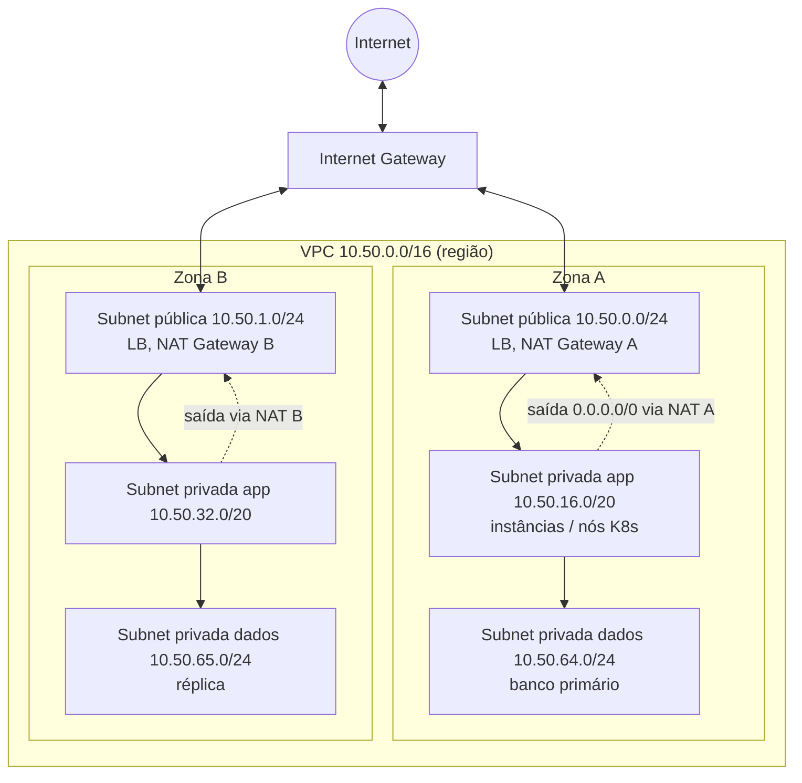
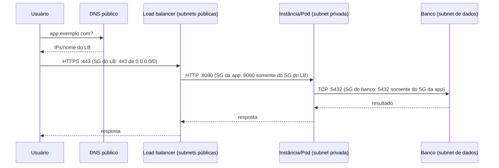

# Redes em Cloud e DevOps

> [!info] Posição na trilha
> **Etapa 5 — Redes em DevOps.** Pré-requisitos: [[04 - CIDR e Subnetting]], [[09 - Roteamento e Gateway]], [[10 - NAT e PAT]], [[14 - Firewall e Filtragem de Pacotes]], [[16 - Balanceamento de Carga]]. Próxima: [[23 - Segurança de Redes]].
> Não é necessário ter conta em cloud para estudar esta nota. Os conceitos são **neutros em relação ao provedor**; nomes específicos (AWS, Azure, GCP) aparecem apenas como referência.

## 1. Definição

**Redes em cloud** são redes definidas por software (SDN) que o provedor oferece como serviços configuráveis via API. Elas reproduzem os mesmos conceitos de uma rede física — sub-redes, roteadores, NAT, firewall, balanceadores, DNS, VPN — mas como **recursos lógicos**, criados e versionados por código.

### Equivalência de termos entre provedores

| Conceito | AWS | Azure | Google Cloud |
|---|---|---|---|
| Rede privada virtual | VPC | Virtual Network (VNet) | VPC network (global) |
| Sub-rede | Subnet (por AZ) | Subnet (regional) | Subnet (regional) |
| Tabela de rotas | Route table | Route table (UDR) | Routes (na rede) |
| Saída para Internet | Internet Gateway | Implícita / IP público / NAT Gateway | Rota padrão + IP externo / Cloud NAT |
| NAT de saída gerenciado | NAT Gateway | NAT Gateway | Cloud NAT |
| Firewall stateful por recurso | Security Group | Network Security Group (NSG)* | VPC firewall rules / policies |
| Filtro stateless por sub-rede | Network ACL | — (NSGs podem ser associados a subnets) | — |
| Interconexão de redes | VPC Peering, Transit Gateway | VNet Peering, Virtual WAN | VPC Peering, Network Connectivity Center |
| Acesso privado a serviços gerenciados | VPC Endpoints / PrivateLink | Private Endpoint / Private Link | Private Service Connect |
| DNS gerenciado | Route 53 | Azure DNS / Private DNS | Cloud DNS |
| Conectividade híbrida | Site‑to‑Site VPN, Direct Connect | VPN Gateway, ExpressRoute | Cloud VPN, Cloud Interconnect |

\* NSGs do Azure são stateful e têm regras com prioridade, incluindo regras de negação. As características exatas de cada serviço mudam com o tempo: **consulte a documentação oficial** antes de decisões de arquitetura.

## 2. Por que isso importa

- Todo workload em cloud vive dentro de uma rede virtual; decisões de endereçamento são **difíceis de mudar depois**.
- A maioria dos incidentes de exposição de dados em cloud envolve **regras de rede permissivas** ou recursos públicos indevidos.
- Custos: tráfego entre zonas, regiões, NAT Gateways e saída para a Internet geralmente são cobrados.

## 3. Como funciona

### 3.1 Arquitetura de referência: VPC com subnets públicas e privadas



| Subnet | Tabela de rotas | Quem fica lá | Exposição |
|---|---|---|---|
| **Pública** | `VPC_CIDR → local`, `0.0.0.0/0 → Internet Gateway` | Load balancers, NAT Gateways, bastion (se houver) | Recursos com IP público podem ser alcançados (se o firewall permitir) |
| **Privada (app)** | `VPC_CIDR → local`, `0.0.0.0/0 → NAT Gateway` | Instâncias, nós de Kubernetes | Sem entrada direta; saída via NAT |
| **Privada isolada (dados)** | Apenas `VPC_CIDR → local` (+ endpoints privados) | Bancos, caches | Sem Internet em nenhum sentido |

> [!important] O que torna uma subnet "pública"
> Não é o nome: é a **rota `0.0.0.0/0` para um Internet Gateway** (no modelo AWS), combinada com recursos que possuam **IP público**. Uma instância numa subnet pública **sem** IP público não é alcançável da Internet; uma instância numa subnet privada **nunca** é, mesmo com regras de firewall abertas.

### 3.2 Fluxo de entrada (usuário → aplicação)



### 3.3 Fluxo de saída (aplicação → Internet)

`APP (10.50.16.25)` → rota `0.0.0.0/0` → **NAT Gateway** (subnet pública, IP público fixo) → rota da subnet pública → **Internet Gateway** → Internet. O destino vê o **IP público do NAT Gateway** ([[10 - NAT e PAT]]).

### 3.4 Acesso privado a serviços gerenciados

Para acessar armazenamento de objetos, registries, secret managers ou APIs do provedor **sem passar pela Internet nem pelo NAT**, use **endpoints privados** (VPC Endpoints/PrivateLink, Private Endpoint, Private Service Connect). Benefícios: segurança (tráfego não sai da rede do provedor; políticas de endpoint), menor custo de NAT e menor dependência do caminho de Internet. O DNS normalmente é ajustado (zonas privadas) para que o nome público do serviço resolva para o IP privado do endpoint.

## 4. Conceitos centrais

### 4.1 Security Groups vs Network ACLs (modelo AWS como referência)

| Aspecto | **Security Group** | **Network ACL** |
|---|---|---|
| Aplica-se a | Interfaces de rede (instâncias, LBs, endpoints, Pods em alguns CNIs) | Subnets |
| Estado | **Stateful** (resposta liberada automaticamente) | **Stateless** (resposta precisa de regra, incluindo portas efêmeras) |
| Regras | Apenas **allow** | **Allow e deny**, avaliadas **em ordem numérica** |
| Origem pode ser | CIDR, outro Security Group, prefix list | Apenas CIDR |
| Uso típico | Controle principal, por função | Guarda‑corpo amplo (bloquear faixas, isolar subnets) |

Exemplo de conjunto coerente:

| SG | Entrada | Saída |
|---|---|---|
| `sg-lb` | TCP 443 de `0.0.0.0/0` e `::/0` | TCP 8080 para `sg-app` |
| `sg-app` | TCP 8080 de `sg-lb` | TCP 5432 para `sg-db`; TCP 443 para `0.0.0.0/0` (APIs externas via NAT) |
| `sg-db` | TCP 5432 de `sg-app` | (nenhuma necessária para respostas) |

### 4.2 Roteamento em cloud

- Cada subnet é associada a uma **tabela de rotas**; a rota `local` (CIDR da VPC) é implícita e não pode ser removida.
- Alvos possíveis: Internet Gateway, NAT Gateway, peering, Transit Gateway/hub, VPN, endpoint, appliance de firewall.
- **Longest prefix match** também vale aqui ([[09 - Roteamento e Gateway]]).
- **Peering não é transitivo** (em geral): se A↔B e B↔C, A não alcança C por B. Para muitas redes, use um **hub** (Transit Gateway, Virtual WAN, NCC).
- **CIDRs sobrepostos** impedem peering/roteamento: planeje IPAM centralizado ([[04 - CIDR e Subnetting]]).

### 4.3 DNS em cloud

- **Resolver da VPC:** cada rede tem um resolver interno (na AWS, no endereço base da VPC +2) que resolve nomes internos, zonas privadas e nomes públicos.
- **Zonas privadas:** nomes visíveis apenas dentro de redes associadas — base do *split‑horizon*.
- **Resolução híbrida:** encaminhadores (inbound/outbound endpoints) entre DNS on‑premises e cloud.
- **Registros com alias/roteamento:** apontar o apex para um LB, roteamento por peso, latência, geolocalização, failover com health checks.

### 4.4 Load balancers gerenciados

| Tipo | Camada | Características |
|---|---|---|
| Application LB / HTTP(S) LB | 7 | Roteamento por host/caminho, terminação TLS, integração com WAF |
| Network LB | 4 | Alto desempenho, IPs estáticos em alguns provedores, preserva IP de origem em certos modos |
| LB interno | 4/7 | Somente dentro da VPC |
| LB global | 7 (às vezes 4) | Anycast, roteamento para a região mais próxima |

### 4.5 Disponibilidade

- Distribua recursos em **múltiplas zonas de disponibilidade** (AZs): subnets por zona, LB multi‑AZ, **NAT Gateway por zona** (para que a falha de uma zona não derrube a saída das outras e para evitar custos de tráfego entre zonas).
- **Multi‑região:** DNS com failover/latência, replicação de dados, conectividade entre regiões.

### 4.6 Observabilidade de rede

| Fonte | O que mostra |
|---|---|
| **Flow logs** (VPC/NSG/VPC Flow Logs) | Metadados de fluxos: origem, destino, portas, protocolo, ação (ACCEPT/REJECT), bytes |
| Logs de acesso do LB | Requisições, códigos, tempos, backend escolhido |
| Métricas do NAT Gateway | Conexões, bytes, erros de alocação de porta |
| Logs de consultas DNS | Quem resolveu o quê |
| Ferramentas de análise de alcance | Alguns provedores analisam configurações e dizem se um caminho A→B é possível e qual regra bloqueia |

Exemplo de registro de flow log (formato padrão da AWS, versão 2):

```text
2 123456789012 eni-0a1b2c3d 203.0.113.50 10.50.16.25 51515 22 6 1 60 1700000000 1700000060 REJECT OK
```

→ Tentativa TCP (`6`) de `203.0.113.50` para a porta 22 de `10.50.16.25`, **rejeitada**.

## 5. Exemplos práticos

### Exemplo 1 — Terraform (AWS) de uma subnet privada com NAT (trecho)

```hcl
resource "aws_vpc" "main" {
  cidr_block           = "10.50.0.0/16"
  enable_dns_support   = true
  enable_dns_hostnames = true
}

resource "aws_subnet" "public_a" {
  vpc_id                  = aws_vpc.main.id
  cidr_block              = cidrsubnet(aws_vpc.main.cidr_block, 8, 0)   # 10.50.0.0/24
  availability_zone       = "us-east-1a"
  map_public_ip_on_launch = false
}

resource "aws_subnet" "app_a" {
  vpc_id            = aws_vpc.main.id
  cidr_block        = cidrsubnet(aws_vpc.main.cidr_block, 4, 1)         # 10.50.16.0/20
  availability_zone = "us-east-1a"
}

resource "aws_internet_gateway" "igw" {
  vpc_id = aws_vpc.main.id
}

resource "aws_eip" "nat_a" {
  domain = "vpc"
}

resource "aws_nat_gateway" "a" {
  allocation_id = aws_eip.nat_a.id
  subnet_id     = aws_subnet.public_a.id      # NAT fica na subnet PÚBLICA
}

resource "aws_route_table" "public" {
  vpc_id = aws_vpc.main.id
  route {
    cidr_block = "0.0.0.0/0"
    gateway_id = aws_internet_gateway.igw.id
  }
}

resource "aws_route_table" "app_a" {
  vpc_id = aws_vpc.main.id
  route {
    cidr_block     = "0.0.0.0/0"
    nat_gateway_id = aws_nat_gateway.a.id
  }
}

resource "aws_route_table_association" "public_a" {
  subnet_id      = aws_subnet.public_a.id
  route_table_id = aws_route_table.public.id
}

resource "aws_route_table_association" "app_a" {
  subnet_id      = aws_subnet.app_a.id
  route_table_id = aws_route_table.app_a.id
}
```

O exemplo é ilustrativo e incompleto (falta a segunda zona, Security Groups, etc.). Os argumentos dos recursos mudam entre versões do provider; consulte a documentação do provider Terraform utilizado.

### Exemplo 2 — Kubernetes gerenciado em cloud

- Nós em subnets privadas; o plano de controle pode ter endpoint público (com restrição de origem) ou privado.
- Services `LoadBalancer` e controladores de Ingress/Gateway provisionam LBs nas subnets públicas (identificadas por tags/anotações, conforme o provedor).
- Com CNIs que usam IPs da VPC, cada Pod consome um IP da subnet → dimensione subnets grandes (`/20` ou maiores) ou use recursos como *prefix delegation*.
- Egress dos Pods sai pelo NAT Gateway; para allowlists de parceiros, informe os IPs do NAT.

### Exemplo 3 — Pipeline de CI/CD acessando recursos privados

Opções, da menos para a mais recomendada em termos de exposição:

1. Runner hospedado na Internet + abrir porta para os IPs do provedor de CI (amplo e mutável).
2. **Runner self‑hosted dentro da VPC** (em subnet privada), com acesso de saída controlado.
3. Acesso via identidade federada (OIDC) às APIs da cloud + deploy por mecanismos que não exigem conectividade direta de rede (ex.: o cluster puxa as mudanças — GitOps).

## 6. Comandos e demonstrações (CLI de referência)

Comandos são específicos de provedor; os exemplos usam a AWS CLI apenas como ilustração.

```bash
# Descobrir a configuração de rede de dentro de uma VM (Linux) — vale para qualquer cloud
ip -br addr; ip route; cat /etc/resolv.conf
curl -s https://ifconfig.me ; echo          # IP público de saída (IP da instância ou do NAT)

# AWS: rotas de uma subnet, Security Groups e flow logs (exemplos)
aws ec2 describe-route-tables --filters Name=association.subnet-id,Values=subnet-0abc --output table
aws ec2 describe-security-groups --group-ids sg-0abc --output json
aws ec2 describe-network-acls --filters Name=association.subnet-id,Values=subnet-0abc

# Metadata da instância (IMDSv2: exige token). Só funciona DE DENTRO da instância.
TOKEN=$(curl -s -X PUT http://169.254.169.254/latest/api/token -H 'X-aws-ec2-metadata-token-ttl-seconds: 60')
curl -s -H "X-aws-ec2-metadata-token: $TOKEN" http://169.254.169.254/latest/meta-data/local-ipv4; echo
```

Equivalentes existem no Azure CLI (`az network ...`) e no gcloud (`gcloud compute networks ...`, `gcloud compute firewall-rules ...`).

## 7. Interpretação

- **Tabela de rotas** sem `0.0.0.0/0` → subnet isolada (sem Internet). Com `0.0.0.0/0 → nat-...` → privada com saída. Com `0.0.0.0/0 → igw-...` → pública.
- Rota em estado **blackhole** (AWS) → o alvo (NAT, instância, interface) foi removido ou está indisponível.
- Flow log com `ACCEPT` na entrada e `REJECT` na saída correspondente → **NACL stateless** bloqueando a resposta (portas efêmeras).
- Flow logs **sem nenhum registro** do tráfego esperado → o tráfego nunca chegou àquela interface (DNS, rota anterior, LB).

## 8. Problemas comuns

| Sintoma | Causa provável |
|---|---|
| Instância privada sem Internet | Sem rota para NAT; NAT na subnet errada; NACL; SG de saída restrito |
| Instância "pública" inacessível | Sem IP público; SG sem regra de entrada; NACL; firewall do SO; serviço em loopback |
| LB com targets unhealthy | SG da app não permite o SG do LB; health check em porta/caminho errados |
| Peering ativo, mas sem comunicação | Rotas ausentes em um dos lados; SGs não permitem o CIDR remoto; CIDRs sobrepostos |
| A alcança B e B alcança C, mas A não alcança C | Peering não transitivo |
| Erros intermitentes de conexão de saída sob carga | Esgotamento de portas no NAT Gateway |
| Custos altos de NAT | Tráfego para serviços do provedor saindo via NAT em vez de endpoints privados |
| Nome de serviço resolve para IP público dentro da VPC | Zona privada/endpoint DNS não associado à VPC |
| Pods não recebem IP | Subnet sem IPs livres (CNI com IPs da VPC) |

## 9. Troubleshooting

1. **Desenhe o caminho**: origem (subnet, SG) → rotas → controles (NACL, SG, firewall) → destino.
2. **DNS**: o nome resolve para o IP esperado **de dentro da VPC**?
3. **Rotas** da subnet de origem **e** da subnet de destino (volta!).
4. **NACLs** de ambas as subnets, entrada e saída (portas efêmeras).
5. **Security Groups**: entrada no destino, saída na origem.
6. **Firewall do SO** e serviço escutando no endereço correto.
7. **Flow logs** e ferramentas de análise de alcance do provedor para confirmar onde o tráfego para.

## 10. Aplicações em DevOps

- **Infraestrutura como Código** (Terraform/OpenTofu, Pulumi, CloudFormation, Bicep): redes revisadas em pull requests, com módulos reutilizáveis.
- **Landing zones:** contas/projetos separados por ambiente, rede hub‑and‑spoke, IPAM central.
- **Policy as code:** impedir SGs com `0.0.0.0/0` em portas sensíveis, exigir flow logs, bloquear IPs públicos em subnets de dados.
- **Observabilidade:** flow logs em armazenamento central, alertas para REJECT incomuns, métricas de NAT e LB.
- **Escalabilidade:** auto scaling registrando instâncias no LB; subnets dimensionadas para crescimento.
- **Custos:** endpoints privados, NAT por zona, atenção a tráfego entre zonas e regiões.

## 11. Considerações de segurança

- **Menor exposição:** apenas LBs/CDN em subnets públicas; workloads e dados em privadas.
- Nunca libere SSH/RDP/bancos para `0.0.0.0/0`; use bastion com restrição de origem ou acesso sem portas abertas (gerenciadores de sessão do provedor, acesso zero trust).
- Proteja o **endpoint de metadata** (IMDSv2 na AWS; equivalentes em outros provedores) contra SSRF.
- Controle **egress** (SGs de saída, firewalls gerenciados, proxies) para dificultar exfiltração.
- Ative **flow logs** e logs de DNS para investigação.
- Separe ambientes (produção/não produção) em redes e contas diferentes.
- Revise recursos públicos (buckets, snapshots, endpoints de banco) — "rede" inclui também políticas de acesso a serviços gerenciados.

## 12. Resumo

- VPC/VNet = rede privada lógica; subnets por zona; tabelas de rotas definem pública/privada.
- Internet Gateway para entrada/saída de recursos públicos; NAT Gateway para saída de subnets privadas.
- Security Groups (stateful, allow, por recurso) e NACLs (stateless, ordenadas, por subnet).
- Peering não é transitivo; CIDRs não podem se sobrepor; use hubs para muitas redes.
- Endpoints privados mantêm o tráfego para serviços gerenciados fora da Internet.

## 13. Verificação de conhecimento

1. Uma instância com IP público em uma subnet sem rota para o Internet Gateway pode ser acessada da Internet? Por quê?
2. Por que o NAT Gateway precisa ficar em uma subnet pública?
3. Escreva as regras de SG para: LB público em 443 → app em 8080 → banco em 5432, com o menor privilégio possível.
4. Um flow log mostra `ACCEPT` para entrada na porta 443 e `REJECT` para os pacotes de resposta. Qual controle está causando isso?
5. Por que usar um endpoint privado para acessar o armazenamento de objetos a partir de subnets privadas?

> [!success]- Respostas
> 1. Não. Sem rota para o Internet Gateway, o tráfego de resposta não tem como sair da VPC para a Internet (e o tráfego de entrada não é encaminhado à subnet como pública).
> 2. Porque ele próprio precisa de uma rota para o Internet Gateway para enviar o tráfego traduzido à Internet.
> 3. `sg-lb`: entrada 443 de `0.0.0.0/0` (e `::/0`); `sg-app`: entrada 8080 de `sg-lb`; `sg-db`: entrada 5432 de `sg-app`. Saídas restritas aos destinos correspondentes.
> 4. Uma Network ACL (stateless) sem regra de saída para as portas efêmeras dos clientes.
> 5. Para manter o tráfego na rede do provedor (sem Internet/NAT), reduzir custo de NAT e permitir políticas de acesso no endpoint.

## 14. Tópicos relacionados

- Anterior: [[21 - Redes em Kubernetes]]
- Próxima: [[23 - Segurança de Redes]]
- [[04 - CIDR e Subnetting]]
- [[10 - NAT e PAT]]
- [[14 - Firewall e Filtragem de Pacotes]]
- [[16 - Balanceamento de Carga]]
- [[17 - VLAN e Segmentação de Redes]]
- [[Mapa de Estudos de Redes]]
