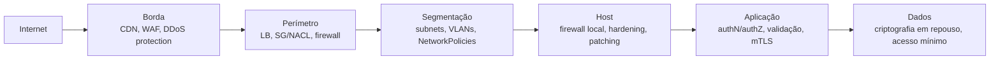

# Segurança de Redes

> [!info] Posição na trilha
> **Etapa 4 — Diagnóstico e Segurança** (revisitada na Etapa 5). Pré-requisitos: [[12 - TLS e Certificados]], [[13 - SSH]], [[14 - Firewall e Filtragem de Pacotes]], [[17 - VLAN e Segmentação de Redes]]. Esta nota **consolida** os aspectos de segurança espalhados pelas demais.

## 1. Definição

**Segurança de redes** é o conjunto de práticas, controles e arquiteturas que protegem a **confidencialidade**, a **integridade** e a **disponibilidade** (tríade **CIA**) dos dados e serviços que trafegam ou dependem da rede.

| Propriedade | Ameaça típica | Controles de rede |
|---|---|---|
| **Confidencialidade** | Interceptação (sniffing, MITM) | TLS, SSH, VPN/IPsec/WireGuard, segmentação |
| **Integridade** | Alteração de dados em trânsito, spoofing | TLS/AEAD, DNSSEC, assinaturas, anti‑spoofing |
| **Disponibilidade** | DDoS, esgotamento de recursos | Rate limiting, CDN/WAF, autoscaling, SYN cookies, redundância |

## 2. Por que isso importa

- Infraestrutura em cloud e containers muda constantemente; uma única regra permissiva pode expor bancos de dados, painéis ou APIs internas.
- Atacantes que conseguem um ponto de entrada exploram **redes planas** para movimentação lateral.
- Engenheiros DevOps definem, por código, grande parte dos controles de rede — segurança é parte do trabalho, não uma etapa posterior.

## 3. Como funciona — princípios

### 3.1 Defesa em profundidade

Camadas de controle independentes; a falha de uma não compromete tudo.



### 3.2 Menor privilégio aplicado à rede

- Liberar **somente** origens, destinos, portas e protocolos necessários.
- Preferir **identidades/grupos** (Security Groups, labels de Pods, contas de serviço) a IPs avulsos.
- **Default deny** em entrada e, onde viável, em saída.
- Revisar e expirar exceções.

### 3.3 Zero Trust

O modelo **Zero Trust** (NIST SP 800‑207) parte da premissa de que **estar "dentro da rede" não confere confiança**. Cada acesso é autenticado, autorizado e cifrado, considerando identidade do usuário/serviço, estado do dispositivo e contexto. Na prática DevOps: mTLS entre serviços, autenticação forte em todas as APIs internas, acesso administrativo por proxies de identidade em vez de VPN ampla, microsegmentação.

## 4. Conceitos centrais — ameaças e mitigações

### 4.1 Ameaças por camada

| Ameaça | Camada | Descrição | Mitigações |
|---|---|---|---|
| **ARP spoofing / poisoning** | 2 | Falsificar mapeamento IP→MAC para interceptar tráfego | DAI, segmentação, TLS/SSH fim a fim ([[08 - DHCP e ARP]]) |
| **Rogue DHCP** | 2/7 | Servidor DHCP falso entrega gateway/DNS maliciosos | DHCP snooping |
| **MAC flooding** | 2 | Encher a tabela do switch para forçar flooding | Port security |
| **VLAN hopping** | 2 | Acessar VLANs não autorizadas | Desabilitar trunk automático, native VLAN dedicada ([[17 - VLAN e Segmentação de Redes]]) |
| **IP spoofing** | 3 | Forjar IP de origem | Filtros anti‑spoofing (BCP 38), `rp_filter`; não usar IP como autenticação |
| **Varredura de portas / reconhecimento** | 3/4 | Descobrir serviços expostos | Menor exposição, alertas, rate limiting |
| **SYN flood** | 4 | Esgotar a fila de conexões semiabertas | SYN cookies, proteção DDoS, LBs gerenciados ([[05 - TCP e UDP]]) |
| **Amplificação/reflexão UDP** | 4/7 | Usar serviços UDP abertos (DNS, NTP, memcached) para multiplicar tráfego contra uma vítima | Não expor resolvers/serviços UDP; BCP 38 |
| **DNS spoofing / cache poisoning** | 7 | Respostas DNS falsas | DNSSEC, resolvers confiáveis, DoT/DoH ([[07 - DNS]]) |
| **Subdomain takeover** | 7 | CNAME órfão apontando para recurso reivindicável | Auditoria de registros DNS |
| **Man‑in‑the‑middle (MITM)** | várias | Interceptar/alterar comunicações | TLS com validação, HSTS, SSH com host keys verificadas |
| **Downgrade de TLS** | 6 | Forçar versões/cifras fracas | Desabilitar versões antigas, HSTS |
| **Credenciais vazadas / força bruta** | 7 | Acesso indevido a SSH, painéis, APIs | Chaves/MFA, fail2ban, restrição de origem ([[13 - SSH]]) |
| **SSRF** | 7 | Aplicação induzida a acessar recursos internos (ex.: metadata) | Allowlists, bloqueio de destinos internos, IMDSv2 |
| **DDoS de camada 7** | 7 | Muitas requisições "legítimas" | WAF, rate limiting, CDN, caching, autoscaling |
| **Exfiltração de dados** | várias | Saída de dados por canais permitidos (HTTPS, DNS) | Controle de egress, proxies, DLP, monitoramento |
| **Movimentação lateral** | várias | Avanço a partir de um host comprometido | Segmentação, microsegmentação, credenciais com escopo mínimo |

### 4.2 Serviços que nunca devem ficar expostos à Internet sem proteção forte

| Serviço | Porta típica | Risco |
|---|---|---|
| API do Docker | 2375/2376 | Controle total do host |
| Kubelet | 10250 | Execução de comandos em Pods |
| etcd | 2379/2380 | Todos os segredos e estado do cluster |
| Bancos (PostgreSQL, MySQL, MongoDB, Redis, Elasticsearch) | 5432, 3306, 27017, 6379, 9200 | Vazamento/sequestro de dados |
| Painéis administrativos (Grafana, Kibana, Jenkins, dashboards) | variadas | Comprometimento de credenciais, execução de código |
| SSH/RDP | 22/3389 | Força bruta, exploração |
| Metadata de cloud | 169.254.169.254 | Credenciais temporárias (via SSRF) |

### 4.3 VPN — riscos e boas práticas

- Use protocolos modernos (WireGuard, IPsec/IKEv2 com algoritmos atuais, OpenVPN atualizado).
- MFA para acesso remoto.
- Restrinja o que cada usuário alcança através da VPN (evite "VPN = acesso a tudo").
- Mantenha os concentradores de VPN **atualizados**: são alvos frequentes de exploração.
- Considere alternativas zero trust para acesso a aplicações específicas.

## 5. Exemplos práticos

### Exemplo 1 — Checklist de exposição de um servidor Linux

```bash
# 1) O que escuta e em qual endereço?
sudo ss -tulnp

# 2) Qual firewall está ativo e quais regras?
sudo nft list ruleset 2>/dev/null || sudo iptables -S
sudo ufw status verbose 2>/dev/null
sudo firewall-cmd --list-all 2>/dev/null

# 3) SSH endurecido?
sudo sshd -T | grep -Ei '^(permitrootlogin|passwordauthentication|pubkeyauthentication|allowusers|x11forwarding)'

# 4) Encaminhamento IP habilitado sem necessidade?
sysctl net.ipv4.ip_forward net.ipv6.conf.all.forwarding

# 5) Redirects ICMP e source routing desativados?
sysctl net.ipv4.conf.all.accept_redirects net.ipv4.conf.all.send_redirects net.ipv4.conf.all.accept_source_route

# 6) Tentativas de login recentes
sudo journalctl -u ssh -u sshd --since today | grep -Ei 'failed|invalid' | tail
```

Interpretação: qualquer serviço em `0.0.0.0`/`[::]` que não precise ser acessado de fora é candidato a bind em `127.0.0.1` ou a uma regra de firewall restritiva.

### Exemplo 2 — Verificação externa autorizada

De uma máquina **fora** da rede, e apenas contra hosts **seus**:

```bash
nmap -Pn -sT --top-ports 100 seu-servidor.exemplo.com
#   -Pn: não depende de ping | -sT: TCP connect (não requer root) | --top-ports: portas mais comuns
```

Compare o resultado com a lista de portas que **deveriam** estar abertas.

> [!warning] Autorização
> Varrer sistemas de terceiros sem autorização pode violar leis e termos de serviço de provedores. Restrinja-se a ambientes próprios, laboratórios ou testes formalmente autorizados.

### Exemplo 3 — Kubernetes: postura mínima de rede

1. CNI com suporte a NetworkPolicy.
2. `default-deny` de ingress (e, idealmente, egress) por namespace.
3. Políticas explícitas por aplicação, incluindo DNS no egress.
4. Ingress/Gateway como único ponto de entrada; Services internos como ClusterIP.
5. API server com acesso restrito por origem e autenticação forte.
6. Bloqueio de metadata da cloud para Pods que não precisam.

Ver [[21 - Redes em Kubernetes]].

### Exemplo 4 — Controle de egress

Por que importa: um container comprometido tipicamente tenta (1) baixar ferramentas, (2) contatar um servidor de comando e controle e (3) enviar dados para fora. Com egress restrito a destinos conhecidos (registries, APIs de parceiros, serviços do provedor via endpoints privados), essas etapas falham ou geram alertas.

Implementações: SGs de saída, NetworkPolicies de egress, proxies de saída com allowlist de domínios, firewalls gerenciados com filtragem por FQDN, egress gateways em service mesh.

## 6. Comandos e demonstrações

| Objetivo | Comando |
|---|---|
| Inventário de portas locais | `sudo ss -tulnp` |
| Regras de firewall | `sudo nft list ruleset`, `sudo iptables -S` |
| Verificar TLS de um endpoint | `openssl s_client -connect h:443 -servername h` |
| Verificar versões TLS aceitas | `openssl s_client -tls1_1 ...` (deve falhar em servidores bem configurados) |
| Cabeçalhos de segurança HTTP | `curl -sI https://site` e procurar `Strict-Transport-Security`, `Content-Security-Policy`, `X-Frame-Options`, `X-Content-Type-Options` |
| Tentativas de acesso | `journalctl -u ssh`, logs do LB/WAF, flow logs |
| Conexões estabelecidas incomuns | `ss -tnp state established` |

## 7. Interpretação

- Porta inesperada em `ss -tulnp` → identifique o processo (`-p`), avalie se deve existir e se o bind está correto.
- `openssl s_client -tls1_1` **conectando** → servidor aceita versão obsoleta.
- Ausência de `Strict-Transport-Security` em um site HTTPS → navegadores podem ser induzidos a usar HTTP na primeira visita.
- Muitos `REJECT` de uma mesma origem em flow logs → varredura; muitos `ACCEPT` inesperados para portas administrativas → regra permissiva demais.

## 8. Problemas comuns (falhas de segurança recorrentes)

| Falha | Consequência | Correção |
|---|---|---|
| `0.0.0.0/0` em portas administrativas/bancos | Exposição a ataques automatizados | Restringir origem; acesso via bastion/zero trust |
| Serviços de desenvolvimento esquecidos em produção | Superfície extra, versões vulneráveis | Inventário e remoção |
| Regras IPv4 corretas, IPv6 aberto | Bypass do firewall | Paridade de regras |
| Portas publicadas pelo Docker contornando o firewall | Exposição inesperada | `127.0.0.1:`/`DOCKER-USER` |
| Desativar verificação TLS em clientes | MITM possível | Instalar CAs corretas |
| Certificados expirados | Indisponibilidade e treino de usuários a ignorar alertas | Automação e monitoramento |
| Redes planas (sem segmentação) | Movimentação lateral livre | Segmentação/NetworkPolicies |
| Egress irrestrito | Exfiltração e C2 fáceis | Controle de saída |
| Segredos em logs/capturas | Vazamento de credenciais | Sanitização, retenção mínima |

## 9. Troubleshooting de segurança (resposta inicial a suspeita de incidente)

1. **Preserve evidências** antes de mudar algo (logs, flow logs, capturas, snapshots), conforme o processo de resposta a incidentes da organização.
2. **Contenha**: isole o recurso (SG/NetworkPolicy de quarentena) em vez de desligar, se a investigação exigir estado em memória.
3. **Identifique o vetor**: qual porta/serviço/credencial foi usado? Flow logs e logs de autenticação.
4. **Avalie o alcance**: quais outros sistemas a origem acessou (movimentação lateral)?
5. **Corrija e endureça**: feche a exposição, rotacione credenciais, aplique patches.
6. **Aprenda**: postmortem e controles preventivos (policy as code, alertas).

## 10. Aplicações em DevOps (DevSecOps)

- **Shift left:** varrer IaC (Terraform, manifests) em CI para detectar regras permissivas antes do deploy (ferramentas como Checkov, tfsec/Trivy, kube-linter, OPA/Conftest, Kyverno).
- **Segredos:** nunca em repositórios; use secret managers; rotação automática.
- **Imagens mínimas** reduzem ferramentas disponíveis para um atacante (mas use containers de debug efêmeros para diagnóstico).
- **mTLS e identidade de workload** (SPIFFE/SPIRE, service mesh).
- **Monitoramento contínuo:** flow logs, logs de DNS, alertas de exposição, inventário de endpoints públicos.
- **Patching** de componentes de borda (proxies, VPNs, controladores de Ingress) com prioridade.

## 11. Considerações finais de segurança

- Rede é **uma** camada de defesa: não substitui autenticação, autorização, criptografia de dados e atualização de software.
- "Interno" não significa "confiável".
- Toda exceção deve ter dono, justificativa e prazo.
- Teste os controles: segmentação e firewall não testados são suposições.

## 12. Resumo

- Tríade CIA guia os controles: cifrar (confidencialidade), autenticar/integridade, e proteger disponibilidade.
- Defesa em profundidade, menor privilégio, default deny e zero trust são os princípios centrais.
- Conheça as ameaças por camada e suas mitigações.
- Controle tanto a entrada quanto a **saída**.
- Automatize verificações (policy as code) e monitore (flow logs, DNS, autenticação).

## 13. Verificação de conhecimento

1. Dê um exemplo de controle de rede para cada propriedade da tríade CIA.
2. Por que TLS fim a fim reduz o impacto de um ARP spoofing?
3. O que é SSRF e por que o endpoint de metadata da cloud é um alvo?
4. Por que controlar egress é importante mesmo com um firewall de entrada bem configurado?
5. Cite três serviços que nunca devem ficar expostos à Internet sem proteção forte e explique o risco de um deles.

> [!success]- Respostas
> 1. Confidencialidade: TLS/VPN. Integridade: AEAD do TLS, DNSSEC. Disponibilidade: rate limiting, proteção DDoS, redundância de LBs.
> 2. Porque, mesmo que o atacante intercepte os pacotes, não consegue lê-los nem alterá-los sem ser detectado, e não consegue se passar pelo servidor sem um certificado válido.
> 3. Server‑Side Request Forgery: induzir o servidor a fazer requisições a destinos escolhidos pelo atacante. O metadata pode fornecer credenciais temporárias da instância.
> 4. Porque, uma vez comprometido um host (por exemplo, via vulnerabilidade na aplicação), a saída livre permite baixar ferramentas, contatar servidores de comando e exfiltrar dados.
> 5. Ex.: API do Docker (controle total do host), etcd (todos os segredos do cluster), kubelet (execução em Pods), bancos de dados, painéis administrativos.

## 14. Tópicos relacionados

- [[14 - Firewall e Filtragem de Pacotes]]
- [[17 - VLAN e Segmentação de Redes]]
- [[12 - TLS e Certificados]]
- [[13 - SSH]]
- [[21 - Redes em Kubernetes]]
- [[22 - Redes em Cloud e DevOps]]
- [[Mapa de Estudos de Redes]]
