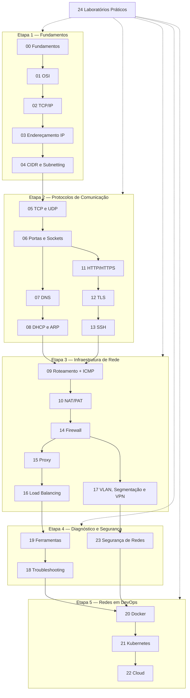

# Mapa de Estudos de Redes para DevOps

Este é o **ponto de entrada** da base de conhecimento de redes. Ele apresenta a ordem de estudo recomendada, os pré-requisitos de cada nota, os resultados esperados em cada etapa e como as notas se conectam.

> [!info] Para quem é
> Pessoas com conhecimento básico de programação que estão construindo uma base sólida de redes para atuar com DevOps, Docker, Kubernetes e cloud. As notas partem da intuição e avançam até cenários de produção.

## Como estudar

1. **Siga as etapas em ordem.** Cada etapa depende da anterior.
2. **Em cada nota:** leia as seções de definição e funcionamento; execute os comandos (em ambiente de laboratório); responda à *Verificação de conhecimento* antes de abrir as respostas.
3. **Pratique** com os laboratórios correspondentes em [[24 - Laboratórios Práticos]].
4. **Revise** usando os resumos (seção "Resumo" de cada nota) e os desafios integradores.
5. Use [[18 - Diagnóstico e Troubleshooting]] e [[19 - Ferramentas de Diagnóstico]] como referência constante a partir da Etapa 2.

## Visão geral da trilha

---

## Etapa 1 — Fundamentos

**Objetivo:** entender o que é uma rede, como os dados são organizados em camadas e como os endereços IP identificam redes e hosts.

| Ordem | Nota | Conteúdo principal | Pré-requisitos |
|---|---|---|---|
| 1 | [[00 - Fundamentos de Redes]] | Tipos de rede, arquiteturas, PDUs, encapsulação, banda/latência/jitter/perda, unicast/broadcast/multicast | — |
| 2 | [[01 - Modelo OSI]] | 7 camadas, responsabilidades, protocolos, diagnóstico por camada | 00 |
| 3 | [[02 - Modelo TCP-IP]] | 4 camadas, relação com OSI, fluxo real de um pacote, MTU | 01 |
| 4 | [[03 - Endereçamento IP e Sub-redes]] | IPv4/IPv6, privados/públicos, loopback, link‑local, rede/broadcast, gateway | 02 |
| 5 | [[04 - CIDR e Subnetting]] | Notação CIDR, cálculos passo a passo, VLSM, planejamento de VPC | 03 |

**Resultados esperados — ao final você deve conseguir:**

- Explicar encapsulação e o papel de cada camada (dados → segmento → pacote → frame).
- Diferenciar banda, throughput, latência, jitter e perda.
- Ler a saída de `ip addr` e `ip route` e identificar IP, prefixo e gateway.
- Calcular rede, broadcast, faixa de hosts e dividir blocos CIDR sem calculadora.
- Reconhecer faixas privadas, loopback, link‑local e endereços de documentação.

**Laboratórios:** Labs 1, 2, 3 e 6.

**Pré-requisitos para avançar à Etapa 2:** resolver os exercícios de subnetting de [[04 - CIDR e Subnetting]] e explicar por que um host faz ARP do gateway (e não do destino remoto).

---

## Etapa 2 — Protocolos de Comunicação

**Objetivo:** entender como processos se comunicam (TCP/UDP, portas), como nomes viram endereços (DNS), como hosts obtêm configuração (DHCP) e descobrem vizinhos (ARP), e os protocolos de aplicação mais usados (HTTP, TLS, SSH). O **ICMP** é estudado em [[09 - Roteamento e Gateway]], seção 4 — leia essa seção já nesta etapa.

| Ordem | Nota | Conteúdo principal | Pré-requisitos |
|---|---|---|---|
| 6 | [[05 - TCP e UDP]] | Handshake, estados, confiabilidade, controle de fluxo/congestionamento, UDP, erros comuns | 02 |
| 7 | [[06 - Portas e Sockets]] | Faixas de portas, bind, efêmeras, portas conhecidas, `ss` | 05 |
| 8 | [[07 - DNS]] | Hierarquia, recursivo vs autoritativo, registros, TTL, `dig`, `getent` | 05, 06 |
| 9 | [[08 - DHCP e ARP]] | DORA, leases, relay; ARP/NDP, cache de vizinhos, riscos | 03 |
| — | [[09 - Roteamento e Gateway]] (seção ICMP) | Mensagens ICMP, `ping`, `traceroute` | 02 |
| 10 | [[11 - HTTP e HTTPS]] | Métodos, status, cabeçalhos, versões HTTP, `curl` | 05, 06, 07 |
| 11 | [[12 - TLS e Certificados]] | Handshake, cadeia de confiança, SAN, SNI, expiração, `openssl s_client` | 11 |
| 12 | [[13 - SSH]] | Autenticação por chave, host keys, túneis, SFTP vs FTP | 06, 12 |

**Resultados esperados:**

- Descrever o three‑way handshake e interpretar `refused`, `timed out` e `reset by peer`.
- Identificar quem escuta em qual porta e endereço (`ss -tlnp`) e entender o efeito de `127.0.0.1` vs `0.0.0.0`.
- Explicar o fluxo de resolução DNS, interpretar `dig` e saber quando usar `getent`.
- Explicar DORA e ARP e diagnosticar `169.254.x.x` e `FAILED` em `ip neigh`.
- Ler uma saída de `curl -v` camada por camada e distinguir 502, 503 e 504.
- Validar um certificado (cadeia, datas, SAN) e diagnosticar erros comuns de TLS.
- Configurar acesso SSH por chave e criar um túnel `-L` através de um bastion.

**Laboratórios:** Labs 3, 4, 5, 7 e 8.

**Pré-requisitos para avançar à Etapa 3:** explicar por que `ping` funcionar não garante que uma aplicação HTTPS funcione, e listar o que é verificado em cada camada até uma resposta HTTP 200.

---

## Etapa 3 — Infraestrutura de Rede

**Objetivo:** entender como o tráfego atravessa redes (roteamento, NAT), como é filtrado (firewalls), intermediado (proxies), distribuído (load balancers) e isolado (VLANs, segmentação, VPNs).

| Ordem | Nota | Conteúdo principal | Pré-requisitos |
|---|---|---|---|
| 13 | [[09 - Roteamento e Gateway]] | Tabela de rotas, longest prefix match, gateway padrão, rotas de retorno, ICMP, traceroute | 04, 08 |
| 14 | [[10 - NAT e PAT]] | SNAT, DNAT, masquerade, conntrack, limites de portas, CGNAT | 06, 09 |
| 15 | [[14 - Firewall e Filtragem de Pacotes]] | Stateful vs stateless, ingress/egress, netfilter, nftables/iptables, SG vs NACL | 05, 06, 10 |
| 16 | [[15 - Proxy e Reverse Proxy]] | Forward vs reverse, CONNECT, L4/L7, `X-Forwarded-*`, nginx | 11, 12 |
| 17 | [[16 - Balanceamento de Carga]] | L4 vs L7, algoritmos, health checks, sticky sessions, draining, timeouts | 05, 15 |
| 18 | [[17 - VLAN e Segmentação de Redes]] | 802.1Q, access/trunk, VXLAN, zero trust, **fundamentos de VPN** | 08, 09, 14 |

**Resultados esperados:**

- Prever a rota escolhida para um destino e identificar problemas de rota de retorno.
- Explicar como o NAT permite saída de redes privadas e como o DNAT publica serviços.
- Escrever regras de firewall básicas com default deny e explicar a diferença stateful/stateless.
- Explicar o papel de um reverse proxy e configurar cabeçalhos de encaminhamento.
- Projetar health checks e timeouts coerentes para um load balancer.
- Justificar uma estratégia de segmentação e explicar como uma VPN conecta redes.

**Laboratórios:** Lab 9 (network namespaces) e Desafio 2.

**Pré-requisitos para avançar à Etapa 4:** desenhar o caminho completo de uma requisição de um usuário até um servidor atrás de NAT, firewall, reverse proxy e load balancer, indicando o que cada componente altera no pacote/requisição.

---

## Etapa 4 — Diagnóstico e Segurança

**Objetivo:** dominar as ferramentas de diagnóstico do Linux, aplicar uma metodologia de troubleshooting e consolidar os princípios de segurança de redes.

| Ordem | Nota | Conteúdo principal | Pré-requisitos |
|---|---|---|---|
| 19 | [[19 - Ferramentas de Diagnóstico]] | `ip`, `ping`, `traceroute`/`tracepath`, `mtr`, `ss`, `nc`, `dig`, `getent`, `curl`, `openssl s_client`, `tcpdump` | Etapas 1–3 |
| 20 | [[18 - Diagnóstico e Troubleshooting]] | Metodologia, tabela de sintomas, 10 cenários práticos, análise com tcpdump | 19 |
| 21 | [[23 - Segurança de Redes]] | Tríade CIA, defesa em profundidade, zero trust, ameaças por camada, egress, DevSecOps | 12, 13, 14, 17 |

> A nota 19 é estudada antes da 18 porque a metodologia usa as ferramentas; ambas devem ser consultadas juntas.

**Resultados esperados:**

- Escolher a ferramenta certa para cada sintoma e interpretar sua saída.
- Usar `tcpdump` para determinar se o problema está antes do destino, no destino ou no caminho de volta.
- Conduzir um diagnóstico estruturado (origem, destino, porta, sintoma, mudança recente).
- Identificar ameaças comuns por camada e propor mitigações.
- Auditar a exposição de um servidor (portas, firewall, SSH).

**Laboratórios:** Labs 3 e 9 (revisão), todos os cenários de [[18 - Diagnóstico e Troubleshooting]], Desafio 1.

**Pré-requisitos para avançar à Etapa 5:** resolver pelo menos 6 dos 10 cenários de troubleshooting sem consultar a análise, e conseguir reproduzir o Lab 9 explicando cada comando.

---

## Etapa 5 — Redes em DevOps

**Objetivo:** aplicar todos os conceitos a containers, orquestração e cloud, incluindo arquiteturas de deploy e troubleshooting em produção.

| Ordem | Nota | Conteúdo principal | Pré-requisitos |
|---|---|---|---|
| 22 | [[20 - Redes em Docker]] | Namespaces, veth, bridge, drivers, DNS embutido, publicação de portas, Compose | 06, 07, 10, 14 |
| 23 | [[21 - Redes em Kubernetes]] | Pods, CNI, Services, DNS, Ingress, Gateway API, NetworkPolicies | 20, 15, 16 |
| 24 | [[22 - Redes em Cloud e DevOps]] | VPC/VNet, subnets, rotas, SG/NACL, NAT Gateway, endpoints privados, flow logs | 04, 09, 10, 14, 16 |
| — | [[23 - Segurança de Redes]] (revisão) | Aplicar os princípios a containers, clusters e cloud | 21, 22 |

**Resultados esperados:**

- Explicar e diagnosticar a comunicação container↔container, container↔host e container↔Internet.
- Explicar como um Service do Kubernetes encaminha tráfego para Pods e depurar Services sem endpoints, `targetPort` errado e NetworkPolicies.
- Escolher entre ClusterIP, NodePort, LoadBalancer, Ingress e Gateway API.
- Projetar uma VPC com subnets públicas/privadas em várias zonas, com Security Groups encadeados.
- Relacionar redes com observabilidade (flow logs, métricas de LB/NAT/DNS), disponibilidade (multi‑AZ, health checks), escalabilidade (subnets, NAT, LBs) e segurança (segmentação, egress, mTLS).

**Laboratórios:** Labs 10–15 e Desafios 3, 4 e 5.

**Depois desta etapa:** aprofundar em service mesh, eBPF/Cilium, IPv6 em produção, BGP e conectividade híbrida, conforme as necessidades do seu trabalho.

---

## Índice completo das notas

| # | Nota | Etapa |
|---|---|---|
| 00 | [[00 - Fundamentos de Redes]] | 1 |
| 01 | [[01 - Modelo OSI]] | 1 |
| 02 | [[02 - Modelo TCP-IP]] | 1 |
| 03 | [[03 - Endereçamento IP e Sub-redes]] | 1 |
| 04 | [[04 - CIDR e Subnetting]] | 1 |
| 05 | [[05 - TCP e UDP]] | 2 |
| 06 | [[06 - Portas e Sockets]] | 2 |
| 07 | [[07 - DNS]] | 2 |
| 08 | [[08 - DHCP e ARP]] | 2 |
| 09 | [[09 - Roteamento e Gateway]] | 3 (seção ICMP na Etapa 2) |
| 10 | [[10 - NAT e PAT]] | 3 |
| 11 | [[11 - HTTP e HTTPS]] | 2 |
| 12 | [[12 - TLS e Certificados]] | 2 |
| 13 | [[13 - SSH]] | 2 |
| 14 | [[14 - Firewall e Filtragem de Pacotes]] | 3 |
| 15 | [[15 - Proxy e Reverse Proxy]] | 3 |
| 16 | [[16 - Balanceamento de Carga]] | 3 |
| 17 | [[17 - VLAN e Segmentação de Redes]] | 3 |
| 18 | [[18 - Diagnóstico e Troubleshooting]] | 4 |
| 19 | [[19 - Ferramentas de Diagnóstico]] | 4 |
| 20 | [[20 - Redes em Docker]] | 5 |
| 21 | [[21 - Redes em Kubernetes]] | 5 |
| 22 | [[22 - Redes em Cloud e DevOps]] | 5 |
| 23 | [[23 - Segurança de Redes]] | 4 (revisão na 5) |
| 24 | [[24 - Laboratórios Práticos]] | Todas |

> [!note] Numeração vs ordem de estudo
> A numeração dos arquivos segue a estrutura temática; a **ordem de estudo** recomendada é a das tabelas de cada etapa. As principais diferenças: HTTP, TLS e SSH (11–13) entram na Etapa 2, antes de roteamento e NAT (09–10); Ferramentas (19) vem antes de Troubleshooting (18).

## Onde encontrar cada tema

| Tema | Nota(s) |
|---|---|
| LAN/WAN/WLAN, cliente‑servidor, P2P, PDUs | [[00 - Fundamentos de Redes]] |
| Banda, throughput, latência, jitter, perda | [[00 - Fundamentos de Redes]] |
| Unicast, broadcast, multicast, anycast | [[00 - Fundamentos de Redes]] |
| MTU, PMTUD | [[02 - Modelo TCP-IP]], [[18 - Diagnóstico e Troubleshooting]] |
| IPv6 | [[03 - Endereçamento IP e Sub-redes]], [[04 - CIDR e Subnetting]] |
| ICMP, ping, traceroute | [[09 - Roteamento e Gateway]], [[19 - Ferramentas de Diagnóstico]] |
| SFTP vs FTP, port forwarding | [[13 - SSH]] |
| VPN | [[17 - VLAN e Segmentação de Redes]], [[23 - Segurança de Redes]] |
| Ingress, Gateway API, NetworkPolicy | [[21 - Redes em Kubernetes]] |
| Security Groups, NACLs, NAT Gateway | [[22 - Redes em Cloud e DevOps]], [[14 - Firewall e Filtragem de Pacotes]] |
| DNS e TLS em produção | [[07 - DNS]], [[12 - TLS e Certificados]], [[22 - Redes em Cloud e DevOps]] |
| Troubleshooting em CI/CD | [[18 - Diagnóstico e Troubleshooting]], [[15 - Proxy e Reverse Proxy]], [[24 - Laboratórios Práticos]] |

## Referências oficiais recomendadas

- RFCs no [RFC Editor](https://www.rfc-editor.org/) — por exemplo: RFC 791 (IPv4), RFC 8200 (IPv6), RFC 9293 (TCP), RFC 768 (UDP), RFC 1034/1035 (DNS), RFC 2131 (DHCP), RFC 826 (ARP), RFC 792 (ICMP), RFC 1918 (endereços privados), RFC 4632 (CIDR), RFC 9110 (semântica HTTP), RFC 8446 (TLS 1.3), RFC 4251–4254 (SSH).
- [Registros da IANA](https://www.iana.org/protocols) — portas, endereços de uso especial.
- Documentação oficial: [Docker networking](https://docs.docker.com/engine/network/), [Kubernetes — Services, Load Balancing and Networking](https://kubernetes.io/docs/concepts/services-networking/), [Gateway API](https://gateway-api.sigs.k8s.io/).
- Páginas de manual no próprio Linux: `man ip`, `man ss`, `man tcpdump`, `man pcap-filter`, `man curl`, `man dig`, `man ssh`, `man sshd_config`, `man nft`.
- Documentação de rede do seu provedor de cloud (VPC/VNet, load balancers, DNS).

## Áreas relacionadas do vault

As pastas `Linux/` e `Bash Scripting/` foram criadas para estudos futuros e ainda não têm notas. Quando forem criadas, conecte-as a esta trilha — por exemplo, administração de interfaces e serviços (Linux) e automação de diagnósticos de rede (Bash).
